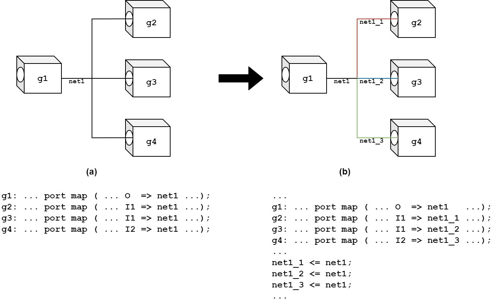

# Testing and Fault Tolerance (01RKZYG) — Laboratory 1
## Stuck-at Faults by Hand: Fault Lists and Fault Injection by Logic Simulation

> **Course:** 01RKZYG – Testing and Fault Tolerance, Politecnico di Torino  
> **Working directory:** `~/lab1` (remote `/home` directory) · all run outputs go to `~/lab1/run`  
> **Tools:** Synopsys TestMAX ATPG (fault manager; formerly TetraMAX) · Siemens Questa SIM (logic simulator) · Synopsys Design Compiler (logic synthesis, optional part)  
> **Structure:** guided workflow in Parts 0–C; Part D and the exercises of Section 5 are optional

---

## 1. Objectives and Prerequisites

### 1.1 Why this lab

From Lab 2 on you will use commercial fault simulators and ATPG tools (TestMAX, Z01X). They will tell you, for thousands of faults, whether each one is detected. This lab makes you do the same job **by hand** on a 5-gate circuit, so that every line of those reports has a meaning for you:

* a stuck-at fault is a **forced value** on a pin;
* a pattern detects it only if it **controls** the fault site to the opposite value (**excitation**) **and** makes the difference **observable** at a primary output (**propagation**): *Test = Control + Observe*;
* a fault simulator is nothing more than *golden run + one faulty run per fault + comparison of the outputs*.

### 1.2 What you will be able to do at the end of this lab

1. **Count** the single stuck-at faults of a gate-level circuit by hand, including fan-out branches, and **check** the count against the list produced by TestMAX.
2. **Read** a TestMAX fault list and recognise **equivalence classes** and **prime faults**.
3. **Predict**, for a given fault and pattern, whether the fault is *not excited*, *excited but not observed*, or *detected*, and **verify** the prediction by injecting the fault in simulation.
4. Explain why **stem** and **branch** faults are different, and modify a netlist so that branch faults are injected correctly.
5. Read a **fault dictionary** and find **untestable faults**, **essential/redundant patterns** and the **fault coverage**.

### 1.3 Theory you must have clear (lecture slides)

| Concept used in this lab | Where it is in the course material |
|---|---|
| Stuck-at fault: a line permanently at 0 (s-a-0) or 1 (s-a-1) | *03 – The stuck-at fault model*, slides 2–4 |
| **Test = Control + Observe**: excitation and propagation of a fault | *03*, slides 5–11 |
| Number of single stuck-at faults: **2n** for *n* checkpoints (nodes **and fan-out branches**) | *03*, slides 12–13 |
| Faults on a fan-out **stem** are **not** equivalent to faults on its **branches** | *03*, slides 14–17 |
| **Untestable** faults and their link with **redundant** logic | *03*, slides 29–33 |
| One vector can detect several faults; the goal is a *minimum* test set | *03*, slides 40–43 |
| Test set *T<sub>f</sub>*, test vs. functional **equivalence**, local equivalence rules, **equivalence classes**, collapsing | *03*, slides 63–77 |
| Fault simulation: inputs, outputs, fault coverage, complexity *O(n²)* | *03*, slides 78–88 |
| Full fault-list generation and collapsing in TestMAX (`add_faults -all`) | *04 – ATPG*, slides 6–8 |
| Test-set compaction: removing patterns that detect nothing new | *04*, slides 25 and 31 |
| Exhaustive testing (all 2<sup>#PI</sup> input combinations) | *04*, slides 42–43 |

**Prerequisites from previous courses:** VHDL structural vs. dataflow descriptions, component instantiation and `port map`, basic Linux shell (`cd`, `ls`, `diff`, `wc`, a text editor).

---

## 2. Files and Workspace Provided

All files are in `~/lab1`. Every bash script **changes directory into `run/`** (creating it if needed) before invoking the tool (except `fault_injection.sh`, which finds the folder by itself), so **launch scripts from `~/lab1`** and expect every generated file in `~/lab1/run`.

```text
~/lab1
├── ex1_dataflow.vhd           # ex1, dataflow description (input to synthesis)
├── ex1_structural.vhd         # ex1, structural netlist of pdt2002 cells (simulation)
├── ex1_structural_sep.vhd     # same netlist, fan-out branches separated (Part C)
├── ex1_structural_tmax.vhd    # same netlist, TestMAX-compliant (input to TestMAX)
├── ex1_testbench.vhd          # tester-like testbench: reads the patterns, writes monitor.txt
├── ex1_patterns.txt           # test patterns applied to ex1, one per line   ← you may EDIT this
├── pdt2002.v                  # PoliTo technology library, Verilog gate models
├── pdt2002.db                 # PoliTo technology library, compiled (Design Compiler)
├── pdt2002.dc_setup.tcl       # library setup for Design Compiler
├── tmax.sh        + tmax_script.tcl        # TestMAX: build model, write fault lists
├── simulation.sh  + simulation_script.tcl  # Questa SIM: compile + simulate (batch)
├── synthesis.sh   + synthesis_script.tcl   # Design Compiler: synthesise ex1_dataflow.vhd (Part D)
├── convert_faults.sh          # 1 line of a TestMAX fault list → 1 Questa force command
├── fault_injection.sh         # complete serial fault-injection campaign (Part C.4)
├── mux_structural.vhd  mux_structural_tmax.vhd  mux_testbench.vhd  mux_patterns.txt
├── tmax_script_mux.tcl        # second circuit: 2-to-1 multiplexer (optional exercise E1)
└── run/                       # all outputs (created by the scripts if missing)
```

### 2.1 HDL sources

| File | Content | Notes |
|---|---|---|
| `ex1_dataflow.vhd` | Entity `ex1` (inputs `A`, `B`; outputs `S`, `C`) described with five `nand` concurrent assignments on internal signals `net1`, `net2`, `net3`. | Technology-independent: no cells, only VHDL operators. |
| `ex1_structural.vhd` | Same function, built by instantiating five `Nand_Gate` cells `U1`…`U5` from `pdt2002`. | The netlist you simulate first. Instance names (`U1`…`U5`) and pin names (`I1`, `I2`, `O`) are the **fault-site names** used by TestMAX. |
| `ex1_structural_sep.vhd` | The same netlist, with every fan-out branch on its own signal. | Used from Part C.2 on, to inject branch (pin) faults correctly. |
| `ex1_structural_tmax.vhd` | Identical netlist, with the `component` declaration **commented out**. | TestMAX takes the cell definition from `pdt2002.v`, read with `-library`; the manual notes that with duplicate module definitions the **last one read wins**, so a single definition avoids ambiguity. |
| `pdt2002.v` | Verilog models of the PoliTo library cells (`Nand_Gate`, `And_Gate`, `Nor_Gate`, …), each one a Verilog primitive. | One cell = one gate, so **cell pins = fault sites**. |
| `ex1_testbench.vhd` | Entity `tb_ex1`, DUT instance **`u_ex1`**, a `tester_clock`, a `stimuli` process that **reads the patterns from `ex1_patterns.txt`**, a `monitor` process writing `monitor.txt`. | `u_ex1` is the prefix of every force command. Patterns are in a text file, so you can change the test set without touching VHDL. |
| `ex1_patterns.txt` | One pattern per line, bits in the order `A B`; empty lines and lines starting with `#` are ignored. | Commenting a line with `#` removes that pattern from the test set. |
| `mux_*.vhd`, `mux_patterns.txt` | A second circuit, a 2-to-1 multiplexer `mux` (inputs `A`, `B`, `S`; output `F`), with the same file organisation as `ex1` (DUT instance `u_mux`). | Used only in the optional exercises. |

### 2.2 Scripts

| Script | What it does | Why it is written this way |
|---|---|---|
| `tmax.sh` → `tmax -shell ../tmax_script.tcl` | Starts TestMAX in **shell (non-GUI) mode** and executes the command file (another script can be given as argument: `./tmax.sh tmax_script_mux.tcl`). The executable is still called `tmax`, a legacy of the former name TetraMAX. | `-shell` runs the non-GUI form of the tool: fast and scriptable. You will use the same tool, with more commands, from Lab 2 on. |
| `tmax_script.tcl` | `read_netlist` (library + design) → `run_build_model ex1` → `run_drc` → `set_faults -model stuck` → `add_faults -all` → `write_faults … -uncollapsed` / `-collapsed`. | The "full fault list generation + collapsing" steps of *04 – ATPG*, slides 7–8. |
| `simulation.sh` | In `run/`: `vlog ../pdt2002.v`, `vcom -2008 … ex1_structural.vhd ex1_testbench.vhd`, then `vsim -c -vopt -voptargs="+acc" -debugDB work.tb_ex1 -do ../simulation_script.tcl -wlf sim.wlf`. The environment variable `DESIGN` (default `ex1`) selects the circuit (`DESIGN=mux ./simulation.sh`); `NETLIST` selects another netlist of the same circuit. | `-c` = command-line mode; `-do` runs the Tcl file at start-up; `-wlf` names the waveform file; `-voptargs="+acc"` keeps internal nets **visible** after optimisation, which is needed to `force` them (*Questa SIM Quick Reference*). |
| `simulation_script.tcl` | `log -r /*` (records all signals in the WLF), then **if the environment variable `INJECT` is `1`, sources `run/inject_fault.tcl`**, then `run -all`, `quit`. | Fault injection is decoupled from the script: you only (re)write `run/inject_fault.tcl` and set `INJECT=1`. |
| `convert_faults.sh <list> <line>` | Prints line `<line>` of a TestMAX fault list as `force -freeze /u_ex1/<pin path> 0|1` (`/u_mux/…` with `DESIGN=mux`). | Bridges TestMAX names and Questa names. |
| `fault_injection.sh <list> [first] [last]` | For each fault of the list: writes `inject_fault.tcl`, simulates with `INJECT=1`, compares the POs pattern by pattern with `run/ex1_monitor_golden.txt`. Writes **`run/ex1_fault_dictionary.txt`** and prints the fault coverage. Marks as `INJ_FAILED` every run that reports an error. | A minimal **serial fault simulator**: exactly what you do by hand in Part C.3, repeated automatically. |
| `synthesis.sh` / `synthesis_script.tcl` | Design Compiler synthesises `ex1_dataflow.vhd` on `pdt2002` (XOR/XNOR cells marked *dont_use*) and writes `ex1_synth.v` / `ex1_synth.vhd`. | Optional Part D. |

---

## 3. Guided Workflow

| Part | Topic |
|---|---|
| 0 | Set-up |
| A | Fault lists: by hand and with TestMAX |
| B | Testbench and golden simulation |
| C | Control + Observe: predicting and injecting stuck-at faults |
| D | Synthesised circuit (optional) |

**Self-assessment quiz.** On the course page on Moodle you find the quiz *Lab 1 - Stuck-at faults by hand*, with one section for each part of this guide. It is **not graded**: you can answer as many times as you want, and each answer comes with an explanation. Use it to check your results at the end of each part; the questions are built on the checkpoints of this guide, so you can answer them only after running the steps. The practical exam also takes place on Moodle, so the quiz is also a way to get used to the environment.

---

### Part 0 — Set-up

Download `lab1.zip` from the course page on Moodle and extract it in your home directory. Your home is on a network disk mounted on every LabInf PC, so your work will be there whichever PC you use next time.

```console
$ unzip ~/Downloads/lab1.zip -d ~/lab1     # use the folder where your browser saved the file
$ cd ~/lab1
$ chmod +x *.sh
$ ls
```

If `~/lab1` already exists from a previous session, `unzip` asks before overwriting each file: answer *no* to keep your work, or extract into a different folder.

**Checkpoint 0.** You see all the files of §2 and an (empty) `run/` directory.

---

### Part A — Fault Lists

Fault models are defined on the **structure** of a circuit: the stuck-at model needs gates and pins, not equations. This is why we work on the structural netlist.

#### A.1 — Draw the circuit and count the faults *before* running the tool

1. Open `ex1_structural.vhd`. For each instance `U1`…`U5`, write down the signal on each pin `I1`, `I2`, `O`.
2. **Draw the gate-level schematic** (paper or `draw.io`). Label every gate with its instance name and every pin with its name (`U3/I1`, …). Mark the **fan-out points**: how many cell inputs does each of `A`, `B`, `net1`, `net2`, `net3` feed?
3. Write the Boolean expressions of `S` and `C`. What well-known arithmetic block is `ex1`? Write its truth table: it is the **expected golden response** of Part B.
4. **Count the full (uncollapsed) stuck-at fault list.** The fault sites (checkpoints) are the **primary ports** plus **every pin of every cell** (*03*, slide 12).

> **Hint.** A net with one driver and one load gives two pin sites whose faults are trivially equivalent, but both appear in an uncollapsed list. A net with fan-out *k* gives one stem site plus *k* branch sites (*03*, slides 14–17).

#### A.2 — Generate the fault lists with TestMAX

Read `tmax_script.tcl` before running it:

```tcl
read_netlist ../pdt2002.v -format verilog -insensitive -library   ;# library cells (models)
read_netlist ../ex1_structural_tmax.vhd -format vhdl -insensitive ;# the design netlist
run_build_model ex1                     ;# build the ATPG model, top = ex1
run_drc                                 ;# design rule checking
set_faults -equiv_code --               ;# code printed for equivalent faults
set_faults -model stuck                 ;# single stuck-at model
add_faults -all                         ;# all fault sites of the design
write_faults fault_list_stuckat_full.txt      -all -replace -uncollapsed
write_faults fault_list_stuckat_collapsed.txt -all -replace -collapsed
quit
```

* `-library` reads cell *models*: their internals are not fault sites, only the pins of the cell instances are.
* TestMAX moves through command modes **BUILD → DRC → TEST** (the prompt shows `BUILD-T>`, `DRC-T>`, `TEST-T>`). `run_build_model` moves from BUILD to DRC, `run_drc` from DRC to TEST, and faults are added in TEST mode: if the build or the DRC fails, every later command fails too. You will meet the same flow in every TestMAX lab.

```console
$ cd ~/lab1
$ ./tmax.sh | tee run/tmax.log
$ grep -iE "error|warning" run/tmax.log
$ grep -cE "^sa[01]" run/fault_list_stuckat_full.txt
$ grep -cE "^sa[01]" run/fault_list_stuckat_collapsed.txt
```

**Checkpoint A.2.** No errors in the log, and the number of faults in the full list **equals your hand count**. If not, open the list and tick off each fault on your schematic until you find the site you missed.

#### A.3 — Read the fault list

Each line has three fields (TestMAX User Guide, *Working with Fault Lists*):

```text
sa0   --   U3/I1
```

| Field | Example | Meaning |
|---|---|---|
| 1 | `sa0`, `sa1` | stuck-at value |
| 2 | two letters, or `--` | fault class code; `--` means *equivalent to the primary fault on the line above* |
| 3 | `U3/I1`, `A` | fault site: a cell pin (`<instance>/<pin>`) or a primary port (`<port>`) |

An **equivalence class** is a line with a real class code followed by all its `--` lines. Its first fault is the **primary (prime)** fault, the one kept in the collapsed list. The TestMAX manual states that the choice of the primary fault within a class is arbitrary.

**Tasks A.3**
1. How many **equivalence classes** are there? (Check: the same number as the faults in the collapsed list.)
2. Pick two classes and justify them with the **local equivalence rules of a NAND gate** (*03*, slide 69).
3. Is any fault on a fan-out branch in the same class as the fault on its stem? Why not (*03*, slide 17)?

> **Self-check on Moodle:** quiz section *Part A - Fault lists*.

---

### Part B — Testbench and Golden Simulation

#### B.1 — Read the testbench as a tester program

`ex1_testbench.vhd` models an **automatic test equipment**: inputs are applied periodically and outputs are sampled ("strobed") at a fixed offset, relative to a tester clock. The same concepts (apply, strobe, test cycle) appear in the test protocols used by TestMAX from Lab 2 on.

| Constant | Value | Meaning |
|---|---|---|
| `clock_t1`, `clock_t2`, `clock_t3` | 50, 30, 20 ns | low / high / low phases of `tester_clock` |
| `apply_offset`, `apply_period` | 0, 100 ns | when `stimuli` drives `A`, `B` |
| `strobe_offset`, `strobe_period` | 40, 100 ns | when `monitor` samples PIs and POs |

* `stimuli` reads `ex1_patterns.txt` line by line (`00, 10, 11, 01`, as `A B`), applies one pattern every `apply_period`, and after the last one calls `finish(0)`, which ends the simulation.
* `monitor` writes, at each strobe, one line `pattern:<n> PIs:<AB> POs:<SC>` to `run/monitor.txt`.
* `tester_clock` is **not** connected to the DUT: `ex1` is combinational.

**Tasks B.1**
1. Draw `tester_clock` from 0 to 400 ns and mark (a) when stimuli are **applied** and (b) when outputs are **observed**.
2. Why is the strobe 40 ns after the application, and not at the same instant?
3. How many patterns are applied? Relate the number to **exhaustive testing** (*04*, slide 42).

#### B.2 — Golden (fault-free) run

```console
$ cd ~/lab1
$ ./simulation.sh > run/sim_golden.log
$ grep -E "\*\* (Error|Fatal)" run/sim_golden.log
$ cat run/monitor.txt
$ cp run/monitor.txt run/ex1_monitor_golden.txt
$ cp run/sim.wlf run/golden.wlf
```

> Use exactly the name **`ex1_monitor_golden.txt`**: `fault_injection.sh` looks for `run/<design>_monitor_golden.txt`.  
> If `vlog`/`vcom` complain that library `work` does not exist, run `vlib work` inside `run/` once (`vlib` creates a design library).

**Checkpoint B.2.** No errors; `monitor.txt` has **4 lines** (`pattern:0`…`pattern:3`) and the POs match the truth table you wrote in A.1. *Every later conclusion is a comparison with this file: check it now.*

> **Self-check on Moodle:** quiz section *Part B - Testbench and golden run*.

---

### Part C — Control + Observe

#### C.1 — Your first fault, and the fan-out trap

**Injecting a fault.** A stuck-at is injected with the Questa command `force`, which *applies stimulus to VHDL signals and Verilog nets*. With `-freeze` the object stays at the forced value whatever its driver does: that is a stuck-at. You do not edit `simulation_script.tcl`: write the command in `run/inject_fault.tcl` and run with `INJECT=1`.

1. **Predict first.** Take `net2` (the output of `U2`, a net with a single load) stuck-at-1. For each of the 4 patterns: is the fault excited (golden `net2` = 0)? If yes, does `U4` let the difference through (its other input must be at the non-controlling value 1)? Write down the patterns you expect to detect the fault.
2. **Verify.**
   ```console
   $ echo "force -freeze /u_ex1/net2 1" > run/inject_fault.tcl
   $ rm -f run/monitor.txt
   $ INJECT=1 ./simulation.sh > run/sim_fault.log
   $ diff <(grep -o "POs:.*" run/ex1_monitor_golden.txt) <(grep -o "POs:.*" run/monitor.txt)
   ```
   Every line printed by `diff` is a pattern that **detects** the fault; no output means **not detected**. We compare only the `POs:` field because detection is defined on primary outputs only.
3. **Look inside.** Open the waveform of the faulty run and compare it with the golden one (`add wave -r /*` shows all signals of the design):
   ```console
   $ cd ~/lab1/run
   $ vsim -view sim.wlf
   ```
   ```tcl
   add wave -r /*
   ```
   At each strobe (40, 140, 240, 340 ns), find where the difference created on `net2` stops, or how it reaches `S`.

**The fan-out trap.** The TestMAX list is made of **pin** faults. In the simulator, all pins connected to the same VHDL signal are **one net**: forcing any of them forces the stem **and all its branches**.

4. Predict the detecting patterns of `U1/O sa0` (stem of `net1`) and of `U2/I2 sa0` (one branch of `net1`). Do you expect the same answer?
5. Inject `U2/I2 sa0` with the current netlist (generate the command with the converter and **read it** before running):
   ```console
   $ grep -n "U2/I2" run/fault_list_stuckat_full.txt     # find the line number n
   $ ./convert_faults.sh run/fault_list_stuckat_full.txt <n> > run/inject_fault.tcl
   $ cat run/inject_fault.tcl
   ```
   Does the simulation agree with your prediction for the **branch**, or does it behave like the **stem**? Why?

> **Read every generated command.** The converter turns the TestMAX pin path (e.g. `U2/I2`) into a path inside the DUT instance (`/u_ex1/U2/I2`). Check that it names an existing object. A wrong path produces an error in `run/sim_fault.log`; that is why we delete `monitor.txt` before every faulty run, so that a failed injection cannot silently reuse the previous results.

#### C.2 — Fan-out separation

To inject a branch fault, every branch must be a **separate signal** driven by the stem.

<p align="center">
  
</p>

**Figure 1.** Fan-out separation for pin-fault emulation.
* **(a) Original netlist.** `g1/O` drives `net1`, which feeds `g2/I1`, `g3/I1` and `g4/I2`. A stuck-at forced on `g4/I2` also forces `net1` and every other pin connected to it: this is **not** a single stuck-at.
* **(b) Separated netlist.** `g4/I2` is connected to `net1_3`, the only wire that takes the forced value; `net1` and the other branches keep their functional values. A force on `g1/O` (the stem) still reaches all branches.

`ex1_structural_sep.vhd` applies this separation to `ex1`. Open it next to `ex1_structural.vhd` and compare them:

1. Which signals have been split, and into how many branches each? Check them against the fan-out points you marked on your schematic in A.1.
2. The branches are created with **concurrent signal assignments** (`net1_1 <= net1;`). Why not with buffer cells (`Buf_Gate`)? *(Hint: what would happen to the TestMAX fault list?)*
3. Why does `U5` need **two** branch signals, although both its inputs come from the same net?
4. The instance and pin names are unchanged. Why is that essential for the fault list generated in Part A?

Now simulate the separated netlist. `NETLIST` tells `simulation.sh` (and, later, `fault_injection.sh`) which netlist to compile; set it once for the rest of Part C:

```console
$ export NETLIST=../ex1_structural_sep.vhd
$ ./simulation.sh > run/sim_golden_sep.log
$ diff run/monitor.txt run/ex1_monitor_golden.txt && echo "GOLDEN UNCHANGED"
```

The function did not change, so the golden response must not change either. Then re-inject `U2/I2 sa0` (same `inject_fault.tcl` as in step 5 of C.1): now the result must match your prediction for the **branch**.

#### C.3 — Predict, then verify

For each fault in the table below, **first fill in the prediction by hand**, reasoning on your schematic, using:

* `–` the fault is **not excited** by the pattern (the golden value at the site equals the stuck value);
* `E` the fault is **excited but not observed** (the difference is blocked before the outputs);
* `D` the fault is **detected** (at least one PO differs).

Then inject each fault (with `NETLIST` still set to the separated netlist) and check the `D` cells with the simulation. For the `E` cells, find on the waveform the gate where the difference stops and the side input that blocks it.

| # | Fault | Why it is in the list | 00 | 10 | 11 | 01 |
|:-:|---|---|:-:|:-:|:-:|:-:|
| F1 | `U1/O` sa0 | stem of `net1` | | | | |
| F2 | `U2/I2` sa0 | a branch of `net1`: compare with F1 | | | | |
| F3 | `A` sa1 | stem of a primary input | | | | |
| F4 | `U2/I1` sa1 | a branch of `A`: compare with F3 | | | | |
| F5 | `U5/I1` sa0 | one input of `U5` … | | | | |
| F6 | `U5/O` sa1 | … and its output: compare with F5 | | | | |
| F7 | `U5/I1` sa1 | look carefully at `U5` | | | | |

**Questions C.3**
1. F1 vs F2 and F3 vs F4: in which patterns do stem and branch differ, and why?
2. F5 vs F6: same row? Find the two faults in the fault list: are they in the same equivalence class?
3. F7: is there **any** input pattern that detects it? If not, the fault is **untestable**. What does this tell you about the logic around `U5` (*03*, slides 29–33)? How would you implement `C` without that redundancy?
4. For each `E` cell of the table, name the gate and the side-input value that block propagation.

**Checkpoint C.3.** Every `D` you predicted is confirmed by the simulation, and vice versa. A mismatch means either a reasoning error (find it on the waveform) or a wrong injection (check `inject_fault.tcl` and `sim_fault.log`).

#### C.4 — The complete campaign: a fault simulator in a script

What you did by hand for 7 faults, `fault_injection.sh` does for a whole list:

```console
$ cd ~/lab1
$ echo $NETLIST                # still ../ex1_structural_sep.vhd
$ ./fault_injection.sh run/fault_list_stuckat_full.txt
$ cat run/ex1_fault_dictionary.txt
```

Each line of `run/ex1_fault_dictionary.txt` contains the fault, the POs obtained at each pattern, the patterns that detect it (`detected_by`, pattern numbers 0–3 in the order of `ex1_patterns.txt`), and the verdict. The file is a **fault dictionary** (*03*, slide 85).

**First, validate the tool.** Before trusting the script, check that its results for F1–F7 coincide with yours, and that no line reports `INJ_FAILED`. Checking a tool on cases you already know is the habit you will need with every commercial tool.

**Questions C.4**
1. Which faults are **untestable**? Is the answer consistent with your reasoning on F7?
2. Faults of the same equivalence class must have identical rows. Verify it on two classes.
3. `U2/I1 sa1` and `U3/I2 sa1` have identical rows. Are they in the same TestMAX class? Explain the difference between faults that are equivalent by **local structural rules** and faults that are **functionally equivalent** (*03*, slides 64–68).
4. For each pattern, find a fault detected **only** by that pattern. Is any of the 4 patterns **redundant**, i.e. removable without losing detected faults (*04*, slide 31)?
5. Run the script on the collapsed list as well. How many simulations did each run need? Compare the two **fault coverages**: are they equal? Why (*03*, slides 60–62)?

> **Self-check on Moodle:** quiz section *Part C - Control and observe*.

---

### Part D — Synthesised Circuit (optional)

The same function, synthesised by Design Compiler from `ex1_dataflow.vhd`:

```console
$ cd ~/lab1
$ ./synthesis.sh | tee run/synthesis.log
$ cat ex1_synth.v
```

1. **Draw the synthesised schematic** from `ex1_synth.v` (note the `assign` statement: which net drives output `C`, and where else does it go?). Compare it with `ex1_structural.vhd`: number of gates, gate types, fan-out points. Remember that XOR/XNOR cells were excluded by `pdt2002.dc_setup.tcl`.
2. **Count the faults by hand**, then generate the new fault lists: copy `tmax_script.tcl` to `tmax_script_synth.tcl`, read `../ex1_synth.v -format verilog -insensitive` instead of the structural VHDL, and change the two `write_faults` file names. Run it with `tmax -shell ../tmax_script_synth.tcl` from `run/`.
3. **Without simulating**, decide whether the synthesised circuit has untestable faults. What happened to the redundancy you found in C.3? Does the fault coverage obtained with the same 4 patterns change?

> To also simulate the synthesised circuit, run `NETLIST=../ex1_synth.vhd ./simulation.sh`: the Verilog netlist instantiates `AND_GATE`/`NOR_GATE`, while `pdt2002.v` defines `And_Gate`/`Nor_Gate`, and Verilog names are case-sensitive. TestMAX reads it without problems because of `-insensitive`.

> **Self-check on Moodle:** quiz section *Optional - Synthesis and multiplexer*.

---

## 4. Wrap-up and Discussion

### 4.1 What you have seen

| Concept | Where you met it in this lab |
|---|---|
| A stuck-at fault lives on a **pin** of the structure, not on an equation | A.1–A.2: the fault list is built from ports and cell pins |
| Fault sites on a fan-out **stem** and on its **branches** are different faults | A.3, C.1 (the fan-out trap), C.2 |
| **Test = Control + Observe**: excitation alone is not enough | C.1, C.3: the `E` cells of your matrix |
| **Equivalent** faults have the same test set, so one representative is enough | A.3, C.3 (F5/F6), C.4 Q2 |
| A fault that no pattern can detect reveals **redundant** logic | C.3 (F7), Part D |
| A **fault simulator** = golden run + faulty runs + output comparison | C.4: `fault_injection.sh` and the fault dictionary |
| Fault coverage depends on the **test set** and on **how faults are counted** | C.4 Q4–Q5 |

### 4.2 Questions for discussion

1. You used a *structural* netlist to build the fault list. Could you define stuck-at faults on `ex1_dataflow.vhd`? What would be missing?
2. Before fan-out separation, how many of the faults in the TestMAX list did the simulation inject correctly? What does this teach you about trusting a fault-injection setup?
3. The original `ex1` has an untestable fault; the synthesised one does not. Is a circuit with untestable faults *wrong*? Why can redundancy be a problem for test?
4. On `ex1`, all 4 patterns are needed. On a circuit with 30 inputs you could not apply all 2<sup>30</sup> patterns: how would you choose them? (This is the job of the ATPG, from Lab 2 on.)
5. Your script needed one full simulation per fault. What would make this approach impractical on a real design, and what must a commercial fault simulator do differently?

### 4.3 Self-check: can you do it without a tool?

| Skill | Quick self-check |
|---|---|
| Count the stuck-at faults of a netlist | 2 × (ports + cell pins); a net with fan-out *k* contributes 1 stem + *k* branches |
| Build equivalence classes | NAND: any input s-a-0 ≡ output s-a-1; AND: input s-a-0 ≡ output s-a-0; NOR: input s-a-1 ≡ output s-a-0; OR: input s-a-1 ≡ output s-a-1 |
| Find a test vector for a fault | 1) **excite**: set the site to the opposite of the stuck value; 2) **propagate**: put every side input on the path at the **non-controlling** value (1 for AND/NAND, 0 for OR/NOR); 3) justify all those values back to the PIs |
| Prove a fault untestable | show that excitation and propagation require contradictory input values |
| Read a fault dictionary | coverage = detected / total; a pattern is essential if it is the only one detecting some fault |

### 4.4 Habits for the next labs

* **Run scripts from the right folder** and know where they write their outputs.
* **Read the first error in the log**, not the last: in TestMAX a failed `run_build_model` or `run_drc` makes every later command fail.
* **Check the counts**: the number of faults written by a tool must match your expectation.
* **Validate a tool on known cases** before trusting it on a whole fault list, as you did in C.4.

### 4.5 Troubleshooting

| Symptom | Likely cause | Quick check |
|---|---|---|
| A fault you expected to be detected is "not detected" | wrong force path, or `INJECT` not set | `cat run/inject_fault.tcl`; `grep "\*\* Error" run/sim_fault.log` |
| Branch fault behaves like the stem | the original netlist is being simulated | `echo $NETLIST` must print `../ex1_structural_sep.vhd` |
| Golden changed after separating a netlist yourself (E1) | a pin connected to the wrong branch | compare the `port map` of every instance with the original file |
| Equivalent faults with different rows | an injection failed or a net is not separated | look for `INJ_FAILED`, re-run that fault alone |
| `./simulation.sh: No such file or directory` | script launched from the wrong folder | `cd ~/lab1` |
| The simulation never ends and the terminal is stuck | Questa stopped at its prompt after an error and is waiting for a command | type `quit -f` and press Enter, then read the log |

Useful Questa commands when debugging in the GUI: `add wave -r /*`, `examine <path>` (current value), `drivers <path>` (who drives a net), `find signals /u_ex1/*` (check that a path exists), `noforce <path>`, `restart`.

---

## 5. Optional Exercises and Further Study

*No step-by-step solution is provided. Discuss your results with the teaching staff.*

### E1 — A redundancy you can justify: the multiplexer

`mux_structural.vhd` implements a 2-to-1 multiplexer as

```text
F = A·S' + B·S + A·B
```

The term `A·B` (gate `U4`) does not change the function: it is the **consensus** term that keeps `F` at 1 when `S` switches while `A = B = 1`, removing a static hazard. Redundancy of this kind is exactly what *03*, slide 33 refers to.

1. Draw the schematic, mark the fan-out points and count the faults. Generate the fault lists with `./tmax.sh tmax_script_mux.tcl` (files `run/mux_fault_list_stuckat_*.txt`).
2. **Before simulating**, decide which faults of `U4` and of the `U5` input connected to it are untestable, and why.
3. This time **separate the fan-out branches yourself**. Copy `mux_structural.vhd` to `mux_structural_sep.vhd` and edit the copy, following the same rules as `ex1_structural_sep.vhd`:
   * separate **every** net with fan-out > 1, primary inputs included;
   * use concurrent signal assignments, no buffer cells;
   * do not rename instances or pins.

   Then run the golden simulation on both netlists (the two responses must be identical) and the campaign on the separated one:
   ```console
   $ unset NETLIST
   $ DESIGN=mux ./simulation.sh > run/mux_golden.log
   $ cp run/monitor.txt run/mux_monitor_golden.txt
   $ DESIGN=mux NETLIST=../mux_structural_sep.vhd ./simulation.sh > run/mux_golden_sep.log
   $ diff run/monitor.txt run/mux_monitor_golden.txt && echo "GOLDEN UNCHANGED"
   $ DESIGN=mux NETLIST=../mux_structural_sep.vhd ./fault_injection.sh run/mux_fault_list_stuckat_full.txt
   ```
   Do the untestable faults in `run/mux_fault_dictionary.txt` match your answer to question 2?
4. Is a circuit with these untestable faults badly designed? What would you lose by removing `U4`?

### E2 — Choosing a test set

On `ex1` the exhaustive test set is also the minimum one. On the multiplexer this is no longer true.

1. Using `run/mux_fault_dictionary.txt` only (no new simulation), find the **smallest subset** of the 8 patterns that detects every testable fault. How many patterns do you need?
2. Comment out the other patterns in `mux_patterns.txt` with `#`, regenerate the golden response and rerun the campaign: is the coverage unchanged?
3. Do the same on `ex1` (`ex1_patterns.txt`): which faults are lost when you remove each of the 4 patterns? Could you predict it from `run/ex1_fault_dictionary.txt`?
4. On a circuit with 30 inputs you cannot apply 2<sup>30</sup> patterns and look for a subset. What must a tool do instead (*04 – ATPG*)?

### E3 — Inside the fault simulator

Read `fault_injection.sh` and answer:
* Why is the golden response simulated only once?
* The script simulates all the patterns for every fault. How would **fault dropping** (*04*, slide 19) change the number of pattern evaluations, if the simulator could evaluate one pattern at a time?
* How does the total number of simulations grow with the size of the circuit (*03*, slide 88), and why do real fault simulators (such as Z01X, Lab 2 onwards) not run one complete simulation per fault?

> **Self-check on Moodle:** quiz section *Optional - Synthesis and multiplexer* (questions on E1 and E2).
