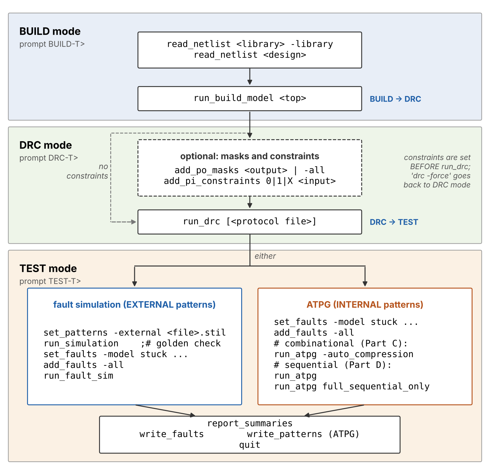

# Testing and Fault Tolerance (01RKZYG) — Laboratory 2
## Fault Simulation and ATPG with TestMAX

> **Course:** 01RKZYG – Testing and Fault Tolerance, Politecnico di Torino  
> **Working directory:** `~/lab2` (remote `/home` directory) · all run outputs go to `~/lab2/run`  
> **Tool:** Synopsys TestMAX ATPG (formerly TetraMAX; the executable is `tmax`)  
> **Structure:** guided workflow in Parts 0–D; the exercises of Section 5 are optional

---

## 1. Objectives and Prerequisites

### 1.1 Why this lab

In Lab 1 you built a fault simulator out of a logic simulator: one golden run, one faulty run per fault, a comparison of the outputs. It took about a minute for 38 faults on a 5-gate circuit. In this lab you hand the same job to a commercial tool, **TestMAX**, and then ask it to do something your script could not do at all: **generate** the patterns.

You will use TestMAX in its two basic roles:

* **fault simulator** (*fault grading*): you give it the patterns, it tells you which faults they detect;
* **ATPG** (*Automatic Test Pattern Generation*): you give it the faults, it finds the patterns, or proves that no pattern exists.

You will also see the two things that most often limit the test of a real circuit: inputs that cannot be set freely (**PI constraints**), outputs that cannot be observed (**PO masks**), and memory elements that cannot be loaded or read directly (**sequential circuits** without scan).

### 1.2 What you will be able to do at the end of this lab

1. **Read** a STIL file: signals, test protocol (timing, procedures, clocks) and patterns.
2. **Compose** TestMAX command files from the documented steps (fault simulation, combinational and sequential ATPG, with masks and constraints), and **check** a new flow on a circuit whose answer you already know (Lab 1).
3. **Read** a TestMAX fault summary: fault classes (DT, PT, UD, AU, ND and their sub-classes) and the difference between **test coverage** and **fault coverage**.
4. **Predict** the effect of a PO mask or of a PI constraint on the detectable faults, and **verify** it with TestMAX.
5. **Run** combinational ATPG and explain why ATPG can prove a fault untestable while fault simulation cannot.
6. **Run** full-sequential ATPG on a circuit without scan and explain why it is so much harder than combinational ATPG.

### 1.3 Theory you must have clear (lecture slides)

| Concept used in this lab | Where it is in the course material |
|---|---|
| Test generation flow: fault management → fault simulation of existing vectors → ATPG | *03 – The stuck-at fault model*, slides 53–57; *04 – ATPG*, slides 3–6 |
| Fault simulation (fault grading): inputs, outputs, purposes, complexity *O(n²)* | *03*, slides 78–88 |
| Full fault list; easy untestable faults found by topological checks (`add_faults -all`) | *03*, slides 58–59; *04*, slide 7 |
| Untestable faults and redundant logic | *03*, slides 29–33 |
| Fault simulation of existing vectors and fault dropping | *04*, slides 9–10 and 19 |
| ATPG loop: target fault, test generation, fault dropping; faults **tested**, **untestable**, **aborted** | *04*, slides 11–21 |
| **Possibly detected** faults (X on the outputs) | *04*, slides 21–24 |
| Reading a TestMAX fault summary (DT, PT, UD, AU, ND) | *04*, slide 23 |
| Limiting controllability and observability: **PO masks** and **PI constraints** (0, 1, X) | *04*, slides 32–33 |
| Test-set compaction | *04*, slides 25–31 |
| Exhaustive testing | *04*, slides 42–43 |
| ATPG complexity and basic hypotheses (only PIs controllable, only POs observable) | *04*, slides 40–41 |
| Topological ATPG: excitation and observation (D-algorithm, PODEM, FAN) | *04*, slides 48–50 |
| Test of sequential circuits: input **sequences**, time frames | *03*, slides 44–52; *04*, slides 51–52 |

**Prerequisites:** Lab 1 (stuck-at fault lists, equivalence, untestable faults, fault dictionary, the apply/strobe timing of the testbench); basic Linux shell (`cd`, `ls`, `grep`, `diff`, a text editor).

---

## 2. Files and Workspace Provided

All files are in `~/lab2`. Every script **changes directory into `run/`** (creating it if needed) before invoking TestMAX, so **launch scripts from `~/lab2`** and expect every generated file in `~/lab2/run`. Command files therefore refer to the sources as `../<file>`.

```text
~/lab2
├── ex1_structural_tmax.vhd  # Lab 1 half adder (5 NAND), TestMAX version
├── ex1.stil                 # the 4 exhaustive patterns of Lab 1, in STIL
├── c6288.vhd                # ISCAS'85 c6288: 16x16-bit multiplier (combinational)
├── c6288.stil               # test protocol + 59 test patterns for c6288
├── b10.v      b10.spf       # ITC'99 b10: voting system FSM (sequential) + STIL procedure file
├── b12.v      b12.spf       # ITC'99 b12: one-player game FSM (sequential) + STIL procedure file
├── pdt2002.v                # PoliTo technology library, Verilog cell models
├── tmax.sh                  # runs a TestMAX command file in shell mode, from run/
├── summary.sh               # one-line summary of the last fault report in a log
├── list_faults.sh           # faults of a fault list by class (resolves the "--" lines)
├── sweep_po_masks.sh        # Part B: fault simulation with 7 PO-mask settings
├── sweep_atpg.sh            # Part C: ATPG with 10 constraint/mask settings
├── images/
└── run/                     # all outputs (created by the scripts if missing)
```

The TestMAX command files (`*.tcl`) are **not** in the workspace: writing them is the main skill of this lab. You will compose them in `~/lab2` from the steps of §2.4: `fsim_ex1.tcl` and `fsim_c6288.tcl` (Part A), `atpg_c6288.tcl` (Part C), `atpg_b10.tcl` (Part D).

### 2.1 Design and pattern files

| File | Content | Notes |
|---|---|---|
| `ex1_structural_tmax.vhd` | The half adder of Lab 1: `U1`…`U5` are `Nand_Gate` cells, ports `A`, `B`, `S`, `C`. | You know all its answers from Lab 1: it is the circuit on which you **validate** the flow. |
| `ex1.stil` | The 4 patterns of Lab 1 (`A B` = 00, 10, 11, 01) with their expected outputs. | Same order as `ex1_patterns.txt` of Lab 1, so pattern numbers are the same. |
| `c6288.vhd` | 2416 cells (`Nor_gate`, `And_gate`, `Inv_gate`); ports `datai(31:0)`, `datao(31:0)`. Internal names `G_<n>GAT` come from the original ISCAS'85 netlist. | The two 16-bit operands and the 32-bit product are packed in `datai` and `datao`. Multipliers are a classic hard case for some test methods; for stuck-at ATPG c6288 is easy, which makes it a clean playground. |
| `c6288.stil` | STIL file: test protocol (signals, waveform table, `capture` procedure) **and** 59 patterns. | One file plays two roles: TestMAX reads the protocol during DRC and the patterns as an external pattern source. |
| `b10.v`, `b12.v` | Synthesised ITC'99 benchmarks, Verilog netlists of `pdt2002` cells, with D flip-flops (`FLIP_FLOP_D_RESET`). | Sequential circuits **without scan**: the flip-flops can be set and read only through the primary inputs and outputs. |
| `b10.spf`, `b12.spf` | STIL procedure files (protocol only, no patterns), written by TestMAX. | They declare `clock` and `reset` as clocks and define `test_setup`. |
| `pdt2002.v` | The PoliTo cell library (same file as in Lab 1). | Read with `-library`: one cell = one gate, so cell pins = fault sites. |

### 2.2 Scripts

| Script | What it does | Why it is written this way |
|---|---|---|
| `tmax.sh <file.tcl>` | `cd run/`, then `tmax -shell <file.tcl> < /dev/null`; shows the transcript and saves it in `run/<file>.log`; at the end reports whether the log contains errors and prints the first one. | `-shell` is the non-GUI mode of the tool (User Guide, *Running TestMAX in shell mode*). TestMAX stops a command file at the first error and goes back to its prompt: with standard input from `/dev/null` it then exits instead of waiting for the keyboard. The final check is there because the error message is easy to miss in a long transcript. |
| `summary.sh <log> [label]` | Prints one line with the classes, patterns and coverages of the **last** fault summary in a log. | Used by the sweep scripts; useful also for your own runs. |
| `list_faults.sh <list> [codes]` | Prints the faults of a TestMAX fault list with their class: by default the ones not detected, or only the classes given (e.g. `UR AN`), then a count per class. | In a fault list an equivalent fault has code `--` (User Guide, *Working with Fault Lists*): its class is the one of the primary fault above it, and a plain `grep` would miss it. |
| `sweep_po_masks.sh`, `sweep_atpg.sh` | For each setting, **write** a command file in `run/sweep_*/`, run it and collect a table. | The repetitive part of Parts B and C. You validate them first on settings you have run with your own scripts. |

### 2.3 How TestMAX works: command modes

TestMAX moves through three command modes, shown by the prompt: **BUILD** → **DRC** → **TEST** (you met them in Lab 1). The order of the commands in a script follows them:

<p align="center">
  
</p>

**Figure 1.** TestMAX command modes, in the order of a command file. `run_build_model` moves from BUILD to DRC mode, `run_drc` from DRC to TEST mode. PO masks and PI constraints are optional and are set in DRC mode, **before** `run_drc`; without them, `run_drc` follows `run_build_model` directly (dashed path). In the circuits of this lab the clocks are not declared by commands: they come from the protocol file read by `run_drc` (`b10.spf`). In TEST mode you either fault-simulate external patterns or generate patterns with ATPG; both end with reports and output files. The command `drc -force` brings you back from TEST to DRC mode.


### 2.4 TestMAX command steps

This is the page you need to **compose** your command files. Every command and option below is documented in the TestMAX User Guide.

**Two ways to give commands to TestMAX**

* **Interactively.** Start the shell with `tmax -shell` (from `~/lab2/run`) and type, or paste, one command at a time at the prompt (`BUILD-T>`, `DRC-T>`, `TEST-T>`). You see the answer of each command immediately, and an error does not stop the session: you correct the command and type it again. `report_commands -history` lists the commands you have typed; `quit` leaves the shell. This is the way to **learn** what each step does.
* **With a command file.** A plain text file with one command per line, executed in order as if you typed them at the prompt: `./tmax.sh <file>.tcl` (from `~/lab2`). This is the way to **repeat** a flow. You build the file by copying into it the commands that worked interactively.

**Writing rules for command files**

* First line: `set_messages -display`. By default the commands of a file are not echoed in the transcript (User Guide, *Setup Command Files*); with this command each one is printed before its output, so you can see which command produced a message.
* Comments: a line starting with `#`; after a command, use `;#` (the `;` ends the command).
* Paths: `tmax.sh` runs TestMAX inside `run/`, so the sources are `../<file>` and the outputs are written in `run/`.
* Each command must be given in the right **mode** (Figure 1).
* Last line: `quit`.

**What happens when a command fails.** At the prompt, you just get an `Error:` message and can try again. In a command file, by default TestMAX **stops executing the file at the first error** (User Guide, *Using Command Files*): all the following commands are skipped, the summary is never printed, no output file is written. The error message can scroll away among hundreds of lines, so `tmax.sh` saves the transcript in `run/<file>.log` and, at the end, tells you whether there were errors and shows the **first** one with the command that caused it.

**Commands used in this lab**

| Mode | Command (as used in this lab) | What it does / why |
|---|---|---|
| BUILD | `read_netlist ../pdt2002.v -format verilog -insensitive -library` | Reads the cell models. `-library`: their internals are not fault sites, only the pins of the cell instances are. Always read it first. |
| BUILD | `read_netlist <design file> -format vhdl -insensitive` | Reads the design netlist (`-format verilog` for a `.v` file). `-insensitive`: names are not case-sensitive (the netlists write `NAND_GATE`, the library `Nand_Gate`). |
| BUILD | `run_build_model <top>` | Builds the ATPG model of the top-level entity/module (`ex1`, `c6288`, `b10`). BUILD → DRC. |
| DRC | `add_po_masks <output>` · `add_po_masks -all` | The output is not observed (Part B). |
| DRC | `add_pi_constraints 0\|1\|X <input>` | The input is held at 0, at 1, or is not controllable (Part C). |
| DRC | `report_pi_constraints` · `report_primitives -pis` · `report_primitives -pos` | Lists the constraints set; lists the input / output ports and their names. |
| DRC | `run_drc [<protocol file>]` | Design rule checking; reads the test protocol (clocks, procedures) from a STIL file if given. DRC → TEST. A combinational circuit tested with internal (ATPG) patterns needs no protocol file. |
| TEST | `set_patterns -external <STIL file>` | Uses the patterns of a file as pattern source (fault simulation). |
| TEST | `run_simulation` | Good-machine simulation of the external patterns: simulated vs. expected outputs. |
| TEST | `set_faults -model stuck` | Single stuck-at fault model. |
| TEST | `set_faults -summary verbose` · `set_faults -fault_coverage` | The fault summary also shows the sub-classes (DS, UR, AN, NC, NO…) and the fault coverage. |
| TEST | `add_faults -all` | Fault list on all fault sites; easy untestable faults are classified here. |
| TEST | `run_fault_sim` | Fault simulation of the current pattern source. |
| TEST | `run_atpg -auto_compression` | Combinational (basic-scan) ATPG, with compaction of the patterns. |
| TEST | `run_atpg` · `run_atpg full_sequential_only` | Basic-scan ATPG; full-sequential ATPG on the faults not detected yet (sequential circuits, Part D). |
| TEST | `set_atpg -full_seq_time <seconds>` | Maximum time full-sequential ATPG spends on one fault before aborting it (default 10 s). |
| TEST | `report_summaries` | Fault summary (classes, test coverage) and pattern summary. |
| TEST | `analyze_faults <pin> -stuck 0\|1` | Explains why one fault is (not) detected. |
| TEST | `write_faults <file> -all -uncollapsed -replace` | Writes the fault list with the class of every fault. `-replace` overwrites an old file. |
| TEST | `write_patterns <file> -format stil -replace` | Writes the patterns generated by ATPG in STIL. |
| any | `set_messages -display` | Echoes each command of a command file in the transcript. First line of every file. |
| any | `report_commands -history` | Lists the commands typed at the prompt (interactive session). |
| any | `quit` | Leaves TestMAX. |

**The two flows of this lab, step by step**

| # | Fault simulation of external patterns | ATPG |
|:-:|---|---|
| 1 | read the library | read the library |
| 2 | read the design | read the design |
| 3 | build the model | build the model |
| 4 | *(optional)* masks and constraints | *(optional)* masks and constraints |
| 5 | DRC **with the STIL file** as protocol | DRC (with the SPF for a sequential circuit) |
| 6 | select the STIL file as pattern source | set the fault model and the report options |
| 7 | good-machine simulation | add all faults |
| 8 | set the fault model and the report options | run ATPG |
| 9 | add all faults | report |
| 10 | run fault simulation | write the fault list and the patterns |
| 11 | report | quit |
| 12 | write the fault list | |
| 13 | quit | |

**Messages that tell you a step worked** (at the prompt, or in the log of a command file):

| After | Look for | If it is missing |
|---|---|---|
| BUILD | `End parsing ... with 0 errors` for each file, then `End build model` | wrong path or format of a netlist, wrong top-level name |
| DRC | `Design rules checking was successful` | read the first `Error` or the rule violations above it |
| TEST | `Simulation completed ... #fail_pats=0` (fault simulation), then the fault summary | a command in the wrong mode, or a wrong file name |

---

## 3. Guided Workflow

| Part | Topic |
|---|---|
| 0 | Set-up |
| A | Fault simulation of external patterns |
| B | Observability: PO masks |
| C | Combinational ATPG and PI constraints |
| D | Sequential circuits: full-sequential ATPG |

**Self-assessment quiz.** On the course page on Moodle you find the quiz *Lab 2 - Fault simulation and ATPG with TestMAX*, with one section for each part of this guide. It is **not graded**: you can answer as many times as you want, and each answer comes with an explanation. The questions are built on the checkpoints of this guide, so you can answer them only after running the steps.

---

### Part 0 — Set-up

Download `lab2.zip` from the course page on Moodle and extract it in your home directory:

```console
$ unzip ~/Downloads/lab2.zip -d ~/lab2     # use the folder where your browser saved the file
$ cd ~/lab2
$ chmod +x *.sh
$ ls
```

**Checkpoint 0.** You see all the files of §2 and an (empty) `run/` directory.

---

### Part A — Fault Simulation of External Patterns

#### A.1 — Read a STIL file

STIL (*Standard Test Interface Language*, IEEE 1450) is the language in which test patterns travel from the ATPG to the automatic test equipment. Open `ex1.stil`: it is short, and it contains everything a tester needs.

| Block | In `ex1.stil` | Meaning |
|---|---|---|
| `Signals` | `"A" In; … "S" Out; …` | the ports of the circuit and their direction |
| `SignalGroups` | `"_pi" = '"A" + "B"'` | names for groups of signals; `_pi` and `_po` fix the **bit order** of the pattern strings |
| `Timing` → `WaveformTable` | `Period '100ns'`; inputs at 0 ns; outputs `H`/`L` compared at 40 ns | the **test cycle**: when inputs are applied and when outputs are strobed (the `apply_offset` and `strobe_offset` of the Lab 1 testbench) |
| `Procedures` → `"capture"` | `forcePI`, then `measurePO` | what the tester does for one pattern: apply the inputs, then compare the outputs |
| `Pattern` | `"pattern 1": Call "capture" { "_pi"=10; "_po"=HL; }` | the patterns: values for the PIs and **expected** values for the POs (`H` = 1, `L` = 0, `X` = don't care) |

**Tasks A.1**
1. Check that the `_po` strings of `ex1.stil` are the golden responses of Lab 1 (`S C`).
2. Open `c6288.stil`: how many inputs, outputs and patterns does it contain? (Look at the `// #signals=` comments and at the last pattern.) c6288 is a 16×16 multiplier: `datai` holds the two operands, `datao` the product.

#### A.2 — First TestMAX session and first command file, on a known circuit

Before trusting a tool on 15 000 faults, check it on a circuit whose answer you already know. In Lab 1 you found, for `ex1` with these 4 patterns, the full fault list, the detected faults and the untestable ones. This is also the safest place to write your first TestMAX command file: if something is wrong, the result will not match what you already know.

**Predict first** (from your Lab 1 notes): total number of faults; number of faults detected by the 4 patterns; which faults are not detected.

You will first run the whole fault-simulation flow **interactively**, one command at a time, then turn it into your first command file, `fsim_ex1.tcl`. Follow the left column of *The two flows of this lab* (§2.4). The design is `ex1_structural_tmax.vhd` (VHDL, top-level `ex1`); the STIL file `ex1.stil` is both the protocol for DRC and the pattern source; call the fault list `ex1_fsim_faults.txt`.

Open a text editor on a new file `~/lab2/fsim_ex1.tcl` next to the terminal: every time a command works at the prompt, copy it into the file.

1. **Start the shell** from `run/`, so that the paths are the same as in a command file:
   ```console
   $ cd ~/lab2/run
   $ tmax -shell
   ```
   The prompt is `BUILD-T>`.
2. **BUILD mode.** Read the library (first row of the command table). The answer must end with `End parsing ... with 0 errors`.
   Now make a mistake **on purpose**, to see what an error looks like: read the design with a wrong name, `read_netlist ../ex1.vhd -format vhdl -insensitive`, and read the `Error:` message. The prompt does not change and nothing else happens: an error at the prompt costs nothing. Then read the right design file and build the model: the prompt becomes `DRC-T>`.
3. **DRC mode.** Run DRC with `../ex1.stil` as protocol. Look for `Design rules checking was successful`; the prompt becomes `TEST-T>`.
4. **TEST mode.** Give steps 6–12 one at a time and look at each answer: how many patterns are read? Does the good-machine simulation report `#fail_pats=0`? How many faults does `add_faults -all` add? What does the summary say?
5. **Look back.** Type `report_commands -history`: compare the list with your file, which must contain only the commands that worked, in the same order. Then `quit`.
6. **Run the file.** Add `set_messages -display` as first line and `quit` as last line, then:
   ```console
   $ cd ~/lab2
   $ ./tmax.sh fsim_ex1.tcl
   ```
   The transcript is saved in `run/fsim_ex1.log`; the last lines printed by `tmax.sh` say whether there were errors.
7. **Break it on purpose.** In the **first** line after `set_messages -display`, change `pdt2002.v` into `pdt2020.v` and run the file again. What does `tmax.sh` report at the end? Which commands were executed, and is there a fault summary in the log? Restore the correct name and run once more.

> When a command file fails, read the **first** error (the one `tmax.sh` shows): it names the command and usually the reason (a missing file, a command given in the wrong mode, a misspelled option). Everything after it was not executed, so the later "errors" or missing results are only consequences. Section 4.5 lists the most common cases. If you are not sure how to fix a command, go back to the interactive shell and try it there.

Your file contains two simulation commands, and the order matters:

* `run_simulation` is the **good-machine** (fault-free) simulation: it compares the simulated POs with the **expected** POs written in the STIL file. It must end with `#fail_pats=0`: if the expected values are wrong, every detection that follows is meaningless. It is the golden run of Lab 1, done for you by the tool.
* `run_fault_sim` simulates all the faults on all the patterns, in a single run.

Now read the result:

```console
$ grep -E "Simulation completed|fail_pats" run/fsim_ex1.log
$ ./summary.sh run/fsim_ex1.log
$ ./list_faults.sh run/ex1_fsim_faults.txt       # faults not detected, with their class
```

**Checkpoint A.2.** `tmax.sh` reports no errors for `fsim_ex1.tcl`, and the file gives the same results as your interactive session; `run_simulation` reports no failing patterns; the total number of faults, the number of detected faults (DT) and the list of non-detected faults coincide with your Lab 1 results. If not, stop and find out why before going on.

**Questions A.2**
1. In which fault class does TestMAX put `U5/I1 sa1` and `U5/I2 sa1`? Read the class definitions in the User Guide (*Fault Categories and Classes*).
2. The report prints a **test coverage** and a **fault coverage**. Write the two definitions (User Guide, *Fault Summary Reports*; an annotated report is on *04*, slide 23) and explain why the two numbers differ (or not) on `ex1`. Which one did `fault_injection.sh` compute in Lab 1?
3. Your Lab 1 campaign needed one complete simulation per fault. How long did TestMAX take?

#### A.3 — Fault simulation of c6288

1. **Count the faults before running.** The fault sites are the 64 ports plus every pin of every cell (Lab 1). Count the cells by type:
   ```console
   $ grep -c "Nor_gate port map" c6288.vhd
   $ grep -c "And_gate port map" c6288.vhd
   $ grep -c "Inv_gate port map" c6288.vhd
   ```
   How many faults do you expect in the full (uncollapsed) list?
2. **Adapt your command file.** Copy your `fsim_ex1.tcl` to `fsim_c6288.tcl` and change only what is specific to the design. Before editing, list the lines that must change and why (there are 5 changes). Then run it:
   ```console
   $ cp fsim_ex1.tcl fsim_c6288.tcl
   $ (edit fsim_c6288.tcl)
   $ ./tmax.sh fsim_c6288.tcl
   $ grep -E "fail_pats" run/fsim_c6288.log
   $ ./summary.sh run/fsim_c6288.log
   ```

**Checkpoint A.3.** `run_simulation` reports `#fail_pats=0`; the total number of faults equals your count of step 1.

**Questions A.3**
1. Which fraction of the faults do the 59 patterns detect?
2. List the faults that are not detected and the classes TestMAX gives them:
   ```console
   $ ./list_faults.sh run/c6288_fsim_faults.txt | less
   ```
   Some pins appear with **both** `sa0` and `sa1` not detected (e.g. look for `G_1399GAT/I1`). What does it mean for the circuit if neither stuck value of a pin can ever be detected (*03*, slides 29–33)? Many of these faults are in class **UT** (*undetectable tied*): read its definition in the User Guide. Which part of TestMAX found them, if `run_fault_sim` cannot prove that a fault is undetectable?
3. A fault simulator can tell you that a fault **is** detected. Can it ever tell you that a fault is **undetectable**? Which faults can the fault manager already declare untestable when the faults are added, and how (*03*, slide 59)? *(Keep your answer: you will check it in Part C.)*

> **Self-check on Moodle:** quiz section *Part A - Fault simulation of external patterns*.

---

### Part B — Observability: PO Masks

On a tester, an output may be impossible or useless to observe: it is not bonded, it is too fast, its value is unpredictable. TestMAX lets you **mask** it: a fault effect that reaches only masked outputs does not count as detected. Masks are set in DRC mode with `add_po_masks` (User Guide, *Masking Input and Output Ports*). As *04*, slide 33 notes, masks can also be applied during fault simulation, at the price of a lower fault coverage: this is what you do in this part.

#### B.1 — Predict

Answer **before** running anything, using `c6288.vhd` (`grep -n "datao(1)" c6288.vhd` and follow the net backwards one gate):

1. If you mask `datao(1)`, which faults are **certainly** lost, whatever the patterns? How many are they? Could more be lost?
2. Let *L1*, *L2*, *L3* be the faults lost when masking `datao(1)`, `datao(2)`, `datao(3)` one at a time. When you mask the three together, do you expect to lose *L1 + L2 + L3*, fewer, or more? Why?
3. What do you expect with **all** the outputs masked?
4. Masks act on observation only. Of the two not-detected sub-classes, **NC** (*not controlled*) and **NO** (*not observed*), which one should change with the masks, and which one should not?

#### B.2 — One mask by hand

Copy `fsim_c6288.tcl` to `fsim_c6288_mask.tcl`, add the mask in DRC mode (between `run_build_model` and `run_drc`) and change the name of the fault list file:

```tcl
add_po_masks datao(1)            ;# fault effects on datao(1) are not observed
```

```console
$ ./tmax.sh fsim_c6288_mask.tcl
$ ./summary.sh run/fsim_c6288.log      "no mask"
$ ./summary.sh run/fsim_c6288_mask.log "mask datao(1)"
```

**Checkpoint B.2.** The number of detected faults decreases by exactly the amount you predicted in B.1 Q1 (if it does not, find the extra faults with `diff` on the two fault lists).

#### B.3 — All the settings with a script

`sweep_po_masks.sh` runs the fault simulation for 7 mask settings. For each one it writes a command file in `run/sweep_po/`, runs it and adds a line to `run/sweep_po/table.txt`:

```console
$ ./sweep_po_masks.sh
$ cat run/sweep_po/datao1.tcl          # read one generated command file
```

**First, validate the script:** its rows *none* and *datao(1)* must coincide with your two runs of B.2, and its command file `run/sweep_po/datao1.tcl` should contain the same commands as your `fsim_c6288_mask.tcl`.

> The setting "all but `datao(1)`–`datao(3)`" is written as 29 `add_po_masks` commands, one per port. The User Guide also documents `add_po_masks -all`, used for the setting "all".

**Question B.3.** Check your predictions of B.1 Q2–Q4 on the table. *(More questions on this table in exercise E8.)*

> **Self-check on Moodle:** quiz section *Part B - Observability: PO masks*.

---

### Part C — Combinational ATPG and PI Constraints

#### C.1 — ATPG without constraints

Now TestMAX generates the patterns itself. `run_atpg` runs the loop of *04*, slides 11–16: pick an undetected target fault, generate a pattern for it, fault-simulate the pattern to drop all the faults it detects, repeat.

**Compose `atpg_c6288.tcl`** from your `fsim_c6288.tcl`, following the right column of *The two flows of this lab* (§2.4). Before editing, answer: which commands of the fault-simulation flow have no reason to exist any more (*who provides the patterns now?*), and why does `run_drc` no longer need a protocol file for c6288? Keep the BUILD part, then:

* step 5: `run_drc` without a file;
* steps 6–9: fault model and report options, all faults, `run_atpg -auto_compression`, report;
* step 10: write the fault list to `c6288_atpg_faults.txt` and the patterns to `c6288_atpg.stil`.

Leave an empty line between `run_build_model` and `run_drc`: the constraints of C.2 will go there. `run_atpg` is new: if you want to see what it prints before putting it in the file, run the BUILD and DRC steps at the prompt (`cd run; tmax -shell`) and try it there.

**Predict:** compared with the 59 external patterns of Part A, will ATPG reach a higher, equal or lower test coverage? Will it need more or fewer patterns?

```console
$ ./tmax.sh atpg_c6288.tcl
$ ./summary.sh run/atpg_c6288.log "ATPG, no constraints"
$ ./summary.sh run/fsim_c6288.log "fault sim, 59 patterns"
```

**Checkpoint C.1.** No errors in the log; the total number of faults is the same as in Part A.

**Questions C.1**
1. How many patterns did ATPG need? Compare test coverage and fault coverage with Part A.
2. How many faults are now **UD** (*undetectable*), and in which sub-class? Compare them with the faults that were not detected in Part A (Question A.3-3). What can ATPG do that fault simulation cannot? *(User Guide: "Fault grading can never place a fault in this class".)*
3. At the end of ATPG every fault is **tested**, **untestable** or **aborted** (*04*, slides 17–21). Map the three groups onto the TestMAX classes: a fault still **ND** after ATPG is one for which the ATPG gave up within its effort limit (User Guide, class ND; *04*, slide 23). Are there any?

#### C.2 — PI constraints by hand

A constrained input is held at a fixed value during the whole test (for example a test-mode pin), or cannot be controlled at all (`X`); the aim is to generate patterns that respect the limits of the tester or of the test mode, and the price is a harder ATPG (*04*, slide 32). Constraints are set in DRC mode:

```tcl
add_pi_constraints 0 datai(0)    ;# the input is held at 0 during ATPG
add_pi_constraints 1 datai(0)    ;# held at 1
add_pi_constraints X datai(1)    ;# not controllable: always unknown
```

`datai(0)` feeds 16 `And_gate` cells (check: `grep -n "datai(0)" c6288.vhd`, then `grep -c` on the net it drives). Each AND computes one partial product `a_i · b`, where `b` is the operand bit carried by `datai(0)`.

1. **Predict.** With `datai(0) = 0`, the 16 AND outputs are constant. List the faults that become untestable **on those 16 gates and on the port** (count them). With `datai(0) = 1`, the ANDs simply pass `a_i`: which faults become untestable? Which of the two constraints will cost more faults, and is your count a lower bound or the exact number?
2. **Verify.** Copy `atpg_c6288.tcl` to `atpg_c6288_d0.tcl`, add the constraint for `datai(0) = 0` in DRC mode (before `run_drc`), add `report_pi_constraints` after it to check it, and change the output file names. Run it (the log is `run/atpg_c6288_d0.log`). The run with `datai(0) = 1` is row 03 of the sweep in C.3.
3. **Look at one gate.** Find the faults of one of the AND gates, e.g. `G_588GAT`, in the fault list of the run (`./list_faults.sh run/c6288_atpg_d0_faults.txt | grep G_588GAT`): are they the ones you listed in step 1?

**Checkpoint C.2.** The constraint that costs more faults is the one you predicted, and the number of new AU faults is at least the count of step 1.

#### C.3 — All the settings with a script

`sweep_atpg.sh` runs ATPG for 10 constraint/mask settings and writes `run/sweep_atpg/table.txt`:

```console
$ ./sweep_atpg.sh
```

**First, validate the script:** rows 01 and 02 must coincide with your runs of C.1 and C.2. Then compare one generated command file (`run/sweep_atpg/02_datai0_0.tcl`) with your `atpg_c6288_d0.tcl`: apart from comments, file names and `report_pi_constraints`, they should contain the same commands.

**Questions C.3** *(more questions on this table in exercise E8)*
1. Rank the constraints `datai(0) = 0`, `= 1`, `datai(1) = X` by the number of faults they make untestable. Why does `X` cost more than either fixed value? *(Think of what an `X` does when it reaches a gate together with a fault effect.)*
2. Rows 08–10 add PO masks. In which class do the faults lost because of a mask end up during **ATPG** (*04*, slide 23)?

> **Self-check on Moodle:** quiz section *Part C - Combinational ATPG and constraints*.

---

### Part D — Sequential Circuits: Full-Sequential ATPG

c6288 has no memory: one pattern = apply the inputs, strobe the outputs. b10 and b12 are finite-state machines whose flip-flops are **not** in a scan chain: the only way to set a flip-flop is to drive the inputs for some clock cycles, the only way to read it is to wait until its value reaches an output. A test is then a **sequence** of input vectors (*03*, slides 44–52), and sequential ATPG is much harder than combinational ATPG (*04*, slides 51–52).

#### D.1 — Read the circuit and predict

1. Open `b10.spf`: how many inputs and outputs does b10 have, and which signals are declared as clocks? *(In an SPF, clocks are the signals in the group with a pulse waveform `P`; `test_setup` gives their off value.)* `reset` is an asynchronous reset, not a clock: why must TestMAX know about it (User Guide, *Declaring Clocks → Asynchronous Set and Reset Ports*)?
2. How many flip-flops does `b10.v` contain (`grep -c "FLIP_FLOP_D_RESET" b10.v`)? Look at the flip-flops named `v_out_reg`, `cts_reg`, `ctr_reg`: what drives the primary outputs of b10?
3. The default ATPG mode (*basic-scan*) generates patterns that load the scan cells, apply one capture cycle and unload them. b10 has **no** scan cells. **Predict:** which faults can basic-scan ATPG detect on b10? Very few, about half, or almost all?

#### D.2 — Basic-scan and full-sequential ATPG

You will run the two ATPG modes one after the other on the **same** fault list: first `run_atpg` (basic-scan), then `run_atpg full_sequential_only`, which works only on the faults not detected yet (User Guide, *Running ATPG in Basic Scan, Fast-Sequential, or Full-Sequential Mode*).

**Compose `atpg_b10.tcl`** from your `atpg_c6288.tcl`. What changes:

* the design is a **Verilog** file, top-level `b10`;
* `run_drc` reads the protocol from `../b10.spf` (clocks, reset, `test_setup`);
* in TEST mode: `run_atpg`, then `report_summaries`, then `set_atpg -full_seq_time 1`, `run_atpg full_sequential_only`, then `report_summaries` again;
* outputs: `b10_atpg_faults.txt` and `b10_atpg.stil`.

**Why `set_atpg -full_seq_time 1`.** Full-sequential ATPG spends at most a fixed time on each target fault before giving up (aborting it) and moving to the next one; the default is 10 seconds per fault (User Guide, *Path Delay ATPG Options*). A limit of 1 second keeps the run short: on b10 the whole script takes well under a minute. The faults that are aborted stay ND; exercise E6 checks what a larger limit buys.

```console
$ time ./tmax.sh atpg_b10.tcl
$ grep -E "total faults|test coverage|patterns" run/atpg_b10.log
```

`time` prints the elapsed (`real`) and CPU (`user`) time of the whole run.

**Checkpoint D.2.** No errors in the log; two fault summaries, the second one with a higher test coverage than the first.

Complete the table from the two summaries:

| b10 | #faults | DT | AU | ND | test coverage | #patterns |
|---|:-:|:-:|:-:|:-:|:-:|:-:|
| after basic-scan ATPG | | | | | | |
| after full-sequential ATPG | | | | | | |

**Questions D.2** *(more questions in exercise E8)*
1. Was your prediction of D.1 Q3 right? Explain the result of basic-scan ATPG: why can it not test even the faults on the output ports?
2. Open `run/b10_atpg.stil` and look at `pattern 0`. A c6288 pattern is one `Call "capture"`, i.e. one test cycle; how many test cycles does a b10 pattern take? In the `_pi` strings a `P` is a **pulse** (the order of the signals is in the `_pi` group): which signal is pulsed in almost every cycle, and which one only in the first cycle of a pattern? Why?
3. Some faults remain AU, PT or ND (aborted, *04*, slides 17 and 23). Give two reasons why a fault of a sequential circuit can be hard to test from the primary I/Os: think of **initialization** and of **sequential depth**. The DRC part of your log reports the sequential depth of b10 (`Fast-sequential depth results: control=… observe=… detect=…`): what do those numbers mean?
4. The full-sequential summary contains **PT** (*possibly detected*) faults. Using *04*, slides 22–24, explain how a stuck-at fault can produce only an `X` at an output of a sequential circuit.

> **Self-check on Moodle:** quiz section *Part D - Sequential ATPG*.

---

## 4. Wrap-up and Discussion

### 4.1 What you have seen

| Concept | Where you met it in this lab |
|---|---|
| A test pattern is inputs **plus expected outputs**, inside a test protocol | A.1: STIL files |
| Always check a tool on a known case, and the expected values with a good-machine simulation | A.2: `ex1`; `run_simulation` before `run_fault_sim` |
| Test coverage ≠ fault coverage: undetectable faults are excluded from the first | A.2, C.1 |
| Fault simulation can only show detection; ATPG can also **prove** untestability | A.3 Q3, C.1 Q2 |
| Masking an output can lose faults even if each other output still sees most of the logic; losses are not additive | B.1–B.3 |
| Constraints make faults **ATPG untestable** (AU), not undetectable: they still matter for the product | C.2, C.3 |
| At the end of ATPG every fault is tested (DT), untestable (UD, or AU under constraints) or aborted (ND) | C.1 Q3, Part D |
| An uncontrollable input (`X`) is worse than a fixed one | C.3 Q1 |
| Without scan, test of a sequential circuit needs input **sequences**, and much more effort | Part D |

### 4.2 Questions for discussion

1. The 59 patterns of `c6288.stil` reach the maximum test coverage. Why would anyone still run ATPG on this circuit?
2. An AU fault "has the potential to cause failures" (User Guide). Should a product be shipped with 5 % of AU faults caused by a test-mode constraint? What could you do about them?
3. Why might a real test program mask some outputs on purpose?
4. b10 is tiny compared with c6288, yet its ATPG is harder. Which property of a circuit decides the difficulty of ATPG: the number of gates, or something else?
5. In Lab 1 you had to separate fan-out branches to inject pin faults correctly. Did you need anything similar with TestMAX? Why not?

### 4.3 Self-check: can you do it without a tool?

| Skill | Quick self-check |
|---|---|
| Count the faults of a netlist | 2 × (ports + all cell pins), flip-flop pins included |
| Read a STIL pattern | `_pi` / `_po` strings follow the order of the signal groups; `H`/`L` are expected outputs, compared at the strobe time |
| Tell test coverage from fault coverage | test coverage = DT / (all − UD) (with the default credits); fault coverage = DT / all |
| Predict the faults lost by masking an output | at least the faults of the port and of the gate that drives only that output; then every fault observable **only** through it |
| Predict the faults lost by a constant input | the input faults equal to the constant, plus every fault that needs the opposite value, or whose propagation needs it |
| Explain why sequential ATPG is hard | the state must be **justified** through earlier time frames from an unknown initial state, and fault effects must be **propagated** through later time frames to an output |

### 4.4 Habits for the next labs

* **Try new commands at the prompt, then copy them into a command file**; after every run, read the end of the `tmax.sh` output (errors).
* **Validate a flow on a known circuit** before running it on a large one (A.2).
* **Check the golden simulation** (`run_simulation`) before trusting a fault simulation.
* **Count before you run:** total faults, faults you expect to lose.
* **Read the first error in the log**: a failed `run_build_model` or `run_drc` makes every later command fail.
* **Read every generated command file** before trusting a sweep (B.3, C.3).

### 4.5 Troubleshooting

| Symptom | Likely cause | Quick check |
|---|---|---|
| `Command file ... not found!` | script launched from the wrong folder, or wrong name | `cd ~/lab2; ls *.tcl` |
| no fault summary in the log, output files missing | the command file stopped at an error: the following commands were skipped | the first error printed at the end by `tmax.sh`; fix that one first |
| in the interactive shell, `read_netlist` cannot find `../pdt2002.v` | the shell was started from `~/lab2` instead of `~/lab2/run` | `quit`, then `cd ~/lab2/run; tmax -shell` |
| in the interactive shell, a DRC command (`add_po_masks`) is refused after `run_drc` | the session is already in TEST mode | `drc -force` goes back to DRC mode |
| `read_netlist` cannot open a file | path not relative to `run/` | write `../c6288.vhd`, not `c6288.vhd` |
| a command fails right after `run_build_model` or `run_drc` | command given in the wrong mode (e.g. `add_po_masks` after `run_drc`, `add_faults` before it) | check the order against Figure 1 and §2.4 |
| TestMAX reports an unknown option | option misspelled | compare with the table of §2.4 |
| `write_faults` complains that the file exists | `-replace` missing | add `-replace` |
| Every command after `run_build_model` fails | wrong top-level name, or a netlist not read | first error in the log; `run_build_model c6288` / `b10` |
| `run_simulation` reports failing patterns | the expected values in the STIL file do not match the circuit | you edited the STIL file, or read the wrong netlist |
| A port name is not accepted (`datao(1)`) | the name is written differently from the netlist | `report_primitives -pos` in DRC mode lists the output ports |
| `summary.sh` prints "no fault summary found" | TestMAX stopped before `report_summaries` | read the end of the log |
| `tmax` does not end | a command waiting for input in an interactive session | always run through `tmax.sh` (stdin from `/dev/null`) |
| full-sequential ATPG takes much longer than expected | `set_atpg -full_seq_time 1` missing, or written after `run_atpg full_sequential_only` | the order of the last commands of `atpg_b10.tcl` |

---

## 5. Optional Exercises and Further Study

*No step-by-step solution is provided. Discuss your results with the teaching staff.*

### E1 — Back to Lab 1: injecting one fault with TestMAX

`run_simulation` can also simulate the patterns **with a fault injected** and report every failing output, exactly like one run of your Lab 1 campaign. In your `fsim_ex1.tcl`, after `run_simulation`, add:

```tcl
run_simulation -stuck {0 U2/I2}      ;# ex1 with U2/I2 stuck-at-0
```

Which patterns fail? Compare with Lab 1, C.1–C.2: did TestMAX inject the **branch** fault or the stem fault? Repeat with `U1/O`.

### E2 — A wrong expected value

Copy `c6288.stil` to `run/c6288_bad.stil` and change one `H` into `L` in one `_po` string. Fault-simulate it (copy `fsim_c6288.tcl` and change the STIL file). What does `run_simulation` report? What would happen to the fault coverage if you skipped `run_simulation` and trusted `run_fault_sim`?

### E3 — Your own patterns

Write 12 patterns of your choice for c6288 (only the `_pi` values: you do not know the expected products). TestMAX can compute the expected outputs for you and write a new STIL file:

```tcl
set_patterns -external ../my_patterns.stil
run_simulation -update                               ;# replace the expected POs with the simulated ones
write_patterns my_patterns_updated.stil -external -format stil -replace
```

Fault-simulate the updated file. Which patterns of a multiplier are good patterns? Try, for instance, alternating `0101…` and `1010…` operands, walking ones, all ones.

### E4 — Fault-grade the ATPG patterns

Your `atpg_c6288.tcl` writes `run/c6288_atpg.stil`. Fault-simulate it with your `fsim_c6288.tcl` (use it both as protocol for `run_drc` and as pattern file). Do you obtain the same coverage that ATPG reported? Why is this an independent check?

### E5 — Effort: abort limit and incremental ATPG

On setting 07 of C.3 (`datai(0..2) = X`), run ATPG with a low and a high abort limit and compare the ND faults:

```tcl
set_atpg -abort_limit 5
run_atpg
report_summaries
set_atpg -abort_limit 250
run_atpg                       ;# continues on the faults not detected yet
report_summaries
```

Does the higher limit move faults from ND to DT, to AU, or neither? Is it worth the extra time on c6288?

### E6 — Effort and size: b10 with the default limit, and b12

1. **More effort on b10.** Copy `atpg_b10.tcl` to `atpg_b10_full.tcl`, remove the `set_atpg -full_seq_time 1` line (default: 10 seconds per fault) and change the output names. How many faults were aborted in your 1-second run? Use that number to **estimate** the extra run time, then run it and compare DT, AU, ND, test coverage and number of patterns with the 1-second run. Was the extra effort worth it?
2. **b12.** b12 has 121 flip-flops (b10 has 17) and about 5.5 times as many faults. Full-sequential ATPG on b12 takes hours. Compare with *04*, slide 52: why is the test of real sequential circuits based on scan rather than on sequential ATPG? If you want to try, copy your script for b12 and run it in the background with `set_atpg -full_seq_time 1`. The b12 SPF header lists two DRC warnings (rules B9 and B10): find them in your log.

**Long runs in the background.** Use a terminal that survives logout, for instance `byobu`: start `byobu`, run the script, press **F6** to detach and log out; later run `byobu` again to re-attach.

### E7 — N-detect

A fault detected once may escape a defect that behaves slightly differently from the stuck-at model. *N-detect* asks that every fault be detected by at least *N* different patterns (User Guide, *N-detect*; the options belong to `run_atpg` and `run_fault_sim`). Fault-simulate the 59 patterns with *N* = 5 and run ATPG with *N* = 5: how do coverage and number of patterns change?

### E8 — Further analysis of your results

These questions use only the files you have already produced.

* **A.1** c6288 is a 16×16 multiplier. Take `pattern 21` of `c6288.stil` and find how the bits are ordered: which `datai` bits form operand A, which form B, and is `datao(0)` the least or the most significant bit of the product? *(Hint: in pattern 21 one operand has a single bit at 1.)*
* **A.3** How many patterns would an *exhaustive* test of c6288 need (*04*, slides 42–43)? How many did `c6288.stil` use?
* **B.3** Observing **only** `datao(1)`–`datao(3)` still detects a sizeable fraction of the faults. Why do the high-order bits of a product observe so much of the multiplier? *(Hint: which partial products and carries reach `datao(1)`?)*
* **B.3** Look at the class of the 8 faults lost with the mask on `datao(1)` (`./list_faults.sh run/sweep_po/datao1_faults.txt`). Is it NO or AU? Explain the difference between "not observed by **these** patterns" and "not observable under the current constraints".
* **C.2** Add `analyze_faults G_588GAT/O -stuck 0` before `quit` in `atpg_c6288_d0.tcl` and run it again. What is the class of the fault, and which step (control or observe) fails?
* **C.3** Three inputs constrained (rows 05–07) vs. one (rows 02–04): is the loss roughly three times larger? Why could it be more, or less?
* **C.3** How does the **number of patterns** change with the constraints? Is fewer patterns a good sign here?
* **C.3** In which rows does TestMAX report **PT** faults? Relate them to the `X` constraints (*04*, slide 22).
* **D.2** What would change if every flip-flop could be loaded and read directly, as in a scan chain (*04*, slide 52)?
* **D.2** *04*, slide 23 shows a TestMAX summary of a circuit with 1124 faults. Compare it with your second summary: same circuit? Same numbers? If not, which differences between the two runs could explain it?

> **Self-check on Moodle:** quiz section *Optional - Further exercises*.
