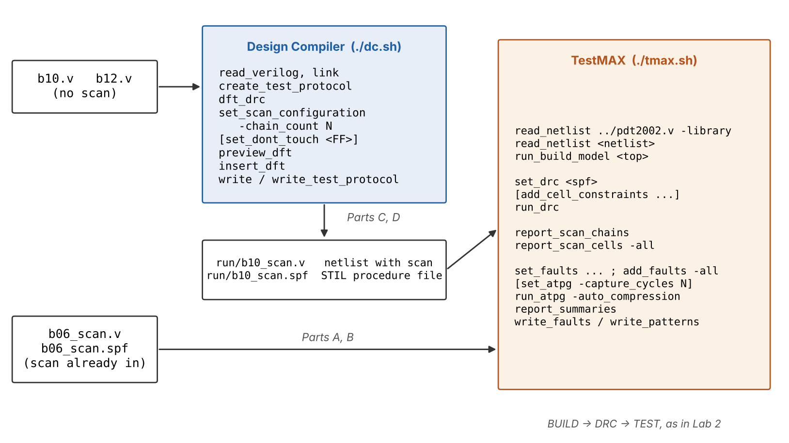
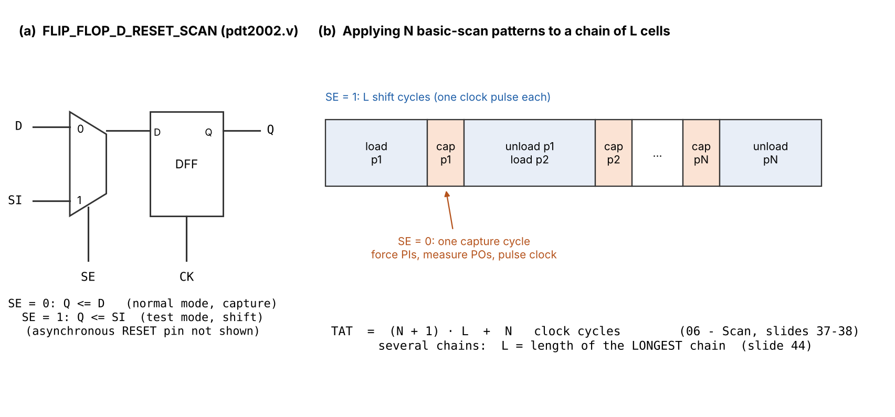

# Testing and Fault Tolerance (01RKZYG) — Laboratory 3
## Scan-Based ATPG and Scan Chain Insertion

> **Course:** 01RKZYG – Testing and Fault Tolerance, Politecnico di Torino  
> **Working directory:** `~/lab3` (remote `/home` directory) · all run outputs go to `~/lab3/run`  
> **Tools:** Synopsys TestMAX ATPG (formerly TetraMAX; the executable is `tmax`) and Synopsys Design Compiler (`dc_shell`)  
> **Structure:** guided workflow in Parts 0–D; the exercises of Section 5 are optional

---

## 1. Objectives and Prerequisites

### 1.1 Why this lab

Lab 2 ended with a disappointing result. On b10, a small finite-state machine with 17 flip-flops, basic-scan ATPG detected **nothing**, and full-sequential ATPG needed 37 s and 32 patterns of 13 clock cycles each to reach 91.10 % test coverage; on b12 (121 flip-flops) it would take hours. The reason is that a flip-flop can be set and read only through the primary inputs and outputs, over many clock cycles.

**Scan** removes the problem at the root (*06 – Scan*, slides 3–8): every flip-flop becomes a scan cell, and in test mode all the cells form a shift register. Each cell can then be loaded from a scan-in pin and read from a scan-out pin, and the ATPG treats the circuit as combinational: the flip-flop outputs become **pseudo-primary inputs** (PPIs), their inputs **pseudo-primary outputs** (PPOs).

In this lab you will:

* look inside a full-scan design (b06) and its test protocol, and run basic-scan ATPG on it;
* limit the control and the observation of single scan cells (**cell constraints**), as you did for ports with PI constraints and PO masks in Lab 2;
* insert scan chains yourself with Design Compiler on b10 and b12, with one or more chains, and measure what scan buys in coverage and test time;
* leave some flip-flops out of the chain (**partial scan**) and see how fast-sequential ATPG recovers part of the coverage.

### 1.2 What you will be able to do at the end of this lab

1. **Trace** a scan chain in a netlist and in a STIL procedure file: scan-in and scan-out ports, order of the cells, position numbers.
2. **Read** a basic-scan pattern (load, force, measure, capture, unload) and **compute** the test application time of a pattern set, with one or more chains.
3. **Run** basic-scan ATPG on a full-scan design and explain why it succeeds where sequential ATPG struggled.
4. **Predict** the faults lost when a scan cell cannot be controlled or observed, and **verify** it with `add_cell_constraints`.
5. **Insert** scan chains with a given Design Compiler script, changing the number of chains or excluding flip-flops, and check the result.
6. **Explain** the trade-offs of multiple chains (test time vs. pins) and of partial scan (area vs. ATPG effort and coverage).

### 1.3 Theory you must have clear (lecture slides)

| Concept used in this lab | Where it is in the course material |
|---|---|
| Why scan: sequential ATPG needs too many time frames | *06 – Scan*, slide 3; *04 – ATPG*, slides 51–52 |
| Scan chain, normal and test mode, flip-flops as virtual I/Os | *06*, slides 4–8 |
| ATPG view of a scan design: PPIs and PPOs | *06*, slides 9–14 |
| Applying a scan pattern: shift in, force PIs, capture, observe POs, shift out | *06*, slides 15–20 |
| DfT insertion in the design flow | *06*, slide 21 |
| Key parameters of scan: area, performance, test time | *06*, slides 22–23 |
| Mux-scan flip-flop and chain construction | *06*, slides 25–29 and 34–35 |
| Safe shift: scan enable must have priority, no dangerous control signals during shift | *06*, slides 30 and 64–67 |
| Scan chain test (`0011…`) and ATPG test | *06*, slide 36 |
| Test time with one chain: (N + 1) · L + N | *06*, slides 37–38 |
| Sharing scan-in/scan-out with functional pins | *06*, slides 39–40 |
| Multiple chains, balancing, test time with the longest chain | *06*, slides 41–46 |
| Partial scan: test procedure, motivations, disadvantages | *06*, slides 47–52 |
| PI constraints, PO masks; fault classes DT, PT, UD, AU, ND | *04 – ATPG*, slides 23 and 32–33 (Lab 2) |

**Prerequisites:** Lab 2 (TestMAX command files, `tmax.sh`, `summary.sh`, `list_faults.sh`, fault classes, PI constraints and PO masks, full-sequential ATPG on b10). Keep your Lab 2 results of Part D at hand: you will compare with them. Your Lab 2 command file `~/lab2/atpg_b10.tcl` is a good starting point for the first command file of this lab.

---

## 2. Files and Workspace Provided

All files are in `~/lab3`. As in Lab 2, every script **changes directory into `run/`** (creating it if needed) before starting a tool, so **launch the scripts from `~/lab3`** and expect every generated file in `~/lab3/run`. Command files refer to the sources as `../<file>`, and to the files written by Design Compiler (which are in `run/`) with their plain name.

```text
~/lab3
├── b06_scan.v               # ITC'99 b06: interrupt handler FSM, full-scan netlist (scan already inserted)
├── b06_scan.spf             # STIL procedure file of b06_scan.v (clocks, scan chain, procedures)
├── b10.v                    # ITC'99 b10: voting system FSM, no scan (same file as Lab 2)
├── b12.v                    # ITC'99 b12: one-player game FSM, no scan (same file as Lab 2)
├── pdt2002.v                # PoliTo technology library, Verilog cell models (read by TestMAX)
├── pdt2002.db               # the same library, compiled for Design Compiler
├── pdt2002.dc_setup.tcl     # library set-up for Design Compiler
├── b10_scan_insertion.tcl   # Design Compiler command file: scan insertion on b10
├── tmax.sh                  # runs a TestMAX command file from run/ (as in Lab 2)
├── dc.sh                    # runs a Design Compiler command file from run/
├── summary.sh               # one-line summary of the last fault report in a log
├── list_faults.sh           # faults of a fault list by class (as in Lab 2)
├── sweep_cells.sh           # Part B: ATPG on b06 with 11 cell-constraint settings
├── sweep_scan.sh            # Part C: scan insertion + ATPG on b10 and b12 with 1, 2, 4 chains
├── sweep_capture.sh         # Part D: ATPG on a partial-scan netlist with 0, 2, 4, 10 capture cycles
├── images/
└── run/                     # all outputs (created by the scripts if missing)
```

The TestMAX command files are **not** in the workspace: as in Lab 2, you compose them, in `~/lab3`: `atpg_b06.tcl` (Part A), `atpg_b06_cc.tcl`, `atpg_b06_0x.tcl` and `atpg_b06_xx.tcl` (Part B), `atpg_b10_scan.tcl` and `atpg_b10_scan4.tcl` (Part C), `atpg_b10_partial.tcl` and `atpg_b10_partial_cc4.tcl` (Part D). The Design Compiler command file is given; you derive `b10_scan4.tcl` (Part C) and `b10_partial.tcl` (Part D) from it, and in exercise E9 you write one from scratch.

### 2.1 Design files

| File | Content | Notes |
|---|---|---|
| `b06_scan.v` | b06 after scan insertion: 9 `FLIP_FLOP_D_RESET_SCAN` cells and 49 gates. Inputs `eql`, `cont_eql`, `clock`, `reset`, `test_si`, `test_se`; outputs `cc_mux[2:1]`, `uscite[2:1]`, `enable_count`, `ackout`. | `test_si` (scan-in) and `test_se` (scan enable) were added by the scan insertion tool. Look for the scan-out yourself (A.1). |
| `b06_scan.spf` | STIL procedure file written by the scan insertion tool: signals, timing, the scan chain (`ScanStructures`), the procedures `load_unload` and `capture`, the macro `test_setup`. | It contains no patterns: it is the **protocol** that TestMAX needs to use the chain. |
| `b10.v`, `b12.v` | The non-scan netlists of Lab 2 (17 and 121 `FLIP_FLOP_D_RESET` cells). | Input of the scan insertion in Parts C and D. |
| `pdt2002.v` | Cell models for TestMAX. The scan cell `Flip_Flop_D_reset_scan` is a multiplexer (`SE` selects `D` or `SI`) in front of a D flip-flop with asynchronous reset (Figure 2a). | Read with `-library` and `-insensitive`, as in Lab 2. |
| `pdt2002.db`, `pdt2002.dc_setup.tcl` | The same library for Design Compiler, and the commands that load it. | The set-up forbids every scan cell except `FLIP_FLOP_D_RESET_SCAN`, the only one modelled in `pdt2002.v`, and the XOR/XNOR cells. |

### 2.2 Scripts

| Script | What it does | Why it is written this way |
|---|---|---|
| `tmax.sh <file.tcl>` | `cd run/`, then `tmax -shell <file.tcl> < /dev/null`; saves the transcript in `run/<file>.log` and reports the first error. | The same script as Lab 2. |
| `dc.sh <file.tcl>` | `cd run/`, then `dc_shell -f <file.tcl> < /dev/null`; saves the transcript in `run/<file>.log` and reports the first error. | Same behaviour as `tmax.sh`, so that both tools write their outputs and logs in `run/`. |
| `summary.sh <log> [label]` | One line with the classes, the patterns (total, and basic-scan / fast-sequential), the coverages, and the test cycles printed by `write_patterns`. | Extended from Lab 2 with the pattern types and the test cycles. |
| `list_faults.sh <list> [codes]` | Faults of a fault list with their class (resolving the `--` lines of equivalent faults). | As in Lab 2. |
| `sweep_cells.sh` | Part B: writes, runs and summarizes 15 TestMAX command files on b06, one per cell-constraint setting. | The repetitive part of Part B, validated on the setting you run by hand. |
| `sweep_scan.sh [design]` | Part C: for b10 and b12 with 1, 2, 4 chains, writes and runs the Design Compiler file, then the TestMAX file; collects chains, longest chain, coverage, patterns, test time. | 12 tool runs: you do the first two by hand. |
| `sweep_capture.sh [name]` | Part D: ATPG on `run/<name>.v` (default `b10_partial`) with 0, 2, 4 and 10 capture cycles. | Validated on the run you do by hand with basic-scan ATPG only. |

### 2.3 The tool flow, and how a scan pattern is applied

<p align="center">
  
</p>

**Figure 1.** The two tools of this lab. In Parts A and B the scan chain of b06 is already there. In Parts C and D you insert it with Design Compiler, which writes a new netlist and its STIL procedure file in `run/`; TestMAX then reads both. The TestMAX flow is the ATPG flow of Lab 2, with the protocol file declared by `set_drc` and, optionally, cell constraints and fast-sequential ATPG.

<p align="center">
  
</p>

**Figure 2.** (a) The scan cell of `pdt2002.v`. (b) How N basic-scan patterns are applied to a chain of L cells (*06*, slides 15 and 37–38): the load of pattern *i+1* and the unload of pattern *i* happen in the same L shift cycles, with one capture cycle in between. TestMAX prints the same steps for every pattern (`report_patterns`): `load`, `force_all_pis`, `measure_all_pos`, `pulse clocks`, `unload`.

### 2.4 TestMAX command steps

The commands of Lab 2 are still valid; the table lists the ones you need in this lab, with the new ones marked **new**. Every command and option below is documented in the TestMAX User Guide, except where noted.

| Mode | Command (as used in this lab) | What it does / why |
|---|---|---|
| BUILD | `read_netlist ../pdt2002.v -format verilog -insensitive -library` | Cell models; always first. |
| BUILD | `read_netlist <netlist> -format verilog -insensitive` | `../b06_scan.v`, or `b10_scan.v` for a netlist written by Design Compiler in `run/`. |
| BUILD | `run_build_model <top>` | `b06`, `b10`, `b12`. BUILD → DRC. |
| DRC | `set_drc <protocol file>` **new** | Names the STIL procedure file that `run_drc` will use (clocks, scan chains, procedures). |
| DRC | `add_cell_constraints 0\|1\|X\|OX\|0X\|1X\|XX <chain> -position {<first> [<last>]}` **new** | Constrains the load and/or the observation of the scan cells from the first to the last position given (Part B). Set **after** `set_drc` and **before** `run_drc`. *The User Guide shows an older form without `-position` (`... c2 4 5`), which this version of TestMAX rejects, and does not list `0X`/`1X` (Part B).* |
| DRC | `run_drc` | Design rule checks with the protocol given by `set_drc`, including the **tracing of the scan chains**. DRC → TEST. |
| TEST | `report_scan_chains` **new** | Each chain: name, length, scan-in and scan-out ports. |
| TEST | `report_scan_cells -all` **new** | The cells of each chain with their position (0 = the cell next to the scan-out). *Option `-all` not described in the User Guide: check the log.* |
| TEST | `report_nonscan_cells -summary` **new** | Sequential cells that are not in a chain (Part D). |
| TEST | `set_faults -model stuck` · `set_faults -summary verbose` · `set_faults -fault_coverage` | As in Lab 2. |
| TEST | `add_faults -all` | Fault list on all fault sites. Faults on the scan path are classified **DI** here (A.3). |
| TEST | `set_atpg -capture_cycles <N>` **new** | 0: basic-scan ATPG only. 2–10: after basic-scan ATPG, fast-sequential ATPG with up to N capture cycles between load and unload (Part D). |
| TEST | `run_atpg -auto_compression` | ATPG with compaction; with `-capture_cycles` > 1 it also runs fast-sequential ATPG. |
| TEST | `report_summaries` | Fault summary and pattern summary. |
| TEST | `report_patterns -all` **new** | Every pattern step by step: `load`, `force_all_pis`, `measure_all_pos`, `pulse clocks`, `unload`. |
| TEST | `analyze_faults <pin> -stuck 0\|1 -verbose` | Why one fault is (not) detected; `-verbose` adds the details. |
| TEST | `write_faults <file> -all -uncollapsed -replace` · `write_patterns <file> -format stil -replace` | As in Lab 2. `write_patterns` prints the number of **test cycles** of the pattern set. |
| any | `set_messages -display` · `report_commands -history` · `quit` | As in Lab 2. |

**The ATPG flow of this lab, step by step**

| # | Step | Command |
|:-:|---|---|
| 1 | read the library, then the netlist | `read_netlist` ×2 |
| 2 | build the model | `run_build_model` |
| 3 | declare the protocol file | `set_drc` |
| 4 | *(optional, Part B)* cell constraints | `add_cell_constraints` |
| 5 | DRC, scan chain tracing | `run_drc` |
| 6 | *(Parts A, C, D)* look at the chains | `report_scan_chains`, `report_scan_cells -all`, `report_nonscan_cells -summary` |
| 7 | fault model, report options, all faults | `set_faults` ×3, `add_faults -all` |
| 8 | *(optional, Part D)* capture cycles | `set_atpg -capture_cycles` |
| 9 | ATPG, report | `run_atpg -auto_compression`, `report_summaries` |
| 10 | *(Part A)* the patterns | `report_patterns -all` |
| 11 | write the fault list and the patterns; quit | `write_faults`, `write_patterns`, `quit` |

**Messages that tell you a step worked**

| After | Look for | If it is missing |
|---|---|---|
| BUILD | `End parsing ... with 0 errors` for each file, then `End build model` | wrong path (`../` or not?), wrong top-level name |
| DRC | a line saying that each chain was **successfully traced** with its number of scan cells, then `Design rules checking was successful` | wrong or missing protocol file; read the first violation |
| TEST | the fault summary; after `write_patterns`, `... generating <n> test cycles` | a command in the wrong mode, or a wrong file name |

### 2.5 The Design Compiler script

Design Compiler is the logic synthesis tool of the Synopsys flow; here it is used only for **scan insertion** on a netlist that is already mapped onto `pdt2002` cells (*06*, slide 21: DfT insertion comes after synthesis). The course material has no Design Compiler manual: the script `b10_scan_insertion.tcl` is given, and in this lab you only change the number of chains and the flip-flops kept out of the chain. Read it with the table below.

| Command in `b10_scan_insertion.tcl` | What it does |
|---|---|
| `uplevel #0 source ../pdt2002.dc_setup.tcl` | Loads the library and the list of cells not to use (`set_dont_use`). |
| `read_verilog ../b10.v` · `current_design b10` · `link` · `check_design` | Reads the netlist, selects the top module, links every cell instance to the library, checks the design. |
| `report_area` | Total cell area (before, and again after insertion). |
| `#set_dont_touch voto2_reg` | Commented out: in Part D you remove the `#` to keep a flip-flop **out** of the chain. |
| `set test_default_scan_style multiplexed_flip_flop` | Scan style: mux-scan cells (*06*, slides 25–28). |
| `create_test_protocol -infer_asynch -infer_clock` | Builds the test protocol, finding the clock and the asynchronous reset in the netlist. |
| `dft_drc` | Test design rule checks, before and after insertion (e.g. flip-flops whose clock or reset is not controllable cannot be scanned). |
| `set_scan_configuration -chain_count 1` | Number of scan chains. |
| `preview_dft` · `insert_dft` | Shows what will be done, then does it: replaces the flip-flops with scan cells, connects the chains, adds the scan ports. |
| `report_scan_path -view existing -chain all` · `... -cell all` | The chains (scan-in, scan-out, length) and their cells, in order. |
| `write -hierarchy -format verilog -output b10_scan.v` · `write_test_protocol -output b10_scan.spf` | The netlist with scan, and its STIL procedure file for TestMAX. |

---

## 3. Guided Workflow

| Part | Topic |
|---|---|
| 0 | Set-up |
| A | A full-scan design: b06 |
| B | Controlling and observing scan cells: cell constraints |
| C | Scan insertion with Design Compiler, one and more chains |
| D | Partial scan and fast-sequential ATPG |

**Self-assessment quiz.** On the course page on Moodle you find the quiz *Lab 3 - Scan-based ATPG and scan insertion*, with one section for each part of this guide. It is **not graded**: you can answer as many times as you want, and each answer comes with an explanation. The questions are built on the checkpoints of this guide, so you can answer them only after running the steps.

---

### Part 0 — Set-up

Download `lab3.zip` from the course page on Moodle and extract it in your home directory:

```console
$ unzip ~/Downloads/lab3.zip -d ~/lab3     # use the folder where your browser saved the file
$ cd ~/lab3
$ chmod +x *.sh
$ ls
$ which tmax dc_shell
```

**Checkpoint 0.** You see all the files of §2 and an (empty) `run/` directory; `which` finds both tools (if `dc_shell` is missing, ask the teaching staff how to set up the Synopsys tools).

---

### Part A — A Full-Scan Design: b06

#### A.1 — Trace the scan chain by hand

Before asking TestMAX, find the chain yourself in the netlist. Every scan cell has a `.SI(...)` pin: the net connected to it is the output of the previous cell of the chain, or the scan-in port for the first cell.

1. How many scan cells does b06 contain, and how many non-scan flip-flops?
   ```console
   $ grep -c "FLIP_FLOP_D_RESET_SCAN" b06_scan.v
   $ grep -c "FLIP_FLOP" b06_scan.v
   ```
2. **Draw the chain on paper.** Start from the cell whose `SI` is `test_si`, then look for the cell whose `SI` is the `Q` of that cell, and so on:
   ```console
   $ grep -n "SI(" b06_scan.v
   ```
   Write the cells in order, from the scan-in to the scan-out port. Which port is the **scan-out**? Is it a dedicated test pin, or a functional output (*06*, slides 39–40)?
3. **Number the cells.** TestMAX numbers the cells of a chain from the scan-out: **position 0** is the cell next to the scan-out (User Guide, *Masking Scan Cell Inputs and Outputs*). Write the position of each cell on your drawing; you will need the positions of `state_reg[0]`, `state_reg[1]`, `state_reg[2]` in Part B.
4. **Compare with the protocol file.** Open `b06_scan.spf` and find the `ScanStructures` block: chain name, `ScanLength`, `ScanIn`, `ScanOut`, and the list `ScanCells`. In which order does it list the cells?
5. **Read the procedures** of `b06_scan.spf` with Figure 2: in `load_unload`, which value does `test_se` take, and in which part of the procedure? In the `Shift` block, which signals change at every shift cycle? In the `capture` procedures, is `test_se` forced?
6. **Count the faults before running.** The fault sites are the ports and every pin of every cell (Lab 2); a scan cell has 6 pins (`D`, `SI`, `SE`, `CK`, `RESET`, `Q`). Count the gates by type:
   ```console
   $ grep -o "^ *[A-Z0-9]*_GATE" b06_scan.v | sort | uniq -c
   ```
   How many faults do you expect?

#### A.2 — Compose `atpg_b06.tcl`

Start from your Lab 2 file (`cp ~/lab2/atpg_b10.tcl atpg_b06.tcl`) or from the table of §2.4, and follow *The ATPG flow of this lab*:

* the netlist is `../b06_scan.v`, top-level `b06`;
* the protocol file is declared with `set_drc ../b06_scan.spf`, then `run_drc` has no argument. In Lab 2 you wrote `run_drc ../b10.spf`, which does both things at once; splitting them leaves room for the cell constraints of Part B;
* after `run_drc`: `report_scan_chains`, `report_scan_cells -all`, `report_nonscan_cells -summary`;
* one ATPG run, `run_atpg -auto_compression`, then `report_summaries` and `report_patterns -all`. b06 is full scan: there is no full-sequential step any more (why?);
* outputs: `b06_atpg_faults.txt` and `b06_atpg.stil`.

```console
$ ./tmax.sh atpg_b06.tcl
$ grep -i -E "traced|scan_cells" run/atpg_b06.log
```

Compare the output of `report_scan_chains` and `report_scan_cells -all` with your drawing.

**Checkpoint A.2.** No errors in the log; DRC traces one chain with the number of cells you counted; the order and the positions printed by `report_scan_cells -all` coincide with your drawing; `report_nonscan_cells` finds no non-scan cell; the total number of faults equals your count of A.1 step 6.

#### A.3 — Basic-scan ATPG on a full-scan design

**Predict first.** In Lab 2, basic-scan ATPG on b10 detected no fault. On b06, with all the flip-flops in the chain, what test coverage do you expect? Use the formula of Figure 2 to write the **test application time** (TAT) as a function of the number of patterns N.

```console
$ ./summary.sh run/atpg_b06.log
$ grep "test cycles" run/atpg_b06.log
```

Complete the table (TAT by formula with the N reported by TestMAX; TAT by the tool from the `write_patterns` message):

| b06, full scan | #faults | DT (of which DI) | AU | UD | ND | test coverage | fault coverage | #patterns | TAT, formula | TAT, tool |
|---|:-:|:-:|:-:|:-:|:-:|:-:|:-:|:-:|:-:|:-:|
| basic-scan ATPG | | | | | | | | | | |

**Questions A.3**
1. Compare with b10 in Lab 2 Part D (basic-scan 0 %, full-sequential 91.10 % with 32 patterns and 416 test cycles in 37 s). Why does basic-scan ATPG work now (*06*, slides 12–14)?
2. Some faults are **DI** (*detected by implication*). Read the definition in the User Guide (*Fault Categories and Classes*) and list them: `./list_faults.sh run/b06_atpg_faults.txt DI`. On which pins are they? Why can TestMAX give them credit without simulating any ATPG pattern?
3. In the output of `report_patterns`, look at **pattern 0**. What is loaded into the chain, and is a clock pulsed? Compare with the *scan chain test* of *06*, slide 36 (User Guide: *Creating Test Patterns for Diagnosing Scan Chain Failures*).
4. Look at pattern 1. Map its steps (`load`, `force_all_pis`, `measure_all_pos`, `pulse clocks`, `unload`) onto *06*, slide 15. Why must `measure_all_pos` come **before** `pulse clocks`?
5. TAT: the formula and the tool do not give exactly the same number. Using the `load_unload` procedure and the `test_setup` macro of `b06_scan.spf`, explain where the extra cycles come from.

> **Self-check on Moodle:** quiz section *Part A - Full-scan design and basic-scan ATPG*.

---

### Part B — Controlling and Observing Scan Cells: Cell Constraints

In Lab 2 you limited the **ports**: a PI held at 0, 1 or X, a PO masked. In a scan design the scan cells are pseudo-primary inputs and outputs, and TestMAX has the same controls for them (User Guide, *Masking Scan Cell Inputs and Outputs*):

| Constraint | Load (the cell as a PPI) | Observation (the cell as a PPO) |
|---|---|---|
| `0` / `1` | always loaded with 0 / 1 | normal |
| `X` | always loaded with X | normal |
| `OX` | no restriction | the captured value is considered X |
| `0X` / `1X` | always loaded with 0 / 1 | the captured value is considered X |
| `XX` | always loaded with X | the captured value is considered X |

`0X` and `1X` combine a fixed load with a mask on the observation. They are accepted by the version of TestMAX installed in the lab, but the User Guide in the course material lists only `0`, `1`, `X`, `OX`, `XX`; adding a second constraint to the same cell does not combine them, it **replaces** the first one (User Guide, Appendix *Masking Defective Scan Chains*).

In practice, cells are constrained when they cannot be loaded or read reliably: a cell whose value is needed by the test mode, a cell that captures an unpredictable value (from a memory, an analog block, another clock domain), a defective chain on a returned chip (User Guide, Appendix *Masking Defective Scan Chains*). A cell is named by its chain and position (`add_cell_constraints OX 1 -position 4` = chain `1`, position 4; `-position {2 4}` = positions 2 to 4) or by its instance name as printed by `report_scan_cells`. The constraint is a DRC-mode command: write it after `set_drc` and before `run_drc`.

#### B.1 — Predict

Answer **before** running anything, using `b06_scan.v` and your drawing of A.1:

1. With `OX` on `state_reg[0]`, the value captured by that cell is never observed. Follow its `D` input backwards (`grep -n "N46" b06_scan.v`, then the inputs of that gate, and so on): which gates drive **only** that `D` input? Count the faults that are certainly lost (include the `D` pin of the cell). Is your count a lower bound or the exact number?
2. On the same cell, which constraint will cost more faults: `0`, `1` or `X`? And `X` or `OX`?
3. Will `0X` lose exactly the faults lost by `0` plus those lost by `OX`? And `XX`, compared with `X` plus `OX`?
4. What do you expect when the same constraint is put on the three cells of the state register (`state_reg[2:0]`, positions 2–4) instead of one?

#### B.2 — Two constraints by hand

Copy `atpg_b06.tcl` to `atpg_b06_cc.tcl`, add the constraint between `set_drc` and `run_drc`, remove the three `report_scan_*`/`report_nonscan_*` lines and `report_patterns`, and change the names of the output files to `b06_cc_faults.txt` and `b06_cc.stil`:

```tcl
add_cell_constraints OX 1 -position 4   ;# state_reg[0] (chain 1, position 4): captured value = X
```

```console
$ ./tmax.sh atpg_b06_cc.tcl
$ ./summary.sh run/atpg_b06.log    "no constraint"
$ ./summary.sh run/atpg_b06_cc.log "state_reg[0] OX"
$ ./list_faults.sh run/b06_cc_faults.txt
```

**Checkpoint B.2.** The detected faults decrease by at least your count of B.1 Q1, and every fault you listed is among the faults not detected, in class **AN** (ATPG untestable). If some faults you did not expect are lost, find out why before going on: they are the ones the hand count missed.

Now a constraint on the **load** too. Copy `atpg_b06_cc.tcl` to `atpg_b06_0x.tcl`, change `OX` into `0X` (load 0 **and** captured value X) and the output names into `b06_0x_faults.txt` and `b06_0x.stil`. Before running, write down your answer to B.1 Q3 for `0X`.

```console
$ ./tmax.sh atpg_b06_0x.tcl
$ ./summary.sh run/atpg_b06_0x.log "state_reg[0] 0X"
```

**Checkpoint B.2 (second run).** No errors; `0X` loses more faults than `OX`. Keep the number: you will compare it with `0` alone in B.3.

#### B.3 — All the settings with a script

`sweep_cells.sh` runs ATPG on b06 for 15 settings: no constraint; `0`, `1`, `X`, `OX`, `0X`, `1X`, `XX` on `state_reg[0]` (rows 02–08); the same seven on `state_reg[2:0]` (rows 09–15). It writes the command files and the logs in `run/sweep_cells/` and a table in `run/sweep_cells/table.txt`:

```console
$ ./sweep_cells.sh
$ cat run/sweep_cells/05_state0_OX.tcl
```

**First, validate the script:** rows 01, 05 and 06 must coincide with your runs of A.3 and B.2, and the command file of row 05 must contain the same commands as your `atpg_b06_cc.tcl`.

**Questions B.3** *(more questions on this table in exercise E8)*
1. Rank `0`, `1`, `X` on `state_reg[0]`. Why does an uncontrollable cell (`X`) cost so much more than a cell that cannot be observed (`OX`)? Think of where the value of `state_reg[0]` goes, compared with where the value captured by it comes from.
2. Check your prediction of B.1 Q3. Is the loss of `0X` (row 06) close to the sum of the losses of `0` and `OX` (rows 02 and 05)? Is the loss of `XX` (row 08) close to the sum for `X` and `OX` (rows 04 and 05)? Explain the difference: with `0`, can the faults observable only at `state_reg[0]` still be excited? And with `X`?
3. In which rows does TestMAX report **PT** faults? Relate them to *04 – ATPG*, slide 22.
4. Rows 09–15 constrain the whole state register of the FSM. Why are the losses so large, compared with one cell?

#### B.4 — Why one fault is not detected

Copy `atpg_b06_cc.tcl` to `atpg_b06_xx.tcl`, put `XX` on the three state cells, and analyze the fault `U51/O` stuck-at-0 after the summary (change also the output names to `b06_xx_*`):

```tcl
add_cell_constraints XX 1 -position {2 4}   ;# state_reg[2:0] (chain 1, positions 2 to 4): load X, observe X
...
report_summaries
analyze_faults U51/O -stuck 0 -verbose
```

```console
$ ./tmax.sh atpg_b06_xx.tcl
$ sed -n '/Fault analysis performed/,/^ *$/p' run/atpg_b06_xx.log
$ grep -n "U51 " b06_scan.v
```

1. What is the class of the fault, and which step fails: the control of the fault site (excitation) or the observation?
2. Which scan cells drive the inputs of `U51`? Which value must one of them have to excite `U51/O` stuck-at-0?
3. In row 08 of the sweep only `state_reg[0]` is `XX`. Is `U51/O` stuck-at-0 detected there? (`./list_faults.sh run/sweep_cells/08_state0_XX_faults.txt | grep "U51/O"`: no line for `sa0` means detected.) Explain why.

**Checkpoint B.4.** In `atpg_b06_xx.log` the fault is not detected and the analysis names a failing step; in row 08 the same fault is detected, and you can say which cell made the difference.

> **Self-check on Moodle:** quiz section *Part B - Cell constraints*.

---

### Part C — Scan Insertion with Design Compiler, One and More Chains

b06 came with its chain. Now you insert the chain into b10, the circuit that cost so much effort in Lab 2.

#### C.1 — Insert one chain into b10

Read `b10_scan_insertion.tcl` with the table of §2.5. **Predict:** how many cells will the chain have? Which ports will be added? Will the area grow, and why?

```console
$ ./dc.sh b10_scan_insertion.tcl
$ grep -i "total cell area" run/b10_scan_insertion.log
$ grep -c "FLIP_FLOP_D_RESET_SCAN" run/b10_scan.v
$ head -4 run/b10_scan.v
$ grep -E "ScanChain|ScanLength|ScanIn|ScanOut" run/b10_scan.spf
```

**Checkpoint C.1.** `dc.sh` reports no errors; `run/b10_scan.v` contains 17 scan cells; the SPF declares one chain of length 17 and names its scan-in and scan-out ports.

**Questions C.1**
1. Which ports were added to b10? Is the scan-out a new port or a functional output? Compare with b06.
2. Compare the two totals printed by `report_area`. Did the area grow as you predicted? Look at what changed in the netlist (`grep -o "^ *[A-Z0-9_]*_GATE" run/b10_scan.v | sort | uniq -c`, and the same on `b10.v`): which cells were replaced, which were added? The `pdt2002` library is an academic library: does its area model the cost of the multiplexer of a scan cell? On a real chip the overhead is of a few percent (*06*, slide 54): what would it depend on?

#### C.2 — ATPG on the full-scan b10

**Compose `atpg_b10_scan.tcl`** from `atpg_b06.tcl`: the netlist and the SPF are now in `run/`, where TestMAX runs, so they are read **without** `../` (`read_netlist b10_scan.v ...`, `set_drc b10_scan.spf`); the top-level is `b10`; keep `report_scan_chains` and `report_nonscan_cells -summary`, remove `report_scan_cells` and `report_patterns`; outputs `b10_scan_faults.txt` and `b10_scan.stil`.

**Predict:** b10 had 1124 faults in Lab 2. How many faults does the scan version have? (Each scan cell has two more pins; every new port is a fault site.) Which test coverage, and how many test cycles, compared with Lab 2?

```console
$ time ./tmax.sh atpg_b10_scan.tcl
$ ./summary.sh run/atpg_b10_scan.log
```

| b10 | #faults | test coverage | #patterns | test cycles | run time |
|---|:-:|:-:|:-:|:-:|:-:|
| no scan, full-sequential ATPG (Lab 2) | 1124 | 91.10 % | 32 | 416 | 37 s |
| full scan, basic-scan ATPG | | | | | |

**Checkpoint C.2.** No errors; the number of faults equals your prediction; the test coverage is higher than in Lab 2.

#### C.3 — More chains: b10 and b12

With one chain, the test time grows with the number of flip-flops; with several balanced chains, loaded in parallel, it scales with the length of the **longest** chain (*06*, slides 41–45). `sweep_scan.sh` inserts 1, 2 and 4 chains into b10 and b12, runs ATPG on each netlist and writes `run/sweep_scan/table.txt` with: number of chains, longest chain, faults, test coverage, patterns, TAT by the formula of Figure 2, test cycles reported by TestMAX.

**Four chains by hand.** Copy `b10_scan_insertion.tcl` to `b10_scan4.tcl`, set `-chain_count 4` and change the output names to `b10_scan4.v` and `b10_scan4.spf`. Copy `atpg_b10_scan.tcl` to `atpg_b10_scan4.tcl` and change the netlist, the SPF and the output names (`b10_scan4_faults.txt`, `b10_scan4.stil`). **Predict** the length of the longest chain and the new ports, then:

```console
$ ./dc.sh b10_scan4.tcl
$ grep -E "ScanChain|ScanLength|ScanIn|ScanOut" run/b10_scan4.spf
$ head -4 run/b10_scan4.v
$ ./tmax.sh atpg_b10_scan4.tcl
$ ./summary.sh run/atpg_b10_scan.log  "b10, 1 chain"
$ ./summary.sh run/atpg_b10_scan4.log "b10, 4 chains"
```

**Checkpoint C.3.** Four chains in the SPF, the longest as you predicted; `report_scan_chains` in the log lists four scan-in/scan-out pairs; the number of patterns is about the same as with one chain, the test cycles are much fewer.

**The other configurations with a script. Predict** (fill the columns b10/1 and b10/4 with your hand runs, the rest before running the script):

| | b10, 1 chain | b10, 2 | b10, 4 | b12, 1 | b12, 2 | b12, 4 |
|---|:-:|:-:|:-:|:-:|:-:|:-:|
| longest chain | | | | | | |
| #patterns (more, fewer, about the same?) | | | | | | |
| TAT | | | | | | |

```console
$ ./sweep_scan.sh
$ diff b10_scan4.tcl run/sweep_scan/b10_4_dc.tcl
```

**First, validate the script:** the rows b10 / 1 chain and b10 / 4 chains must coincide with your runs of C.2 and C.3, and `run/sweep_scan/b10_4_dc.tcl` must contain the same commands as your `b10_scan4.tcl`, apart from comments and file names.

**Questions C.3**
1. How does the TAT change from 1 to 4 chains? Is it divided exactly by 4? Why not (b10 has 17 flip-flops)?
2. Do the number of patterns and the test coverage depend on the number of chains? Why (*06*, slide 43: "The ATPG can be unaware of the number of chains")?
3. What do you pay for 4 chains instead of 1 (*06*, slides 39–42)? Count the ports of `run/sweep_scan/b12_4.v`.
4. b12 with one chain: compare the TAT and the ATPG run time with what full-sequential ATPG would need without scan (Lab 2, exercise E6).

> **Self-check on Moodle:** quiz section *Part C - Scan insertion and multiple chains*.

---

### Part D — Partial Scan and Fast-Sequential ATPG

Sometimes not every flip-flop can be scanned: the area is too high, or a flip-flop is on a critical timing path (*06*, slides 47–52). With **partial scan**, a pattern needs more than one clock cycle in normal mode between load and unload, to control and observe the non-scan flip-flops through the logic. TestMAX does this with **fast-sequential** ATPG (User Guide, *Fast-Sequential Mode Settings*): `set_atpg -capture_cycles N` allows up to N capture cycles between load and unload (2 ≤ N ≤ 10).

#### D.1 — Predict

You will keep `voto2_reg` and `last_r_reg` of b10 out of the chain.

1. Where are `voto2` and `last_r` used? (`grep -n -E "voto2\b|last_r\b" b10.v`)
2. With **basic-scan** ATPG only (one capture cycle), the two cells cannot be loaded or unloaded. Which faults will be hard to detect: those whose excitation needs a value of `voto2`/`last_r`, those whose effect reaches only their `D` input, or both?
3. Rank the test coverage you expect with 0, 2, 4 and 10 capture cycles. Will 10 be much better than 4?

#### D.2 — A partial-scan b10 by hand

Copy `b10_scan_insertion.tcl` to `b10_partial.tcl`; remove the `#` in front of the two `set_dont_touch` lines; change the two output names to `b10_partial.v` and `b10_partial.spf`. Then compose `atpg_b10_partial.tcl` from `atpg_b10_scan.tcl`, changing only the names (`b10_partial.v`, `b10_partial.spf`, `b10_partial_faults.txt`, `b10_partial.stil`): it runs basic-scan ATPG only.

```console
$ ./dc.sh b10_partial.tcl
$ grep -E "ScanLength" run/b10_partial.spf
$ ./tmax.sh atpg_b10_partial.tcl
$ ./summary.sh run/atpg_b10_scan.log    "full scan"
$ ./summary.sh run/atpg_b10_partial.log "partial scan, basic-scan ATPG"
```

**Checkpoint D.2.** The chain has 15 cells; `report_nonscan_cells` reports the 2 cells you excluded; the test coverage is lower than with full scan. If the chain still has 17 cells, `set_dont_touch` was not applied: check `b10_partial.tcl` and its log.

#### D.3 — Capture cycles

**Four capture cycles by hand.** Copy `atpg_b10_partial.tcl` to `atpg_b10_partial_cc4.tcl`, add `set_atpg -capture_cycles 4` in TEST mode **before** `run_atpg` (after `add_faults`), and change the output names to `b10_partial_cc4_faults.txt` and `b10_partial_cc4.stil`. *Predict:* will the basic-scan patterns change? How many fast-sequential patterns, roughly, and how much coverage?

```console
$ ./tmax.sh atpg_b10_partial_cc4.tcl
$ ./summary.sh run/atpg_b10_partial.log     "capture cycles 0"
$ ./summary.sh run/atpg_b10_partial_cc4.log "capture cycles 4"
```

**Checkpoint D.3.** No errors; the summary shows basic-scan **and** fast-sequential patterns; the test coverage is higher than in D.2.

**The other values with a script:**

```console
$ ./sweep_capture.sh b10_partial
```

The script writes `run/sweep_capture/b10_partial_table.txt` with one row per value of `-capture_cycles` (0, 2, 4, 10): faults, classes, patterns (total, basic-scan, fast-sequential), coverages, test cycles and run time.

**First, validate the script:** rows 0 and 4 must coincide with your runs of D.2 and D.3.

**Questions D.3** *(more questions in exercise E8)*
1. How many fast-sequential patterns are generated, and how much coverage do they add? Was your prediction of D.1 Q3 right?
2. Open `run/b10_partial_cc4.stil` and find a pattern preceded by the annotation `Ann {* fast_sequential *}` (`grep -n -A12 fast_sequential run/b10_partial_cc4.stil | less`). How many `multiclock_capture` calls are there between two `load_unload`? In which of them are the outputs (`_po`) compared? Compare with *06*, slide 50: why does the pattern need several capture cycles to detect a fault on the logic that feeds `voto2_reg`?
3. Does the coverage still grow from 4 to 10 capture cycles? The DRC part of the log reports the sequential depth of the circuit (`Fast-sequential depth results`, as in Lab 2): relate it to your answer.
4. Which faults are still not detected with 10 capture cycles? (`./list_faults.sh run/sweep_capture/b10_partial_cc10_faults.txt`) Where are they? Compare with *06*, slide 52.
5. Compare three versions of b10: no scan (Lab 2), partial scan with fast-sequential ATPG, full scan. Which one would you choose, and what would make you choose partial scan?

> **Self-check on Moodle:** quiz section *Part D - Partial scan and fast-sequential ATPG*.

---

## 4. Wrap-up and Discussion

### 4.1 What you have seen

| Concept | Where you met it in this lab |
|---|---|
| A scan chain is a shift register through all the flip-flops; positions count from the scan-out | A.1, A.2 |
| The SPF carries the chain and the procedures (`load_unload`, `capture`, `test_setup`) that make it usable | A.1, C.1 |
| With full scan, basic-scan (combinational) ATPG reaches the coverage that sequential ATPG could not | A.3, C.2 |
| Faults on the scan path are detected by the chain test (DI), pattern 0 | A.3 |
| TAT = (N + 1) · L + N; the tool adds a few cycles of protocol | A.3 |
| An uncontrollable scan cell (X) costs far more than an unobservable one (OX) | B.3 |
| ATPG untestability under cell constraints: excitation or observation blocked by a specific cell | B.4 |
| Scan insertion replaces the flip-flops and adds ports (in a real library, also area); scan-out can share a functional pin | C.1 |
| Multiple chains divide the TAT by the number of chains, not the patterns | C.3 |
| Partial scan needs multiple capture cycles (fast-sequential ATPG), and some faults stay untested | D |

### 4.2 Questions for discussion

1. Scan turns a sequential test problem into a combinational one. What does it cost, and who pays: the designer, the test engineer, or the customer?
2. During shift the combinational logic receives "random" values (*06*, slides 30 and 66). In b06 or b10, could the shift drive a dangerous signal? What would you check in a real design?
3. b06 shares its scan-out with a functional output. When is this sharing safe, and when not?
4. A scan design is tested in a state that the circuit may never reach in normal operation (*06*, slides 70 and 115). Is this a problem for stuck-at faults? For delay faults?
5. If you had a budget of 4 test pins for b12, how would you use them?

### 4.3 Self-check: can you do it without a tool?

| Skill | Quick self-check |
|---|---|
| Trace a chain in a netlist | start from the scan-in port, follow `SI` ← `Q`; position 0 is next to the scan-out |
| Count the faults of a scan design | 2 × (ports + all cell pins), 6 pins per scan cell |
| Compute the TAT | (N + 1) · L + N, L = longest chain; a few cycles more on the tester |
| Predict the effect of a cell constraint | `0`/`1`/`X` act on the PPI (load), `OX` on the PPO (capture), `0X`/`1X`/`XX` on both; certainly lost: the logic that only that cell controls or only that cell observes |
| Predict the effect of more chains | same patterns and coverage, TAT ≈ ÷ chains, more pins |
| Explain partial scan | non-scan flip-flops must be controlled and observed through several capture cycles: more ATPG effort, lower coverage |

### 4.4 Habits for the next labs

* **Draw the structure before you read the tool's report** (chain, positions): then the report checks you, not the other way round.
* **Validate every sweep** on a setting you ran by hand, and read one generated command file.
* **Predict the numbers** you can compute (faults, chain lengths, TAT, lost faults) before running.
* **Compare with the previous lab** when the circuit is the same (b10): the comparison is the point.
* **Read the first error in the log**, for Design Compiler as for TestMAX.

### 4.5 Troubleshooting

| Symptom | Likely cause | Quick check |
|---|---|---|
| `dc.sh` says that `dc_shell` is not found | Synopsys tools not set up in this terminal | ask the teaching staff for the set-up command; `which dc_shell` |
| Design Compiler cannot find `pdt2002.db` or `b10.v` | script launched from the wrong folder, or a path without `../` | run `./dc.sh` from `~/lab3`; DC runs in `run/` |
| `run/b10_scan.v` missing after `dc.sh` | the DC script stopped at an error | the first error printed at the end by `dc.sh` |
| `read_netlist b10_scan.v` fails in TestMAX | Design Compiler not run yet, or the file name was changed | `ls run/*.v` |
| `read_netlist ../b10_scan.v` fails | the DC outputs are in `run/`, the same folder as TestMAX: no `../` | write `b10_scan.v` |
| DRC reports a scan chain blockage or no chain traced | wrong SPF for the netlist (e.g. `b10_scan.spf` with `b10_partial.v`) | the `set_drc` line |
| `add_cell_constraints` is rejected | given after `run_drc` (TEST mode), or before `set_drc` | order: `set_drc`, constraints, `run_drc` (§2.4) |
| `Error: extra positional option '4' (CMD-012)` | position written without `-position` | `add_cell_constraints OX 1 -position 4` |
| no fast-sequential patterns with `-capture_cycles 4` | `set_atpg` written after `run_atpg`, or before `run_drc` (wrong mode) | `set_atpg -capture_cycles` in TEST mode, before `run_atpg` |
| The constraint hits the wrong cell | position counted from the scan-in instead of the scan-out | `report_scan_cells -all` |
| The partial-scan chain still has 17 cells | the `#` was not removed from `set_dont_touch`, or the name is wrong | `grep dont_touch b10_partial.tcl` |
| `sweep_capture.sh` says `run/b10_partial.v not found` | D.2 not done, or different output names | `ls run/b10_partial.*` |
| `summary.sh` prints "no fault summary found" | TestMAX stopped before `report_summaries` | the end of the log |

---

## 5. Optional Exercises and Further Study

*No step-by-step solution is provided. Discuss your results with the teaching staff.*

### E1 — See the fault in the schematic viewer

Start TestMAX with its graphical interface from `~/lab3/run` (`tmax`, without `-shell`), give the commands of `atpg_b06_xx.tcl` at the command line of the GUI (up to `report_summaries`), then:

```tcl
analyze_faults U51/O -stuck 0 -display
```

The Graphical Schematic Viewer shows the fault site and the logic around it (User Guide, *Getting Started With the GSV*). Find the scan cells that block excitation and observation.

### E2 — Blocking the observation

Put `XX` on `state_reg[1]` only (position 3) and analyze `U51/O` stuck-at-0 again. `U51` does not depend on `state_reg[1]`: is the fault detected? Follow the paths from `n32` to the scan cells and the outputs (`grep -n "n32" b06_scan.v`), and explain the class TestMAX gives.

### E3 — Count the cycles of a pattern

Open `run/b06_atpg.stil`: find the `Pattern` block and count, for one pattern, the vectors of `load_unload` (including the `Shift` repetitions) and of the capture procedure. Write the exact TAT formula for this protocol and check it against the number printed by `write_patterns`.

### E4 — Which flip-flops in which chain?

In `run/b10_scan4.spf`, list the cells of each chain (`ScanCells`). How did Design Compiler order and balance them? Is the order related to the function of the circuit or to the names? Why can the order matter in a real layout (*06*, slide 31)?

### E5 — Full-sequential ATPG on the partial-scan b10

Add `set_atpg -full_seq_time 1` and `run_atpg full_sequential_only` (Lab 2, Part D) after the fast-sequential run with 10 capture cycles. Does full-sequential ATPG detect any of the faults left? At what cost?

### E6 — Your own partial scan of b12

Choose some flip-flops of b12 to keep out of the chain (for instance some cells of the `memory` registers: `grep -o "memory_reg[^ ]*" b12.v | sort -u | head`), write `b12_partial.tcl` (copy the b10 script and change the design name in every command), run Design Compiler and `./sweep_capture.sh b12_partial`. How does the coverage depend on how many and which flip-flops you exclude?

### E7 — Scan enable during capture

In b06, `test_se` is an ordinary input during capture: TestMAX may set it to 1. Add `add_pi_constraints 0 test_se` in DRC mode and run ATPG again. Which faults change class? What does this tell you about how the `SI` and `SE` pins are tested?

### E8 — Further analysis of your results

These questions use only the files you have already produced.

* **A.1** `ackout_reg` and `enable_count_reg` have the same `D` input. What does it mean for their values in normal mode? Could one of them be removed from the chain without loss?
* **A.3** Using the TAT of b06, how long does the test take at a test clock of 10 MHz? And for b12 with one chain?
* **B.3** Which faults are lost with `OX` on `state_reg[0]` but not with `X` on the same cell? (Compare the two fault lists.)
* **B.3** Compare rows 02–03 (one cell at `0` or `1`) with rows 09–10 (the whole state register): does the same value cost more in both cases? Which states of the FSM do `state_reg[2:0] = 000` and `111` force, and which transitions can still be tested?
* **C.3** Compare the TAT by formula and by the tool for each row of the table: is the difference constant? What does it depend on?
* **D.3** How much longer are the fast-sequential patterns than the basic-scan ones (test cycles per pattern)? Is the extra coverage worth the test time?

### E9 — From scratch: b12 with partial scan

Without copying any file and without looking at the guide (only the TestMAX User Guide is allowed), write:

1. a Design Compiler command file `b12_partial.tcl` that inserts **two** chains into b12, keeping two flip-flops of your choice out of the chains (`grep FLIP_FLOP b12.v` for the names; choose two whose name has no brackets, such as `wr_reg`: escaped names like `\count_reg[0]` need special quoting in Tcl), and writes `b12_partial.v` and `b12_partial.spf`;
2. a TestMAX command file `atpg_b12_partial.tcl` that reports the chains and the non-scan cells and runs ATPG with 4 capture cycles.

Run both, fix the errors using the first message reported by `dc.sh` / `tmax.sh`, and only at the end compare your files with the cheat sheet of the short guide (`lab3_short_guide.html`) and with the files you composed in Parts C and D. Which commands did you forget, or write in the wrong order?

> **Self-check on Moodle:** quiz section *Optional - Further exercises*.
