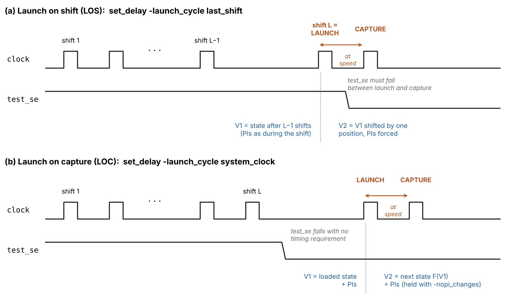
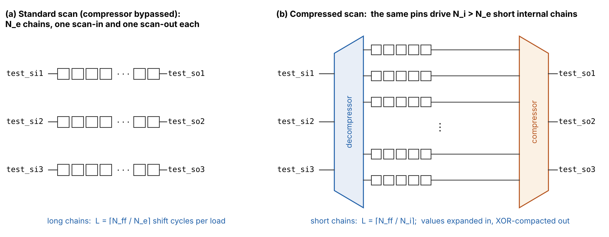

# Testing and Fault Tolerance (01RKZYG) — Laboratory 4
## Transition-Delay Faults and Scan Compression

> **Course:** 01RKZYG – Testing and Fault Tolerance, Politecnico di Torino  
> **Working directory:** `~/lab4` (remote `/home` directory) · all run outputs go to `~/lab4/run`  
> **Tools:** Synopsys TestMAX ATPG (formerly TetraMAX; the executable is `tmax`) and Synopsys Design Compiler (`dc_shell`)  
> **Structure:** guided workflow in Parts 0–D; the exercises of Section 5 are optional

---

## 1. Objectives and Prerequisites

### 1.1 Why this lab

At the end of Lab 3, scan had solved the problem of Lab 2: with every flip-flop in a chain, basic-scan ATPG reached 100 % stuck-at test coverage on b06, b10 and b12 in a few seconds. Two questions were left open.

1. **Is a chip that passes every stuck-at test a good chip?** Not if it is too slow. A resistive via, a weak transistor or a partially open line does not fix a node at 0 or 1: it makes a transition arrive late. The circuit computes the right values at low speed and fails at the operating frequency. Stuck-at patterns are applied at the slow speed of the shift and never check *when* a value arrives. The **transition-delay fault model** targets these defects: each node can be **slow-to-rise** or **slow-to-fall**. To detect such a fault you need **two** vectors: V1 sets the node to its initial value, V2 launches the transition and propagates it, and the response is captured **one fast clock period** after the launch. With scan, V2 can come from the last shift of the load (**launch on shift**, LOS) or from the circuit itself (**launch on capture**, LOC).
2. **What does the test cost?** In Lab 3 the test time of b12 dropped from 13 285 to 3 664 cycles with four chains, but each chain needs its own scan-in and scan-out pins. On a real chip there are millions of flip-flops and a few dozen test pins. **Scan compression** keeps the pins and cuts the chains: a few scan-in pins feed a **decompressor** that drives many short internal chains, and a **compressor** merges their outputs onto a few scan-out pins.

In this lab you will:

* build by hand the two vectors of a transition test, in LOS and in LOC, and find faults that one launch mode can test and the other cannot;
* write the TestMAX command files for transition-delay ATPG on b06 in both modes, starting from your Lab 3 files;
* write the Design Compiler command file that inserts scan compression into b12, starting from your Lab 3 scan insertion script, and run ATPG in the compressed mode and with the compressor bypassed;
* measure how pins, patterns, coverage, test time and test data volume change with the number of internal chains, and compare with the multiple chains of Lab 3.

### 1.2 What you will be able to do at the end of this lab

1. **Explain** the transition-delay fault model (slow-to-rise, slow-to-fall) and its relation with the stuck-at model, and **find** which sites carry transition faults in TestMAX.
2. **Build** by hand the pair of vectors (V1, V2) that tests a transition fault in LOS and in LOC on a full-scan design, and **recognize** a fault that a launch mode cannot test.
3. **Write** TestMAX command files for transition-delay ATPG in LOS and LOC mode, with the right settings (`set_delay`, the constraint on the scan enable, the capture cycles), and **explain** the results with `analyze_faults`.
4. **Compute** the test application time of LOS and LOC patterns from their structure.
5. **Write** a Design Compiler command file that inserts scan chains and compression, choosing the number of external and internal chains, and **read** the two protocol files it produces.
6. **Read** the decompressor and compressor reports, **compute** the test time and test data volume reductions, and **explain** the trade-offs of compression (pins, patterns, coverage).

### 1.3 Theory you must have clear (lecture slides)

| Concept used in this lab | Where it is in the course material |
|---|---|
| Fault models: delay faults, transition faults | lecture on fault models |
| Delay testing with scan: two-vector tests, launch on shift, launch on capture | *06 – Scan*, slides 95–116 |
| A scan design is tested in states and transitions that normal operation may never reach | *06*, slides 70 and 115 |
| Test time with one and with several chains: (N + 1) · L + N, L = longest chain | *06*, slides 37–38 and 41–46 (Lab 3) |
| Fast-sequential ATPG, capture cycles | *06*, slides 49–50 (Lab 3, Part D) |
| PI constraints, PO masks; fault classes DT, PT, UD, AU, ND | *04 – ATPG*, slides 23 and 32–33 (Lab 2) |
| Test data volume and test time with compression | TestMAX User Guide, *Data Volume and Test Application Time Reduction Calculations* |

**Prerequisites:** your Lab 3 folder `~/lab3`, with: the drawing of the chain of b06 (Part A.1); the command files `atpg_b06.tcl` (Part A) and `atpg_b10_scan.tcl` (Part C); the Design Compiler file `b10_scan_insertion.tcl`; the results of b06 (432 faults, 100 % test coverage, 17 patterns, 199 test cycles) and of b12 in `run/sweep_scan/table.txt` (Part C.3); the fault list `run/b06_atpg_faults.txt`. Lab 2: `add_pi_constraints`. If a file is missing, extract `lab3.zip` again and re-run the corresponding step of Lab 3.

---

## 2. Files and Workspace Provided

All files are in `~/lab4`. As in Lab 3, every script **changes directory into `run/`** (creating it if needed) before starting a tool, so **launch the scripts from `~/lab4`** and expect every generated file in `~/lab4/run`. Command files refer to the sources as `../<file>`, and to the files written by Design Compiler (which are in `run/`) with their plain name.

```text
~/lab4
├── b06_scan.v               # ITC'99 b06, full-scan netlist (same file as Lab 3)
├── b06_scan.spf             # STIL procedure file of b06_scan.v (same file as Lab 3)
├── b12.v                    # ITC'99 b12, no scan (same file as Labs 2 and 3)
├── pdt2002.v                # PoliTo technology library, Verilog cell models (read by TestMAX)
├── pdt2002.db               # the same library, compiled for Design Compiler
├── pdt2002.dc_setup.tcl     # library set-up for Design Compiler
├── tmax.sh                  # runs a TestMAX command file from run/ (as in Labs 2 and 3)
├── dc.sh                    # runs a Design Compiler command file from run/ (as in Lab 3)
├── summary.sh               # one-line summary of the last fault report in a log
├── list_faults.sh           # faults of a fault list by class (stuck-at and transition)
├── sweep_delay.sh           # Part B: ATPG on b06 with 5 fault-model / launch settings
├── sweep_compress.sh        # Part D: compression with 6 chain configurations, both test modes
├── images/
└── run/                     # all outputs (created by the scripts if missing)
```

**No command file is given.** You write every one of them, each time starting from a file of a previous lab or of a previous part, as in the table below. The guide tells you *what* must change and *why*, and §2.4–2.5 list every command you need.

| You write | In | Starting from |
|---|---|---|
| `atpg_b06_los.tcl` | A.3 | `~/lab3/atpg_b06.tcl` |
| `atpg_b06_loc.tcl`, `atpg_b06_loc_pi.tcl` | B.1 | `atpg_b06_los.tcl` |
| `atpg_b06_los_af.tcl`, `atpg_b06_loc_af.tcl` | B.2 | `atpg_b06_los.tcl`, `atpg_b06_loc.tcl` |
| `b12_compress.tcl` (Design Compiler) | C.1 | `~/lab3/b10_scan_insertion.tcl` |
| `atpg_b12_bypass.tcl`, `atpg_b12_comp.tcl` | C.3 | `~/lab3/atpg_b10_scan.tcl` |
| `b12_compress_4x30.tcl`, `atpg_b12_4x30_comp.tcl` | D.1 | `b12_compress.tcl`, `atpg_b12_comp.tcl` |

The two sweep scripts do the repetitive part (more settings of the same commands) only **after** you have written and run the first settings by hand, and you validate them on your runs.

### 2.1 Design files

| File | Content | Notes |
|---|---|---|
| `b06_scan.v`, `b06_scan.spf` | b06 with one chain of 9 scan cells and its protocol file. | The files of Lab 3. Keep at hand your drawing of the chain (Lab 3, A.1). |
| `b12.v` | b12, 121 `FLIP_FLOP_D_RESET` cells, no scan. | Input of the scan and compression insertion of Part C. |
| `pdt2002.v` | Cell models for TestMAX; the scan cell is a multiplexer (`SE` selects `D` or `SI`) in front of a D flip-flop with asynchronous reset. | Read with `-library` and `-insensitive`. |
| `pdt2002.db`, `pdt2002.dc_setup.tcl` | The library for Design Compiler, and the commands that load it. | Forbids every scan cell except `FLIP_FLOP_D_RESET_SCAN`, and the XOR/XNOR cells. |

### 2.2 Scripts

| Script | What it does | Why it is written this way |
|---|---|---|
| `tmax.sh <file.tcl>` | `cd run/`, then `tmax -shell <file.tcl> < /dev/null`; saves the transcript in `run/<file>.log` and reports the first error. | As in Labs 2 and 3. |
| `dc.sh <file.tcl>` | `cd run/`, then `dc_shell -f <file.tcl> < /dev/null`; saves the transcript in `run/<file>.log` and reports the first error. | As in Lab 3. |
| `summary.sh <log> [label]` | One line with the classes, the patterns (total, basic-scan / fast-sequential), the coverages and the test cycles. | As in Lab 3; transition faults use the same classes as stuck-at faults. |
| `list_faults.sh <list> [classes]` | Faults of a fault list with their class, resolving the `--` lines of equivalent faults. | Now also for transition fault lists (`str`/`stf` instead of `sa0`/`sa1`). |
| `sweep_delay.sh` | Part B: writes, runs and summarizes 5 TestMAX command files on b06: stuck-at, LOS, and three LOC settings. | Validated on your three hand runs (LOS, LOC with inputs held, LOC with inputs changing). |
| `sweep_compress.sh [stuck\|transition]` | Part D: for 6 configurations (external × internal chains) writes and runs the Design Compiler file, then ATPG in the compressed and in the bypass mode; collects chain lengths, faults, patterns, coverage, test cycles. | 18 tool runs; validated on your two hand configurations (3 × 4 and 4 × 30). |

### 2.3 Two ways to launch a transition, and the compressed scan architecture

<p align="center">
  
</p>

**Figure 1.** The two launch modes used in this lab (User Guide, *Transition-Delay Fault ATPG Timing Modes*). The chain of length L is loaded at the slow shift speed; the **launch** and the **capture** clock are one **fast** (functional) period apart. (a) **LOS:** the last shift is the launch, so V2 is V1 shifted by one position along the chain, and the scan enable must fall between launch and capture, at speed. (b) **LOC:** the chain is loaded completely (V1), then the launch is a system clock: V2 is the **next state** computed by the circuit itself. The scan enable can fall slowly, before the launch.

<p align="center">
  
</p>

**Figure 2.** The two test modes of a design with scan compression. (a) **Standard scan** (`Internal_scan` mode): the internal chains are linked into N<sub>e</sub> long chains, one per pair of scan pins, as in Lab 3. (b) **Compressed scan** (`ScanCompression_mode`): the same N<sub>e</sub> scan-in pins feed a **decompressor** that drives N<sub>i</sub> > N<sub>e</sub> short internal chains; a **compressor** (XOR network) merges the outputs of the internal chains onto the N<sub>e</sub> scan-out pins. One shift cycle loads N<sub>i</sub> cells instead of N<sub>e</sub>. A **mode pin** selects one of the two architectures on the same netlist.

### 2.4 TestMAX command steps

The commands of Lab 3 are still valid; the table lists the ones you need in this lab, with the new ones marked **new**. Every command and option is documented in the TestMAX User Guide, except where noted.

| Mode | Command (as used in this lab) | What it does / why |
|---|---|---|
| BUILD | `read_netlist ../pdt2002.v -format verilog -insensitive -library` | Cell models; always first. |
| BUILD | `read_netlist <netlist> -format verilog -insensitive` | `../b06_scan.v`, or `b12_scan.v` written by Design Compiler in `run/`. |
| BUILD | `run_build_model <top>` | `b06`, `b12`. BUILD → DRC. |
| DRC | `set_drc <protocol file>` | The STIL procedure file: `../b06_scan.spf`; for b12 `b12_scan.spf` (bypass) or `b12_scancompress.spf` (compressed). |
| DRC | `set_delay -launch_cycle last_shift \| system_clock` **new** | Launch mode of transition patterns (Figure 1): LOS or LOC. Default `system_clock`. |
| DRC | `set_delay -nopi_changes` \| `-pi_changes` **new** | LOC only: primary inputs held constant between launch and capture, or allowed to change (default). |
| DRC | `add_pi_constraints 0 test_se` | Lab 2 command. In LOC the scan enable must stay inactive between launch and capture (User Guide, *DRC for Transition Faults*). |
| DRC | `run_drc` | Design rule checks with the protocol given by `set_drc`, including the tracing of the scan chains. DRC → TEST. |
| TEST | `report_scan_chains` | Each chain: name, length, scan-in and scan-out (in compressed mode: the codec connections). |
| TEST | `report_compressors -load -verbose` · `report_compressors -unload -verbose` **new** | Compressed mode only: the decompressor (which scan-in pins drive which internal chains, in each mode) and the compressor (which chains are merged on each scan-out). *The User Guide in the course material mentions only `report_compressors -unload`; the other options are accepted by the installed version.* |
| TEST | `set_faults -model stuck \| transition` **new: `transition`** | Fault model. Transition faults: slow-to-rise (`str`) and slow-to-fall (`stf`). |
| TEST | `set_faults -summary verbose` · `set_faults -fault_coverage` · `add_faults -all` | As in Labs 2 and 3. `add_faults` prints how many faults were added. |
| TEST | `set_atpg -capture_cycles 2` | Lab 3 command. LOC uses the fast-sequential engine: at least 2 capture cycles (one to launch, one to capture), otherwise `run_atpg` stops with error M236. Not needed for LOS, which uses basic-scan ATPG. |
| TEST | `run_atpg -auto_compression` · `report_summaries` | As in Lab 3. |
| TEST | `report_patterns -all` | Every pattern step by step (Lab 3). |
| TEST | `analyze_faults <pin> -slow r\|f -verbose` **new: `-slow`** | Why one transition fault is (not) detected: `r` = slow-to-rise, `f` = slow-to-fall. *The User Guide shows `-slow r \| f` for `add_faults`, `report_faults` and path delay faults; the installed version accepts it for transition faults too.* |
| TEST | `write_faults <file> -all -uncollapsed -replace` · `write_patterns <file> -format stil -replace` | As in Lab 3. `write_patterns` prints the number of test cycles. |
| any | `set_messages -display` · `quit` | As before. |

**The ATPG flow of this lab, step by step**

| # | Step | Command |
|:-:|---|---|
| 1 | read the library, then the netlist | `read_netlist` ×2 |
| 2 | build the model | `run_build_model` |
| 3 | declare the protocol file | `set_drc` |
| 4 | *(transition faults)* launch mode; *(LOC)* inputs held or not, scan enable constrained | `set_delay`, `add_pi_constraints` |
| 5 | DRC, scan chain tracing | `run_drc` |
| 6 | *(Part C)* look at the chains and at the compressor | `report_scan_chains`, `report_compressors` |
| 7 | fault model, report options, all faults | `set_faults` ×3, `add_faults -all` |
| 8 | *(LOC)* fast-sequential ATPG with 2 capture cycles | `set_atpg -capture_cycles 2` |
| 9 | ATPG, report | `run_atpg -auto_compression`, `report_summaries` |
| 10 | *(Parts A, B)* patterns, or one fault | `report_patterns -all`, `analyze_faults` |
| 11 | write the fault list and the patterns; quit | `write_faults`, `write_patterns`, `quit` |

**Messages that tell you a step worked**

| After | Look for | If it is missing |
|---|---|---|
| BUILD | `End parsing ... with 0 errors` for each file, then `End build model` | wrong path (`../` or not?), wrong top-level name |
| DRC | each chain **successfully traced**, then `Design rules checking was successful` | wrong protocol file for the netlist; a `set_delay` or `add_pi_constraints` with a typo |
| TEST | `<n> faults were added to fault list.`; the fault summary (for transition faults the title says *Transition*); after `write_patterns`, `... generating <n> test cycles` | a command in the wrong mode; `M236`: capture cycles missing in LOC |

### 2.5 Design Compiler: from scan insertion to scan compression

In Lab 3 you inserted scan chains into b10 with `b10_scan_insertion.tcl`. Scan compression is inserted by the same flow (Design Compiler with its compression option, DFTMAX), with a few more commands. As in Lab 3, the course material has no Design Compiler manual: the commands below are the ones of the scripts used in the course. Start from **your** Lab 3 file and apply the changes of this table.

| Change to `b10_scan_insertion.tcl` | Command | Why |
|---|---|---|
| design | `read_verilog ../b12.v` · `current_design b12` | b12 instead of b10. Remove the two commented `set_dont_touch` lines (full scan). |
| **add**, before `create_test_protocol` | `set_dft_configuration -scan_compression enable` | Asks `insert_dft` to build a decompressor, a compressor and the logic that selects the test mode. |
| change | `set_scan_configuration -chain_count 3` | Number of **external** chains, i.e. of scan-in/scan-out pin pairs. They are also the chains of the standard scan mode (Figure 2a). |
| **add**, after it | `set_scan_compression_configuration -chain_count 4` | Number of **internal** chains, used in the compressed mode (Figure 2b). |
| **add**, after `insert_dft` and `dft_drc` | `change_names -rules verilog -hierarchy` | The decompressor and the compressor are new modules with names generated by the tool: this makes every name acceptable to a Verilog reader (TestMAX). |
| keep | `report_scan_path ...` · `report_area` | As in Lab 3. With compression `report_scan_path` lists the chains of the standard scan mode only (C.1, question 3). |
| change | `write -hierarchy -format verilog -output b12_scan.v` | One netlist, with the codec modules. |
| change: **two** lines | `write_test_protocol -output b12_scan.spf -test_mode Internal_scan` · `write_test_protocol -output b12_scancompress.spf -test_mode ScanCompression_mode` | **Two** protocol files for the same netlist: standard scan (compressor bypassed) and compressed scan (C.2). |

---

## 3. Guided Workflow

| Part | Topic |
|---|---|
| 0 | Set-up |
| A | Transition-delay faults and launch on shift (b06) |
| B | Launch on capture, and the launch modes compared (b06) |
| C | Scan compression on b12 |
| D | How much compression? |

**Self-assessment quiz.** On the course page on Moodle you find the quiz *Lab 4 - Transition-delay faults and scan compression*, with one section for each part of this guide. It is **not graded**: you can answer as many times as you want, and each answer comes with an explanation. The questions are built on the checkpoints of this guide, so you can answer them only after running the steps.

---

### Part 0 — Set-up

Download `lab4.zip` from the course page on Moodle and extract it in your home directory:

```console
$ unzip ~/Downloads/lab4.zip -d ~/lab4     # use the folder where your browser saved the file
$ cd ~/lab4
$ chmod +x *.sh
$ ls
$ which tmax dc_shell
$ ls ~/lab3/atpg_b06.tcl ~/lab3/atpg_b10_scan.tcl ~/lab3/b10_scan_insertion.tcl ~/lab3/run/b06_atpg_faults.txt
```

**Checkpoint 0.** You see all the files of §2 and an (empty) `run/` directory; `which` finds both tools; the four Lab 3 files exist (if not, see the prerequisites in §1.3).

---

### Part A — Transition-Delay Faults and Launch on Shift (b06)

#### A.1 — The fault model

Read the first page of the User Guide chapter *Transition-Delay Fault ATPG* (*Using the Transition-Delay Fault Model*) and answer:

1. A **slow-to-rise** (`str`) fault on a node: what goes wrong, and when? Why can no single vector detect it?
2. During the capture cycle, a slow-to-rise node still holds its **old** value, 0. Which stuck-at fault on the same node does it behave like, in that cycle? Write the two conditions that a pair of vectors (V1, V2) must satisfy to detect a slow-to-rise fault: one on V1, one on V2.
3. **Count before running.** The User Guide says that the transition faults are placed on the same sites as the stuck-at faults (*Using the report_faults Command*). How many transition faults do you expect for b06? (Lab 3: 432 stuck-at faults.) You will check it in A.3.

#### A.2 — Predict: build the two vectors by hand

Recall the chain of b06 from Lab 3 (scan-in → scan-out):

`test_si` → `ackout_reg` → `cc_mux_reg[1]` → `cc_mux_reg[2]` → `enable_count_reg` → `state_reg[0]` → `state_reg[1]` → `state_reg[2]` → `uscite_reg[1]` → `uscite_reg[2]` → `uscite[2]`

With Figure 1 you can write the rules that link V1 and V2:

* **LOS:** at the last shift every cell takes the value of the cell before it in the chain. So the value of a cell **in V2** is the value of the **previous** cell **in V1** (for example, `state[1]` in V2 = `state[0]` in V1). The primary inputs are forced once **before** the load and held during the shift (V1), then forced again for the capture (V2): they can be different in V1 and V2.
* **LOC:** V1 is the loaded state with the primary inputs; V2 is the **next state** that the circuit computes from V1 (you cannot choose it freely), with the same primary inputs if they are held (`-nopi_changes`) or new ones (`-pi_changes`).

For each of the four faults below, write the conditions on V1 and on V2, then decide whether a pair exists in each mode. Find the gates in the netlist (`grep -n "U51 \|n32" b06_scan.v`, and so on). Where you cannot decide by hand for LOC (you would need the next-state function of the FSM), write "?": the tool will tell you in Part B.

| Fault | V1 must set | V2 must set and propagate | LOS | LOC, PIs held | LOC, PIs may change |
|---|---|---|:-:|:-:|:-:|
| `str U51/O` (NAND of `state[0]`, `state[2]`) | | | | | |
| `str U30/I2` (the `n7` input of `U30`; `n7` = NOT `state[1]`) | | | | | |
| `str U33/O` (NOR of `n32` and `n7`) | | | | | |
| `str eql` (primary input) | | | | | |

Hints. `str U30/I2`: which value must `state[1]` have in V1 and in V2? `U30` is a NAND: which value must its other input `n12` have in V2, and what does it mean for `state[2]` and `state[0]`? Now apply the LOS rule to `state[2]`. `str U33/O`: which **state** (`state[2:0]`) must V2 be, to set the output of the NOR to 1? In LOC, V2 must be a state that the FSM can reach in one clock. `str eql`: in which modes can the input change between V1 and V2?

#### A.3 — Compose `atpg_b06_los.tcl` and run it

Copy your Lab 3 file (`cp ~/lab3/atpg_b06.tcl atpg_b06_los.tcl`) and change it following §2.4:

* between `set_drc ../b06_scan.spf` and `run_drc`, select the launch mode: `set_delay -launch_cycle last_shift`;
* the fault model is `set_faults -model transition`;
* you can remove the three `report_scan_*`/`report_nonscan_*` lines (the chain is the one of Lab 3); keep `report_patterns -all`;
* outputs: `b06_los_faults.txt` and `b06_los.stil`.

**Predict first.** Will the test coverage be higher, equal or lower than the 100 % of stuck-at faults? Will the patterns be basic-scan or fast-sequential (User Guide, *Using the set_atpg Command*)? More or fewer than the 17 stuck-at patterns?

```console
$ ./tmax.sh atpg_b06_los.tcl
$ grep "faults were added" run/atpg_b06_los.log
$ ./summary.sh run/atpg_b06_los.log "LOS"
$ ./list_faults.sh run/b06_los_faults.txt DI | tail -1
$ ./list_faults.sh run/b06_los_faults.txt | grep -E " (U51/O|U30/I2|U33/O|eql)$"
```

The last command lists the four faults of A.2 **if they are not detected** (with their class); a fault that does not appear is detected.

**Your count of A.1 is wrong**, and the tool is right: find out why. Compare the fault sites of the stuck-at list of Lab 3 with those of the transition list:

```console
$ diff <(awk '$1 ~ /^sa/ {print $3}' ~/lab3/run/b06_atpg_faults.txt | sort -u) \
       <(awk '$1 ~ /^st/ {print $3}' run/b06_los_faults.txt | sort -u)
```

| b06 | #faults | DT (of which DI) | AU | test coverage | #patterns (basic/fast) | test cycles |
|---|:-:|:-:|:-:|:-:|:-:|:-:|
| stuck-at (Lab 3) | 432 | 432 (82) | 0 | 100 % | 17 (17/0) | 199 |
| transition, LOS | | | | | | |

**Checkpoint A.3.** No errors in the log; the summary title says *Transition*; you know which sites have no transition fault, and why the DI faults are fewer than in Lab 3; all the patterns are basic-scan; the test coverage is lower than with stuck-at faults; the LOS column of your table of A.2 agrees with the `grep` (if it does not, find which condition you missed before going on).

**Questions A.3**
1. Which sites carry no transition fault? What do they have in common? Why does it make sense not to target them with an **at-speed** test? *(The User Guide in the course material says that the number is the same as for stuck-at faults: the installed version of TestMAX behaves differently. Always check a statement of a manual against the tool.)*
2. b06 is full scan and every stuck-at fault is detected. Why are some transition faults not detected? Give the reason you met in A.2 for `str U30/I2`.
3. In the output of `report_patterns`, look at pattern 1. Compare its steps with a stuck-at pattern of Lab 3: which step is new, and which values of V1 does it set? Where is the launch (Figure 1a)?
4. In LOS the scan enable must switch from 1 to 0 between two **fast** clock edges. In a real chip `test_se` reaches every scan cell through a large buffer tree. What does this mean for the designer? (User Guide, *Launch-On Shift Mode Versus System Clock Launch Mode*.)

> **Self-check on Moodle:** quiz section *Part A - Transition faults and launch on shift*.

---

### Part B — Launch on Capture, and the Launch Modes Compared (b06)

#### B.1 — Compose `atpg_b06_loc.tcl` and `atpg_b06_loc_pi.tcl`

Copy `atpg_b06_los.tcl` to `atpg_b06_loc.tcl` and change it, reading why each command is needed:

* in DRC mode, before `run_drc`: `set_delay -launch_cycle system_clock` (LOC), `set_delay -nopi_changes` (the inputs do not change between launch and capture: a slow tester cannot change them at speed, and "slow-to-transition primary inputs can cause the transition test to be invalid", User Guide, *Using the set_delay Command*), and `add_pi_constraints 0 test_se` (in LOC "the scan enable signal must be inactive between launch and capture", User Guide, *DRC for Transition Faults*; in Lab 3, exercise E7, you used the same constraint);
* in TEST mode, before `run_atpg`: `set_atpg -capture_cycles 2` (LOC needs the fast-sequential engine, with one capture cycle to launch and one to capture);
* outputs: `b06_loc_faults.txt` and `b06_loc.stil`.

Then copy `atpg_b06_loc.tcl` to `atpg_b06_loc_pi.tcl`, replace `-nopi_changes` with `-pi_changes`, remove `report_patterns -all` and change the outputs to `b06_loc_pi_faults.txt` and `b06_loc_pi.stil`.

**Predict.** Basic-scan or fast-sequential patterns? How many clock pulses between load and unload in each pattern? Test coverage of each file, higher or lower than LOS? Fill the two LOC columns of your table of A.2 where you wrote "?", with your best guess.

```console
$ ./tmax.sh atpg_b06_loc.tcl
$ ./tmax.sh atpg_b06_loc_pi.tcl
$ ./summary.sh run/atpg_b06_los.log    "LOS"
$ ./summary.sh run/atpg_b06_loc.log    "LOC, PIs held"
$ ./summary.sh run/atpg_b06_loc_pi.log "LOC, PIs may change"
$ ./list_faults.sh run/b06_loc_faults.txt    | grep -E " (U51/O|U30/I2|U33/O|eql)$"
$ ./list_faults.sh run/b06_loc_pi_faults.txt | grep -E " (U51/O|U30/I2|U33/O|eql)$"
```

**Checkpoint B.1.** No errors; all the patterns are fast-sequential except pattern 0 (the chain test, basic-scan); in `report_patterns` each pattern has two clock pulses between load and unload, with the line `Transition timing: launch_time=..., capture_time=...`; the two LOC columns of your table agree with the `grep`.

**Questions B.1**
1. `str U33/O` is not detected in either LOC run. From your conditions of A.2, what does it tell you about the state that V2 must be? Is that state a functional state of the FSM? Is a fault that only LOS can detect a real problem of the chip in normal operation (*06*, slide 115)?
2. Look in `run/atpg_b06_loc.log` for the warnings printed by `run_atpg` (`grep -i warning run/atpg_b06_loc.log`). What does M977 say? Look for `ScanEnable` in `b06_scan.spf`: is it there?

#### B.2 — Why one fault is not detected

Your hand analysis says that `str U30/I2` cannot be tested in LOS. Ask TestMAX. Copy `atpg_b06_los.tcl` to `atpg_b06_los_af.tcl` and `atpg_b06_loc.tcl` to `atpg_b06_loc_af.tcl`; in both, replace `report_patterns -all` with

```tcl
analyze_faults U30/I2 -slow r -verbose   ;# slow-to-rise on U30/I2: why (not) detected?
```

and change the output names (add `_af`). Then:

```console
$ ./tmax.sh atpg_b06_los_af.tcl
$ ./tmax.sh atpg_b06_loc_af.tcl
$ sed -n '/Fault analysis performed/,/^ *$/p' run/atpg_b06_los_af.log
$ sed -n '/Fault analysis performed/,/^ *$/p' run/atpg_b06_loc_af.log
```

1. Which class does the fault have in each run (`Current fault classification`)?
2. In the LOS run, can the fault site be controlled to 1? Where is the fault blocked, and which scan cell does the analysis name as the source of the problem? Does it match your proof of A.2?
3. In the LOC run, the fault is detected. From the conditions of A.2, which state must V1 load and which next state must the FSM reach?

**Checkpoint B.2.** The two analyses are in the logs; the fault is AN in LOS and DS in LOC, and the LOS analysis names the cell of your proof.

#### B.3 — All the settings with a script

`sweep_delay.sh` runs ATPG on b06 with 5 settings and writes `run/sweep_delay/table.txt`:

| Row | Fault model | Launch | Other settings |
|---|---|---|---|
| 01_stuck | stuck-at | — | the reference of Lab 3 |
| 02_los | transition | LOS | as `atpg_b06_los.tcl` |
| 03_loc_nopi | transition | LOC | `-nopi_changes`, `test_se` = 0, as `atpg_b06_loc.tcl` |
| 04_loc_pi | transition | LOC | `-pi_changes`, `test_se` = 0, as `atpg_b06_loc_pi.tcl` |
| 05_loc_nopi_free | transition | LOC | `-nopi_changes`, **no** constraint on `test_se` (the setting of the 2025 lab) |

**Predict** the coverage of row 05 compared with row 03. Then:

```console
$ ./sweep_delay.sh
$ diff <(grep -v '^#' atpg_b06_loc_pi.tcl | sed 's/ *;#.*//') <(grep -v '^#' run/sweep_delay/04_loc_pi.tcl)
```

**First, validate the script:** row 01 must coincide with your Lab 3 result, rows 02, 03 and 04 with your three runs; the generated `04_loc_pi.tcl` must contain the same commands as your `atpg_b06_loc_pi.tcl`, apart from paths and output names.

**Questions B.3** *(more questions in exercise E8)*
1. Rank the four transition settings by test coverage. On b06, which launch mode detects more faults: LOS, or LOC with the inputs held? Why does holding the inputs cost so much on this circuit (how many data inputs has b06, and how much logic do they feed)?
2. Rows 03 and 04 differ only in `-pi_changes`. Which faults are gained? (`diff <(./list_faults.sh run/sweep_delay/03_loc_nopi_faults.txt) <(./list_faults.sh run/sweep_delay/04_loc_pi_faults.txt)`.) Why could a test engineer still prefer `-nopi_changes`? Look also at warning M487 in `run/sweep_delay/04_loc_pi.log`: which input may change during the at-speed cycles?
3. Row 05 has the same coverage as row 03. Why? Which inputs does `-nopi_changes` hold between launch and capture? Would the constraint on `test_se` still be useless with `-pi_changes` (exercise E1)?
4. **Test time.** In Lab 3 you found that the tool counts, for N patterns on a chain of L cells, (N + 1) · (L + 1) shift-phase cycles (one extra vector with `test_se` = 1 before each shift phase), 2 cycles of `test_setup` and the cycles between load and unload: 1 for the chain test (pattern 0) and k for each of the other N − 1 patterns. Compute k for rows 01, 02, 03 and 04 from the test cycles of the table. Then explain each k by reading one pattern of `run/sweep_delay/<row>.stil` (`grep -n -A8 '"pattern 2"'`): count the `Call` of the procedures between two `load_unload`, and say what each one does (which one forces the inputs, launches, captures).
5. Which faults are detected by **no** transition setting (rows 02, 03, 04)? (`comm -12 <(./list_faults.sh run/sweep_delay/02_los_faults.txt | sort) <(./list_faults.sh run/sweep_delay/03_loc_nopi_faults.txt | sort) | comm -12 - <(./list_faults.sh run/sweep_delay/04_loc_pi_faults.txt | sort)`.)

> **Self-check on Moodle:** quiz section *Part B - Launch on capture and launch modes*.

---

### Part C — Scan Compression on b12

In Lab 3 (Part C.3) b12 with one chain needed 13 285 test cycles; with four chains 3 664, at the price of four scan-in pins. Now you keep three scan-in pins and feed more internal chains through a decompressor.

#### C.1 — Write `b12_compress.tcl`

Copy your Lab 3 script (`cp ~/lab3/b10_scan_insertion.tcl b12_compress.tcl`) and apply the changes of §2.5: b12, compression enabled, 3 external chains, 4 internal chains, `change_names`, one netlist `b12_scan.v`, two protocol files `b12_scan.spf` and `b12_scancompress.spf`.

**Predict:**

1. In the standard scan mode (compressor bypassed), how many chains, and how long is the longest one? (b12 has 121 flip-flops.)
2. In the compressed mode, how many internal chains, and how long is the longest one?
3. How many cycles does one load take in each mode?
4. Which ports will be added to b12? Besides scan-in, scan-out and scan enable, the design must be told which test mode to use: how?

```console
$ ./dc.sh b12_compress.tcl
$ sed -n '/^module b12 /,/;/p' run/b12_scan.v
$ grep "^module" run/b12_scan.v
$ grep -i "total cell area" run/b12_compress.log
$ grep -E "ScanLength" run/b12_scan.spf run/b12_scancompress.spf
$ sed -n '/report_scan_path -view existing -chain all/,/^1$/p' run/b12_compress.log
```

**Checkpoint C.1.** `dc.sh` reports no errors; the lengths in the two protocol files are those you predicted; `b12_scan.v` contains, besides `b12`, a decompressor and a compressor module.

**Questions C.1**
1. Which ports were added? Which one selects the test mode? Are the scan-outs dedicated pins, or shared with functional outputs as in Lab 3?
2. Compare the two `report_area` totals. In Lab 3 the area did not change with scan insertion (the library gives the scan cell the area of the flip-flop): what has been added now?
3. `report_scan_path` prints one test mode: which one, and how many chains does it list? Where will you find the internal chains of the compressed mode (C.2, C.3)?

#### C.2 — Two protocol files for one netlist

TestMAX will read the **same** netlist twice, with two different protocol files. **Predict** what must be the same in the two files (signals, timing, clocks) and what must be different (the value of the mode pin, the chains, the description of the codec). Then compare them:

```console
$ diff run/b12_scan.spf run/b12_scancompress.spf | less
$ grep -n -E '"test_mode" = |ScanIn|ScanOut|ScanEnable' run/b12_scan.spf run/b12_scancompress.spf
$ sed -n '/ScanChainGroups/,/^    }$/p' run/b12_scancompress.spf
$ sed -n '/^CompressorStructures/,/^}/p' run/b12_scancompress.spf
```

1. Which value does `test_mode` take in each file, and in which procedures is it fixed?
2. In `b12_scan.spf` each chain has a `ScanIn` and a `ScanOut` port. In `b12_scancompress.spf` the chains `"1"` … `"4"` have only a `ScanLength`: where do they start and end? What are the extra chains `sccompin0`… and `sccompout0`…, and the groups `load_group`, `unload_group`, `mode_group`?
3. The block `CompressorStructures` describes the decompressor and the compressor. How many modes has the decompressor, and which pin selects the mode? (You will read the same information, in another form, with `report_compressors` in C.4.)
4. Both files declare `ScanEnable "test_se"`. Compare with `b06_scan.spf` and with warning M977 of Part B.
5. What would happen if you ran ATPG with `b12_scan.spf` thinking you were testing the compressed mode?

#### C.3 — ATPG with the compressor bypassed and in compressed mode

Compose two command files from your Lab 3 `atpg_b10_scan.tcl`; the netlist and the protocol files are in `run/`, so they are read **without** `../`:

* `atpg_b12_bypass.tcl`: `read_netlist b12_scan.v ...`, `run_build_model b12`, `set_drc b12_scan.spf`, `run_drc`, `report_scan_chains`, stuck-at faults, `run_atpg -auto_compression`, `report_summaries`, outputs `b12_bypass_faults.txt` and `b12_bypass.stil`;
* `atpg_b12_comp.tcl`: the same with `set_drc b12_scancompress.spf`, and after `report_scan_chains` the two reports `report_compressors -load -verbose` and `report_compressors -unload -verbose`; outputs `b12_comp_faults.txt` and `b12_comp.stil`.

We use **stuck-at** faults here, to compare with Lab 3 (transition faults on the compressed b12 are exercise E3).

**Predict.** Will the two runs have the same number of faults? More or fewer than the 6656 faults of b12 with one chain in Lab 3, and why? Will the compressed mode need more or fewer patterns than the bypass mode? Fewer test cycles?

```console
$ ./tmax.sh atpg_b12_bypass.tcl
$ ./tmax.sh atpg_b12_comp.tcl
$ ./summary.sh run/atpg_b12_bypass.log "bypass, 3 chains"
$ ./summary.sh run/atpg_b12_comp.log   "compressed, 3 x 4"
```

Complete the table (the Lab 3 rows are from your `~/lab3/run/sweep_scan/table.txt`):

| b12, stuck-at | scan-in pins | longest chain | #faults | test coverage | #patterns | test cycles |
|---|:-:|:-:|:-:|:-:|:-:|:-:|
| Lab 3, 1 chain | 1 | 121 | 6656 | 100 % | 107 | 13 285 |
| Lab 3, 4 chains | 4 | 31 | 6668 | 100 % | 110 | 3 664 |
| compressor bypassed (3 chains) | | | | | | |
| compressed (3 → 4 internal chains) | | | | | | |

**Checkpoint C.3.** No errors in both logs; DRC traces 3 chains with `b12_scan.spf` and 4 with `b12_scancompress.spf`; the two runs have the same number of faults; the compressed mode needs fewer test cycles than the bypass mode.

**Questions C.3**
1. Why are there more faults than in Lab 3?
2. The bypass mode has a **lower** test coverage than the compressed mode. Which faults are not detected in bypass mode only? (`diff <(./list_faults.sh run/b12_bypass_faults.txt) <(./list_faults.sh run/b12_comp_faults.txt) | head`.) In which modules are they, and why can the bypass mode not test them?

#### C.4 — Reading the decompressor and the compressor

```console
$ sed -n '/report_compressors -load/,/set_faults/p' run/atpg_b12_comp.log
```

The first report lists the inputs of the decompressor, its **modes** and, for each mode, which scan-in pin drives each internal chain (output id 0–3 = chains 1–4).

1. How many scan-in pins carry **data** for the chains, and which one selects the mode? Does it agree with C.2?
2. In mode 0, which internal chains receive the same bit in the same shift cycle? And in mode 1?
3. **By hand.** In one shift cycle the ATPG needs, at the same depth of the internal chains with output id 0, 2 and 3, the values 1, 0, 0 (the other cells are don't care). Can mode 0 load them? Can mode 1? What does it mean for a test that needs those values (*the care bits*)? Why does compression work anyway? (Remember from Lab 3 how many cells of a pattern are really needed to detect a fault.)

The second report shows, for each scan-out pin, the internal chains whose values are XORed onto it.

4. **By hand.** In one shift cycle some internal chains carry an error (a value different from the expected one). Which combinations of erroneous chains produce **no** difference on any scan-out pin (*aliasing*)? What happens to the three scan-out pins in that shift cycle if chain 1 carries an X?

> **Self-check on Moodle:** quiz section *Part C - Scan compression*.

---

### Part D — How Much Compression?

The ratio between internal and external chains is the **compression ratio** of the scan load.

#### D.1 — A second configuration by hand: 4 × 30

Copy `b12_compress.tcl` to `b12_compress_4x30.tcl`: 4 external chains, 30 internal chains, outputs `b12_4x30.v`, `b12_4x30_scan.spf`, `b12_4x30_scancompress.spf`. Copy `atpg_b12_comp.tcl` to `atpg_b12_4x30_comp.tcl` with the new netlist, protocol file and outputs (`b12_4x30_comp_faults.txt`, `b12_4x30_comp.stil`).

**Predict:** the longest internal chain; the number of data scan-in pins and of modes of the decompressor; patterns, coverage and test cycles compared with 3 × 4.

```console
$ ./dc.sh b12_compress_4x30.tcl
$ ./tmax.sh atpg_b12_4x30_comp.tcl
$ ./summary.sh run/atpg_b12_comp.log       "3 x 4"
$ ./summary.sh run/atpg_b12_4x30_comp.log  "4 x 30"
```

**Checkpoint D.1.** Internal chains of 5 cells at most; far fewer test cycles than 3 × 4; a lower test coverage.

#### D.2 — All the configurations with a script

`sweep_compress.sh` inserts compression into b12 with 6 configurations (external × internal chains): 3 × 4, 1 × 2, 1 × 5, 1 × 30, 4 × 10, 4 × 30, runs stuck-at ATPG in both modes and writes `run/sweep_compress/table_stuck.txt`.

**Predict** (before running): fill the longest internal chain and the longest bypass chain for each configuration, and guess how coverage and patterns of the compressed mode change with the ratio.

| external × internal | 3 × 4 | 1 × 2 | 1 × 5 | 1 × 30 | 4 × 10 | 4 × 30 |
|---|:-:|:-:|:-:|:-:|:-:|:-:|
| longest internal chain | | | | | | |
| longest bypass chain | | | | | | |
| compressed test coverage: about 100 %, lower, much lower? | | | | | | |

```console
$ ./sweep_compress.sh
$ diff <(grep -v -e '^#' -e '^$' b12_compress_4x30.tcl | sed 's/ *;#.*//') <(grep -v '^#' run/sweep_compress/b12_4x30_dc.tcl)
```

The script needs a couple of minutes (6 Design Compiler runs and 12 TestMAX runs). **First, validate it:** the rows 3 × 4 and 4 × 30 must coincide with your runs of C.3 and D.1, and `b12_4x30_dc.tcl` must contain the commands of your `b12_compress_4x30.tcl` apart from comments and output names.

**Questions D**
1. **1 × 30.** With one scan-in pin and 30 internal chains, how many modes does the decompressor have (`grep -A12 "report_compressors -load" run/sweep_compress/b12_1x30_comp_stuck.log`)? Which values can the 30 chains receive in one shift cycle? Explain the test coverage of this row.
2. Does compression cost test coverage? Rank the configurations by compressed coverage and relate the ranking with the number of data scan-in pins per internal chain.
3. The bypass coverage also changes from row to row, although the bypass chains are the same for the same number of external chains. Why? (Compare the number of faults of the rows, and C.3 Q2.)
4. Compute, for the rows 3 × 4, 4 × 10 and 4 × 30, the reductions of the User Guide (*Data Volume and Test Application Time Reduction Calculations*) with respect to their own bypass mode:
   * test time reduction = (L<sub>scan</sub> · N<sub>scan</sub>) / (L<sub>comp</sub> · N<sub>comp</sub>), with L the longest chain and N the number of patterns of each mode;
   * test data volume: scan = 3 · L<sub>scan</sub> · (number of chains) · N<sub>scan</sub>; compressed = L<sub>comp</sub> · (scan-in + 2 · scan-out) · N<sub>comp</sub>.
   Compare the time reduction with the ratio of the test cycles reported by TestMAX.
5. Compare 4 × 10 and 4 × 30 with b12 with four chains in Lab 3: same number of scan-in pins. Which one would you choose, and what does each choice cost?
6. Why does a compressed design keep the bypass mode? Think of a chip that fails the test: from the compressed responses, can you tell which scan cell captured the wrong value?

> **Self-check on Moodle:** quiz section *Part D - Compression ratio*.

---

## 4. Wrap-up and Discussion

### 4.1 What you have seen

| Concept | Where you met it in this lab |
|---|---|
| A transition fault needs two vectors: V1 initializes the node, V2 launches the transition and propagates it; in the capture cycle a slow-to-rise node behaves like a stuck-at-0 | A.1, A.2 |
| TestMAX places no transition faults on the clock, reset and scan-enable networks: fewer faults and fewer DI faults than stuck-at | A.3 |
| LOS: V2 = V1 shifted; inputs forced before the load; fast scan enable; basic-scan engine | A.2, A.3 |
| LOC: V2 = next state of the circuit; scan enable constrained; fast-sequential engine, two capture cycles | B.1 |
| Some faults are testable only in one launch mode, for structural reasons: chain order (LOS), next-state function and unreachable states (LOC), inputs held | A.2, B.1, B.2 |
| A fault testable only through a non-functional state may never matter in normal operation (overtesting) | B.1 |
| Holding the inputs between launch and capture (`-nopi_changes`) loses the faults that need an input transition | B.3 |
| The structure of a pattern (procedures between two loads) gives its test time | B.3 |
| A compressed design has two test modes, one netlist and two protocol files; a mode pin selects the mode | C.1, C.2 |
| The decompressor shares scan-in bits among chains: some combinations of care bits cannot be loaded in one shift cycle | C.4, D.2 |
| The compressor XORs chains: some combinations of errors cancel, an X masks a whole shift cycle | C.4 |
| Compression trades fewer cycles per load against coverage and patterns; the codec is logic to be tested too | C.3, D |

### 4.2 Questions for discussion

1. LOS reaches coverage that LOC cannot, but on pairs of states (V1, V2) that the circuit may never go through in normal operation (*06*, slide 115). Is a fault detected only by a non-functional pair a real failure of the chip? What is **overtesting**, and what does it cost?
2. The transition fault model checks that each node can switch within one clock period, but not along which path. Which delay defects can escape a 100 % transition test?
3. In this lab the launch and the capture clocks have the same period as the shift (the waveform tables of `b06_scan.spf` have one period). What must change in the protocol, and on the tester, to apply the patterns at speed (User Guide, *Creating Transition Fault Waveform Tables*)?
4. A chip has 10 million flip-flops and 32 scan pin pairs. Estimate the test time of one stuck-at pattern without compression, and with a compression ratio of 100.
5. Compression and transition faults: transition patterns need more care bits than stuck-at patterns (two vectors). Should a design with many transition patterns use a higher or a lower compression ratio?

### 4.3 Self-check: can you do it without a tool?

| Skill | Quick self-check |
|---|---|
| Transition fault sites | the stuck-at sites, except clock, reset and scan-enable networks (TestMAX, installed version) |
| Conditions of a slow-to-rise test | V1: node = 0; V2: node = 1 and stuck-at-0 on the node detected |
| LOS pair | V2 value of a cell = V1 value of the previous cell in the chain; inputs free in V1 and V2 |
| LOC pair | V2 = next state F(V1); with `-nopi_changes` the inputs are the same in V1 and V2 |
| Spot a fault LOS cannot test | conditions on two neighbouring cells that contradict the shift |
| Spot a fault LOC cannot test | V2 must be a state that no state reaches in one clock, or an input must change while held |
| Test cycles of transition patterns | (N + 1) · (L + 1) + 2 + 1 + k · (N − 1); k = number of procedures between two loads |
| Chains with compression | bypass: ⌈N<sub>ff</sub> / N<sub>e</sub>⌉; compressed: ⌈N<sub>ff</sub> / N<sub>i</sub>⌉ |
| Test time reduction | (L<sub>scan</sub> · N<sub>scan</sub>) / (L<sub>comp</sub> · N<sub>comp</sub>) |

### 4.4 Habits for the next labs

* **Start from your own previous files**, and change only what the new task requires: the differences are what you have to understand.
* **Write the conditions before you run** (V1, V2, propagation): a fault that the tool does not detect is a question with an answer.
* **Read why each setting is there** (`-nopi_changes`, the constraint on `test_se`): a coverage obtained with an unrealistic setting is not a result.
* **Check the manual against the tool** (the number of transition faults): when they disagree, find out which sites or options are involved.
* **Validate every sweep** on the configurations you ran by hand, and read one generated command file.
* **Read the first error in the log**, for Design Compiler as for TestMAX.

### 4.5 Troubleshooting

| Symptom | Likely cause | Quick check |
|---|---|---|
| `Error ... (M236)` at `run_atpg` | LOC without fast-sequential ATPG | `set_atpg -capture_cycles 2` in TEST mode, before `run_atpg` |
| `set_atpg -capture_cycles 1` rejected | 1 is not a valid value for LOC | use 2 |
| The summary still shows stuck-at faults (`sa0`/`sa1` in the fault list) | `set_faults -model transition` missing, or after `add_faults` | order: `set_faults -model ...`, then `add_faults -all` |
| LOC run with basic-scan patterns only | `set_delay -launch_cycle` not given or misspelled | the `set_delay` lines, before `run_drc` |
| `add_pi_constraints` or `set_delay` rejected | given after `run_drc` (TEST mode) | write them between `set_drc` and `run_drc` |
| Warning M977 in LOC | the protocol file does not declare the scan enable | expected with `b06_scan.spf` (B.1 Q2) |
| `dc.sh` says that `dc_shell` is not found | Synopsys tools not set up in this terminal | `which dc_shell`; ask the teaching staff |
| Design Compiler error at `set_dft_configuration` or `insert_dft` with compression | compression option (DFTMAX) not available or licence busy, or a command written in the wrong place | the first error printed by `dc.sh`; the order of §2.5 |
| `run/b12_scancompress.spf` missing | one `write_test_protocol` line only, or without `-test_mode` | §2.5, last row |
| `read_netlist b12_scan.v` fails in TestMAX | Design Compiler not run yet, `change_names` missing, or the path written with `../` | `ls run/b12_scan.*`; no `../` |
| DRC traces 3 chains in the compressed run | `set_drc b12_scan.spf` instead of `b12_scancompress.spf` | the `set_drc` line |
| `report_compressors` reports nothing | bypass protocol file | it works only with a `..._scancompress.spf` file |
| `sweep_compress.sh` prints `DC_FAILED` | a configuration that Design Compiler refuses | `run/sweep_compress/b12_<e>x<i>_dc.log`, first error |
| `summary.sh` prints "no fault summary found" | TestMAX stopped before `report_summaries` | the end of the log |

---

## 5. Optional Exercises and Further Study

*No step-by-step solution is provided. Discuss your results with the teaching staff.*

### E1 — The scan enable with inputs that change

Row 05 of `sweep_delay.sh` showed that the constraint on `test_se` makes no difference with `-nopi_changes`. Run LOC with `-pi_changes` **without** `add_pi_constraints 0 test_se`. Does the coverage change with respect to `atpg_b06_loc_pi.tcl`? Look at the patterns: does `test_se` change between launch and capture? Then try `set_delay -launch_cycle any` (User Guide, *Selecting the Fault Model*): is its coverage the union of LOS and LOC? Read the warnings of the log.

### E2 — Outputs measured between launch and capture

In LOC the primary outputs are measured after the launch, before the capture pulse, at the tester speed. Add `add_po_masks -all` (Lab 2) to `atpg_b06_loc.tcl` (User Guide, *Using the set_delay Command*: "To mask all primary outputs..."). How many faults are lost? Which ones, and why are they observable only at the outputs?

### E3 — Transition faults on the compressed b12

`./sweep_compress.sh transition` runs LOC transition ATPG (the settings of `atpg_b06_loc.tcl`) on every configuration. Compare `run/sweep_compress/table_transition.txt` with the stuck-at table: does compression cost more coverage with transition patterns? Relate it with discussion question 5.

### E4 — The decompressor in the schematic

Start Design Compiler interactively from `~/lab4/run` (`dc_shell`), give the commands of `b12_compress.tcl` up to `change_names`, then `start_gui`. In the logical hierarchy, open the schematic of the decompressor module and follow its outputs (double click) to the first scan cell of each internal chain; do the same from the inputs of the compressor towards the last cells. Find the multiplexers that select the mode. Compare with your answers to C.4.

### E5 — The waveform tables of the transition patterns

In `run/b06_loc.stil` the launch and the capture use the procedures `allclock_launch` and `allclock_capture`, which refer to the waveform tables `_allclock_launch_WFT_` and `_allclock_capture_WFT_` of `b06_scan.spf`. Find them: which period do they have? Edit a copy of the protocol file to give them a shorter period (User Guide, *Creating Transition Fault Waveform Tables*) and run LOC again: what changes in the patterns, and what not?

### E6 — LOS and LOC on b10

Copy `~/lab3/run/b10_scan.v` and `~/lab3/run/b10_scan.spf` into `~/lab4/run` (the full-scan b10 of Lab 3, Part C) and run LOS and LOC on it. The chain order of b10 was chosen by Design Compiler: does it favour LOS or LOC? Compare with b06.

### E7 — From scratch: LOC transition ATPG on the compressed b12

Without copying any file and without looking at the guide (only the TestMAX User Guide is allowed), write `atpg_b12_comp_loc.tcl`: read the compressed b12 of Part C, compressed mode, launch on capture with the inputs held and the scan enable constrained, transition faults, ATPG, report, analysis of the AN faults (`analyze_faults -class an -verbose -max 3`), outputs. Fix the errors with the first message reported by `tmax.sh`, and only at the end compare with the cheat sheet of the short guide (`lab4_short_guide.html`). Which commands did you forget, or write in the wrong mode?

### E8 — Further analysis of your results

These questions use only the files you have already produced.

* **A.3** Which sites have neither the slow-to-rise nor the slow-to-fall fault detected in LOS? What do they have in common?
* **B.3** Compare the patterns of rows 02 and 03: which mode needs more patterns per detected fault?
* **B.3** List the faults detected only in LOS and only in LOC (row 02 vs row 03). How many of the LOS-only faults need an input transition?
* **C.3** How many of the faults of the compressed b12 are in the decompressor and compressor modules? Are they detected in compressed mode?
* **D** Plot (by hand) the test cycles of the compressed mode against the number of internal chains, for 1 and 4 external chains, and the test coverage on the same axis. Where would you stop?

> **Self-check on Moodle:** quiz section *Optional - Further exercises*.
