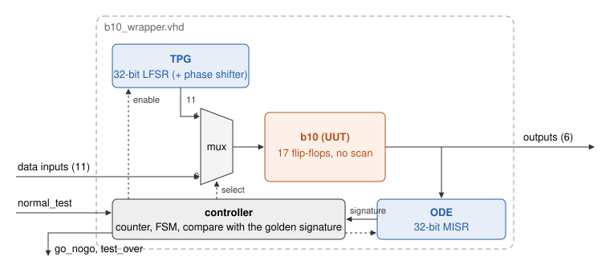
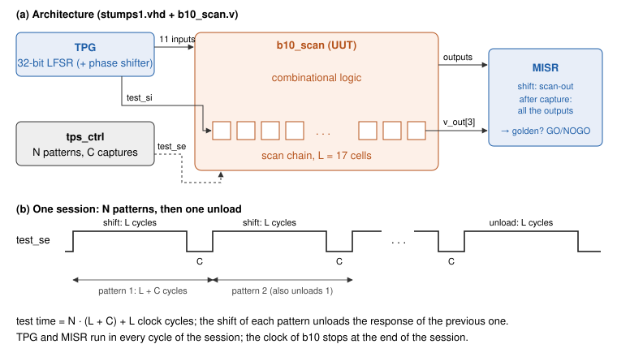

# Testing and Fault Tolerance (01RKZYG) — Laboratory 5
## Pseudo-Random Test and Logic BIST

> **Course:** 01RKZYG – Testing and Fault Tolerance, Politecnico di Torino  
> **Working directory:** `~/lab5` (remote `/home` directory) · all run outputs go to `~/lab5/run`  
> **Tools:** Siemens Questa (`vsim`), as in Lab 1, and Synopsys TestMAX ATPG (`tmax`), as in Labs 2–4  
> **Structure:** guided workflow in Parts 0–C; the exercises of Section 5 are optional

---

## 1. Objectives and Prerequisites

### 1.1 Why this lab

In Labs 2–4 the test patterns were computed by the ATPG and stored in the memory of a tester, which applied them through the scan chains and compared every response with the expected one. **Built-in self-test (BIST)** moves the tester inside the chip. A **test pattern generator** (TPG) produces the patterns, an **output data evaluator** (ODE) compacts all the responses into one word, the **signature**, and a **controller** compares the signature with the **golden** one and raises one bit: GO or NOGO. Nothing has to be stored or compared outside, and the test can run at power-on, in the field, at the speed of the chip.

The TPG and the ODE of a logic BIST (LBIST) are almost always **linear feedback shift registers**: an LFSR generates **pseudo-random** patterns with a few flip-flops and XOR gates, and a **multiple-input signature register** (MISR) compacts the responses. This raises the questions of this lab:

1. **How good are pseudo-random patterns?** An LFSR does not know the circuit: how many patterns does it need, and which faults does it never detect?
2. **How do you apply them?** Only on the functional inputs (as in a functional test), or through the scan chain (*test per scan*)?
3. **What does the chip say at the end?** One signature of 32 bits for thousands of responses: when does it tell a faulty circuit from a good one, and when not?

In this lab you will:

* compute by hand the sequence of an LFSR and the signature of a small signature register, and find when two different sequences give the same signature;
* run a self-test of b10 (the voting FSM of Labs 2 and 3) that drives its **functional inputs** from an LFSR and compacts its outputs in a MISR; measure with TestMAX how many faults its patterns detect, for several test lengths, and see the effect of a **phase shifter**;
* run a self-test **per scan** on the full-scan b10 of Lab 3, with a given controller: compute its test time, choose the number of patterns for a cycle budget, and compare it with the ATPG of Lab 3;
* inject faults into the circuit, predict GO or NOGO from the fault classes of TestMAX, and check.

### 1.2 What you will be able to do at the end of this lab

1. **Compute** the states and the period of an LFSR in standard and modular form from its characteristic polynomial, and **recognize** a maximum-length LFSR.
2. **Compute** the signature of a signature register, and **decide** whether an error sequence is masked (aliasing).
3. **Read** the architecture of a logic BIST (TPG, mux, ODE, controller) in its HDL, and **explain** how the golden signature is obtained and when GO/NOGO is valid.
4. **Write** a TestMAX command file that fault-simulates the patterns of a self-test, read from an eVCD file, starting from a command file of Lab 2, and **read** the fault coverage against the test length.
5. **Explain** why adjacent outputs of an LFSR give correlated patterns, and what a phase shifter does.
6. **Compute** the test time of a test per scan, **choose** the number of patterns for a cycle budget, and **compare** pseudo-random patterns with ATPG patterns.
7. **Predict** the GO/NOGO result of a self-test for a fault from its TestMAX class, and **explain** the exceptions (unknown values, aliasing).

### 1.3 Theory you must have clear (lecture slides)

| Concept used in this lab | Where it is in the course material |
|---|---|
| BIST architecture: TPG, mux, ODE, controller; Normal/Test, Go/Nogo; BIST session and protocol | *09 – BIST*, slides 6–16 |
| Faults in the BIST circuitry; Go/Nogo duplicated | *09*, slides 17–22 |
| LFSRs: polynomials, standard and modular form, primitive polynomials, maximum length, all-zero (absorbing) state | *10 – LFSRs*, slides 6–28 |
| One LFSR for many inputs; the parallel output sequence | *10*, slides 30–31 |
| Signature analysis: SISR, MISR, error polynomial, aliasing, cancellation | *10*, slides 35–57 |
| LBIST of a combinational UUT: pseudo-random patterns, random-pattern-resistant faults, weighted patterns, reseeding | *11 – LBIST*, slides 8–26 |
| Test per clock and test per scan; STUMPS; correlated chains and the phase shifter | *11*, slides 27–56 |
| Functional test: inputs and outputs only, no DfT | *07 – Functional test*, slides 3–7 |
| Test time of a scan test: (N + 1) · L + N | *06 – Scan*, slides 37–38 (Lab 3) |
| Fault simulation of external patterns, fault classes | *04 – ATPG* (Lab 2, Part A) |
| Transition-delay faults | *06*, slides 95–116 (Lab 4) |

**Prerequisites:** from Lab 1, `force` in Questa; from Lab 2, your command files `fsim_c6288.tcl` (Part A) and `atpg_b10.tcl` (Part D), and the coverage of the full-sequential ATPG on b10; from Lab 3, the chain of the full-scan b10 (Part C: one chain, its length) and the results of `atpg_b10_scan.tcl` (1196 faults, 100 % test coverage, 48 patterns, 932 test cycles); from Lab 4, the transition fault model. If a file is missing, extract the zip of that lab again.

---

## 2. Files and Workspace Provided

All files are in `~/lab5`. As in the previous labs, every script **changes directory into `run/`** before starting a tool: **launch the scripts from `~/lab5`** and expect every generated file in `~/lab5/run`. TestMAX command files refer to the sources as `../<file>` and to the files written by the simulations (in `run/`) with their plain name.

```text
~/lab5
├── b10.v                    # ITC'99 b10, no scan (same file as Labs 2 and 3)
├── b10.spf                  # its protocol file (Lab 2): clocks and reset for TestMAX
├── b10_scan.v               # b10 with one scan chain (the netlist of Lab 3, Part C)
├── b10_scan.spf             # its protocol file (Lab 3)
├── pdt2002.v                # PoliTo cell library for TestMAX (same file as Labs 2-4)
├── pdt2002_sim.vhd          # the same cells, as VHDL models for Questa
├── rtl/                     # the self-test hardware and the testbenches (VHDL)
├── func_bist.sh             # Part B: simulates b10 with its functional self-test
├── func_bist.tcl            # Questa commands used by func_bist.sh
├── func_wave.do             # waveforms for GUI=1 ./func_bist.sh
├── scan_bist.sh             # Part C: simulates b10_scan with its self-test per scan
├── scan_bist.tcl            # Questa commands used by scan_bist.sh
├── sweep_bist.sh            # Parts B and C: your command file for several test lengths
├── inject_faults.sh         # Parts B and C: stuck-at faults injected one at a time, GO/NOGO
├── tmax.sh                  # runs a TestMAX command file from run/ (as in Labs 2-4)
├── summary.sh               # one-line summary of the last fault report in a log
├── list_faults.sh           # faults of a fault list by class
├── images/
└── run/                     # all outputs (created by the scripts if missing)
```

**You write every TestMAX command file**, starting from a file of a previous lab or of a previous part. You never edit the HDL: the self-tests are configured by the variables of the scripts (§2.3).

| You write | In | Starting from |
|---|---|---|
| `fsim_b10_func.tcl` | B.3 | `~/lab2/fsim_c6288.tcl` (flow) and `~/lab2/atpg_b10.tcl` (b10 and its protocol) |
| `fsim_b10_scan.tcl` | C.2 | `fsim_b10_func.tcl` and `~/lab3/atpg_b10_scan.tcl` |
| `fsim_b10_scan_tdf.tcl` | C.4 | `fsim_b10_scan.tcl` |

### 2.1 Design files

| File | Content | Notes |
|---|---|---|
| `b10.v`, `b10.spf` | b10 without scan: 11 data inputs, `clock`, `reset`, 6 outputs, 17 flip-flops. | The files of Lab 2. |
| `b10_scan.v`, `b10_scan.spf` | b10 with one chain of 17 scan cells, `test_si`, `test_se`; the scan-out is the functional output `v_out[3]`. | The files written by Design Compiler in Lab 3, Part C. |
| `pdt2002.v` | Cell models for TestMAX. | Its flip-flops use primitives of TestMAX, so Questa cannot simulate them: Questa uses `pdt2002_sim.vhd`, the same cells written in VHDL. |

### 2.2 The self-test hardware (`rtl/`)

| File | Block | What it does |
|---|---|---|
| `lfsr.vhd` | LFSR | Standard-form LFSR of `NBITS` bits (8, 16, 24, 32 or 64), XNOR feedback, seed `SEED`. |
| `tpg.vhd` | TPG | The 32-bit LFSR and, if `PHASE_SHIFTER = 1`, a phase shifter: each output is the XOR of three LFSR bits. With `PHASE_SHIFTER = 0` the outputs are adjacent LFSR bits. |
| `misr.vhd`, `ode.vhd` | ODE | 32-bit MISR in modular form, XNOR; `ode.vhd` connects the outputs of b10 to it. |
| `test_counter.vhd`, `lbist_state_machine.vhd`, `lbist_controller.vhd` | controller | Counts the cycles of the session, enables TPG and ODE, compares the signature with `GOLDEN_SIGNATURE` and holds GO/NOGO. |
| `mux2to1_n.vhd`, `lbist.vhd`, `b10_wrapper.vhd` | mux, LBIST, top | In normal mode the inputs of b10 come from its pins, in test mode from the TPG. |
| `b10_wrapper_testbench.vhd` | testbench | Part B: reset, a few cycles in normal mode, then test mode until the end of the session. |
| `tps_ctrl.vhd` | controller | Part C: for each of `N_PATTERNS` patterns, `CHAIN_LEN` shift cycles and `CAPTURE` capture cycles; then one more shift to unload. |
| `stumps1.vhd` | self-test per scan | Part C: TPG, `tps_ctrl`, MISR and the GO/NOGO comparison, for a circuit with one scan chain. |
| `b10_scan_bist_testbench.vhd` | testbench | Part C: connects `b10_scan.v` to `stumps1`; the only file that depends on the circuit. |

### 2.3 Scripts

| Script | What it does | Why it is written this way |
|---|---|---|
| `func_bist.sh` | Compiles (only when a source changed) and simulates b10 with its functional self-test; prints the length of the session, the signature, the golden signature and GO/NOGO. Variables: `STOP` (session length, default 1000), `SEED`, `PS` (phase shifter), `GOLDEN`, `DUMP=1` (writes `run/b10_func_bist.vcd`), `INJECT=1`, `GUI=1`. | The parameters of the hardware are generics: the script passes them to `vsim` with `-G`, so you never edit the VHDL. |
| `scan_bist.sh` | The same for b10_scan with the self-test per scan; prints the number of test cycles. Variables: `N` (patterns, default 50), `CAPTURE` (default 1), `SEED`, `PS`, `GOLDEN`, `DUMP=1` (writes `run/b10_scan_bist.vcd`), `INJECT=1`. | As above. |
| `sweep_bist.sh func\|scan <command file> "<values>"` | For each value of `STOP` (func) or `N` (scan): simulation with the eVCD, then **your** command file, unchanged; table in `run/sweep/<file>.txt`, logs in `run/sweep/`. The other variables still work (`PS=1 ./sweep_bist.sh ...`). | The eVCD has always the same name, so the sweep repeats exactly your hand run: its row must coincide with your run. |
| `inject_faults.sh func\|scan <fault list>` | For each line `<sa0\|sa1> <class> <pin>` of the list (the format of `write_faults`): one `force` on the output pin of the cell, which fixes the whole net it drives (a stem fault, as in Lab 1); then the self-test, the signature and GO/NOGO. Only outputs of cells (`/O`, `/Q`). | You choose the faults and predict the result; the script does the repetitive part. Set `GOLDEN` to the fault-free signature of the same settings. |
| `tmax.sh`, `summary.sh`, `list_faults.sh` | As in Labs 2–4. | — |

### 2.4 The two self-tests

<p align="center">
  
</p>

**Figure 1.** Part B: the functional self-test of b10 (slide 6 of *09 – BIST*). In test mode the **mux** connects the 11 data inputs of b10 to the **TPG** (a 32-bit LFSR, with an optional phase shifter); the 6 outputs of b10 go to the **ODE**, a 32-bit MISR. The **controller** runs a session of `COUNTER_STOP` clock cycles: the first `COUNTER_START` = 4 responses are not compacted; at the end it compares the signature with the golden one and holds the result on `go_nogo`, while `test_over` = 1. b10 has no scan: the self-test reaches its flip-flops only through the functional inputs.

<p align="center">
  
</p>

**Figure 2.** Part C: the self-test per scan of b10_scan (slides 36–39 and 50–53 of *11 – LBIST*, with one chain). Output 0 of the TPG feeds the scan input `test_si`, the others the 11 data inputs; the controller `tps_ctrl` drives `test_se`. Each pattern takes L = 17 shift cycles and C capture cycles; the shift of a pattern also unloads the response of the previous one, and a last shift unloads the response of the last pattern. The MISR compacts the scan-out `v_out[3]` in the shift cycles and all the outputs after a capture.

### 2.5 TestMAX: fault simulation of the self-test patterns

The simulations write the patterns that the self-test applies to b10, with the responses of the fault-free circuit, in an **extended VCD** (eVCD) file: for each port of b10, every change of value and its direction (input driven by the testbench, or output driven by b10). TestMAX reads it as external patterns, as it read the STIL files of Lab 2 (User Guide, *VCDE Functional Pattern Input*): it cuts the file into cycles of 100 ns and measures the outputs 40 ns into each cycle, before the clock edge.

| Mode | Command (as used in this lab) | What it does / why |
|---|---|---|
| BUILD | `read_netlist ../pdt2002.v -format verilog -insensitive -library` · `read_netlist ../<netlist> -format verilog -insensitive` · `run_build_model b10` | As in Labs 2 and 3. |
| DRC | `run_drc ../b10.spf` (Part B) · `set_drc ../b10_scan.spf` + `run_drc` (Part C) | As in Labs 2 and 3: the protocol file declares `clock` and `reset` as clocks. |
| TEST | `set_patterns -external <file>.vcd -sensitive -strobe_period {100 ns} -strobe_offset {40 ns} -vcd_clock auto` **new** | External patterns from the eVCD: `-sensitive`, the names are case-sensitive; one cycle every 100 ns, outputs measured at 40 ns; `-vcd_clock auto`, the clock pulses are recognized from the clocks declared by the protocol. *The User Guide in the course material describes the VCDE input and the strobe settings only in general; these options are those listed by `help set_patterns -verbose` in the installed version.* |
| TEST | `run_simulation -sequential` **new: `-sequential`** | Good-machine simulation: `#fail_pats=0` means that TestMAX computes the same outputs as Questa. `-sequential`: the patterns are a sequence of clock cycles of a sequential circuit, not scan patterns. |
| TEST | `set_faults -model stuck \| transition` · `set_faults -fault_coverage` · `add_faults -all` | As in Labs 2–4. |
| TEST | `run_fault_sim -sequential` **new: `-sequential`** | Fault simulation of the sequence (User Guide, *Performing Fault Simulation*). |
| TEST | `report_summaries` · `write_faults <file> -all -uncollapsed -replace` | As before. |
| TEST | `report_faults -profile` **new** | For each pattern that detects new faults: how many, and the total so far. *Listed by `help report_faults -verbose`.* |

**Messages that tell you a step worked**

| After | Look for | If it is missing |
|---|---|---|
| `set_patterns` | `Note: adding -vcd_clock 0 clock` (and `reset`), then `End reading <n> patterns` | the eVCD does not exist: run the simulation with `DUMP=1` first; wrong name |
| `run_simulation` | `#fail_pats=0` | not 0: the patterns and the netlist do not agree (wrong netlist for the eVCD) |
| `run_fault_sim` | `Fault simulation completed: ... test_coverage=...` | an error before (read the first one) |

---

## 3. Guided Workflow

| Part | Topic |
|---|---|
| 0 | Set-up |
| A | LFSRs and signatures by hand |
| B | A functional self-test for b10 |
| C | A self-test per scan for b10 |

**Self-assessment quiz.** On the course page on Moodle you find the quiz *Lab 5 - Pseudo-random test and logic BIST*, with one section for each part of this guide. It is **not graded**: you can answer as many times as you want, and each answer comes with an explanation. Part A is checked only by the quiz.

---

### Part 0 — Set-up

Download `lab5.zip` from the course page on Moodle and extract it in your home directory:

```console
$ unzip ~/Downloads/lab5.zip -d ~/lab5     # use the folder where your browser saved the file
$ cd ~/lab5
$ chmod +x *.sh
$ ls . rtl
$ which vsim tmax
$ ls ~/lab2/fsim_c6288.tcl ~/lab2/atpg_b10.tcl ~/lab3/atpg_b10_scan.tcl
$ ./func_bist.sh
```

**Checkpoint 0.** You see all the files of §2 and an (empty) `run/` directory; `which` finds both tools; the three files of Labs 2 and 3 exist; `func_bist.sh` compiles the VHDL (the first time only) and ends with `BIST: result = GO`.

---

### Part A — LFSRs and Signatures by Hand

No tool in this part: pen, paper and the slides of *10 – LFSRs*.

#### A.1 — An LFSR in two forms

The characteristic polynomial is P(x) = x³ + x² + 1.

* **Standard form** (slide 17): three flip-flops Q1 → Q2 → Q3; at each clock Q2 takes Q1, Q3 takes Q2, and Q1 takes Q2 ⊕ Q3. Starting from Q1Q2Q3 = 001, write the sequence of states until it repeats.
* **Modular form** (slide 19): three flip-flops D0, D1, D2; at each clock D0 takes D2, D1 takes D0, and D2 takes D1 ⊕ D2. Starting from D0D1D2 = 001, write the sequence.

1. How many different states does each sequence have? Is it the maximum for 3 flip-flops? Which state is missing, and what happens if the LFSR starts from it?
2. Are the two sequences the same? Do the two forms go through the same set of states?

#### A.2 — Maximum length or not

Three LFSRs of 4 bits in standard form: Q1 → Q2 → Q3 → Q4, and Q1 takes the XOR of the cells listed.

| Polynomial | Q1 takes | Period from 0001 | Period from 0110 |
|---|---|:-:|:-:|
| x⁴ + x³ + 1 | Q3 ⊕ Q4 | | |
| x⁴ + x² + 1 | Q2 ⊕ Q4 | | |
| x⁴ + x³ + x² + x + 1 | Q1 ⊕ Q2 ⊕ Q3 ⊕ Q4 | | |

1. Which LFSR has maximum length? Is its polynomial in the table of primitive polynomials (slide 9)?
2. For the other two: does the period depend on the seed? Why is that a problem for a TPG?
3. x⁴ + x² + 1 = (x² + x + 1)²: why can it not be primitive?

#### A.3 — The LFSR of the TPG

Open `rtl/lfsr.vhd`. For `NBITS = 32` the feedback is `r_reg(32) xnor r_reg(22) xnor r_reg(2) xnor r_reg(1)`.

1. Write the characteristic polynomial. (It is in the table of primitive polynomials of Xilinx application note XAPP052, from which the taps are taken.)
2. With XNOR instead of XOR, which state is the absorbing (lock-up) state: all zeros or all ones? Could the seed be 0? Which seed must never be used?
3. How many clock cycles before the TPG repeats a pattern? At 100 MHz, how long is that?

#### A.4 — A signature by hand, and aliasing

A **SISR** (slides 43–45) with P(x) = x⁴ + x + 1, in modular form: four flip-flops D0…D3, all at 0 at the start; at each clock, with input bit `in`:

> D0 ← D3 ⊕ in · D1 ← D0 ⊕ D3 · D2 ← D1 · D3 ← D2

1. Compact the sequence **11010110** (first bit first). Write the signature D0D1D2D3.
2. A faulty circuit produces **11000110** (the 4th bit is wrong). Compute its signature: is the fault detected?
3. Another faulty circuit produces **11000101**: three bits are wrong. Compute its signature. Write the error polynomial E(x) (slide 46, first bit = x⁷) and compare it with P(x): which theorem explains what you see (slide 47)?
4. With n = 4, what is the aliasing probability for long random sequences (slides 48–49)? And with the 32-bit MISR of this lab?

**Checkpoint A.** The two sequences of A.1, the six periods of A.2, the polynomial and lock-up state of A.3, and the signatures of A.4: check them in the quiz.

> **Self-check on Moodle:** quiz section *Part A - LFSRs and signatures*.

---

### Part B — A Functional Self-Test for b10

#### B.1 — Read the architecture

Look at Figure 1 and open `rtl/b10_wrapper.vhd`, `rtl/tpg.vhd` and `rtl/lbist_state_machine.vhd`.

1. Map each block of slide 6 of *09 – BIST* (TPG, mux, UUT, ODE, controller, Normal/Test, Go/Nogo) to a file and to a signal of `b10_wrapper.vhd`.
2. In `tpg.vhd` with `PHASE_SHIFTER = 0`, which LFSR bits drive the 11 inputs of b10? The LFSR shifts by one position at each clock: what is the relation between the value of input i+1 at cycle t and the value of input i at cycle t + 1?
3. In which states of the FSM are the TPG and the MISR enabled? When does `go_nogo` become valid, and until when does it stay valid?
4. Which of the two BIST protocols of slide 16 does this controller implement?

#### B.2 — Run it, and the golden signature

The default session is `COUNTER_STOP = 1000`. **Predict** how many clock cycles the session lasts (from the first cycle in `START_TEST` to the first cycle in `EVALUATION`), then:

```console
$ ./func_bist.sh
$ STOP=500 ./func_bist.sh
```

1. With 500 cycles the result is NOGO, although the circuit is fault-free. Why?
2. How do you obtain the golden signature of a new configuration? Do it for `STOP=500`, then run again with `GOLDEN=<the signature>`: you must get GO.
3. Which changes of the self-test require a new golden signature? (Think of the seeds, the length, the phase shifter, the circuit.)

**Checkpoint B.2.** You know the number of cycles of a session of `STOP` cycles, the golden signature of `STOP=1000` and of `STOP=500`, and why the golden signature must be recomputed.

#### B.3 — How many faults do these patterns detect?

The MISR says only GO or NOGO. To know **which faults** the self-test detects, fault-simulate its patterns with TestMAX. Write `fsim_b10_func.tcl`:

* start from `~/lab2/fsim_c6288.tcl`: the flow is the same (library, netlist, build, DRC, external patterns, good-machine simulation, faults, fault simulation, report, fault list);
* the netlist is `../b10.v` (Verilog), top `b10`, and DRC uses its protocol file `../b10.spf`, as in `~/lab2/atpg_b10.tcl`;
* the patterns come from `b10_func_bist.vcd` (in `run/`), with the options of §2.5; `run_simulation` and `run_fault_sim` with `-sequential`;
* after `report_summaries` add `report_faults -profile`; write the fault list `b10_func_faults.txt`.

**Predict first.** In Lab 2 the full-sequential ATPG on b10 reached about 91 % test coverage. Will 1000 cycles of pseudo-random inputs do better or worse?

```console
$ DUMP=1 ./func_bist.sh
$ ./tmax.sh fsim_b10_func.tcl
$ grep -n "fail_pats\|test_coverage" run/fsim_b10_func.log
$ ./summary.sh run/fsim_b10_func.log "func 1000"
```

1. How many patterns did TestMAX read? Why more than 1000?
2. In the profile, which is the last pattern that detects new faults? Do the detections come one at a time, or in bursts? What could a burst mean in an FSM?
3. b10 has no scan and its outputs are flip-flops: which faults are detected at the very first patterns?

**Checkpoint B.3.** No errors; `#fail_pats=0`; you have the test coverage of the default session and the last useful pattern.

#### B.4 — Longer sessions, and a phase shifter

**Predict:** with 10 times more cycles, how much does the coverage grow? Then:

```console
$ ./sweep_bist.sh func fsim_b10_func.tcl "100 200 500 1000 2000 5000 10000"
```

**First, validate the script:** the row `STOP = 1000` must coincide with your run of B.3.

| Session (cycles) | 100 | 200 | 500 | 1000 | 2000 | 5000 | 10000 |
|---|:-:|:-:|:-:|:-:|:-:|:-:|:-:|
| test coverage, adjacent bits | | | | | | | |
| test coverage, phase shifter (`PS=1`) | | | | | | | |

1. From which length does the coverage stop growing? Is the period of the LFSR (A.3) the reason?
2. Recall question 2 of B.1. If input i+1 at cycle t always equals input i at cycle t + 1, can every sequence of input vectors be applied? **Predict** what a phase shifter (each input = XOR of three LFSR bits, with different spacings) changes. Then run the same sweep with `PS=1` and fill the second row.
3. A phase shifter whose outputs all use the **same** spacing (bits i, i+11, i+22 for input i) would not help: why? (Look at the relation of question 2 of B.1 again.)
4. The coverage of the self-test with the phase shifter is close to the full-sequential ATPG of Lab 2. Which one needs more test cycles? Which one needs a tester?

**Checkpoint B.4.** The sweep agrees with your hand run; the coverage stops growing well before the period of the LFSR; the phase shifter raises the final coverage.

#### B.5 — GO or NOGO?

TestMAX has classified every fault of b10 for the default session. Will the MISR give NOGO for every fault that TestMAX detects? Choose three faults from `run/b10_func_faults.txt`: `U91/O` stuck-at-1, `U145/O` stuck-at-1, `U154/O` stuck-at-1.

```console
$ grep -E " (U91|U145|U154)/O$" run/b10_func_faults.txt
```

Write their classes (a `--` line has the class of the line above it, see `./list_faults.sh`), and **predict** GO or NOGO for each one. Then write the three lines in a file `my_faults.txt` (format `sa1 <class> <pin>`) and:

```console
$ GOLDEN=A88DEC5B ./inject_faults.sh func my_faults.txt
```

1. Which faults give NOGO? Do the results agree with the classes?
2. One signature is `XXXXXXXX`. Which fault, and what does it do to b10 (look at the net it drives)? Why does TestMAX call it *possibly* detected, and why does the controller still say NOGO?
3. Could a detected fault give GO? With which probability, for a 32-bit MISR (A.4)?
4. TestMAX observes the outputs of b10 at every cycle of the eVCD; the MISR compacts only the cycles of the `TEST` state. Which cycles does TestMAX see that the MISR does not? Could a fault be DS for TestMAX and still give GO?

**Checkpoint B.5.** The three results agree with your predictions, or you can explain why not.

> **Self-check on Moodle:** quiz section *Part B - A functional self-test*.

---

### Part C — A Self-Test per Scan for b10

In Part B the patterns reached the 17 flip-flops of b10 only through the inputs. With the scan chain of Lab 3 the TPG can load every flip-flop directly: this is **test per scan** (Figure 2).

#### C.1 — The controller and the test time

Open `rtl/tps_ctrl.vhd` and `rtl/b10_scan_bist_testbench.vhd`.

1. Follow the states of `tps_ctrl`: how many cycles does one pattern take, with chain length L and C capture cycles? How many cycles in total for N patterns, including the last unload? Compare with the formula of a scan test (slides 37–38 of *06*): which term is different, and why?
2. Which TPG output feeds `test_si`? Which outputs of b10 enter the MISR, and why is the scan-out in position 0?
3. **Predict** the number of test cycles for N = 10 and C = 1 (L from Lab 3). Then:

```console
$ N=10 ./scan_bist.sh
```

**Checkpoint C.1.** The number of test cycles printed by the script is the one you computed.

#### C.2 — Write `fsim_b10_scan.tcl`

Copy `fsim_b10_func.tcl` and change: the netlist `../b10_scan.v`; the protocol `set_drc ../b10_scan.spf` followed by `run_drc` (as in `~/lab3/atpg_b10_scan.tcl`); the eVCD `b10_scan_bist.vcd`; the fault list `b10_scan_faults.txt`. You can remove `report_faults -profile`.

```console
$ N=10 DUMP=1 ./scan_bist.sh
$ ./tmax.sh fsim_b10_scan.tcl
$ ./summary.sh run/fsim_b10_scan.log "scan N=10"
```

1. How many faults? Why more than in Part B (Lab 3)?
2. Compare with Part B: test coverage and number of cycles.

**Checkpoint C.2.** No errors; `#fail_pats=0`; the number of faults is the one of Lab 3.

#### C.3 — How many patterns?

```console
$ ./sweep_bist.sh scan fsim_b10_scan.tcl "10 20 50 100 200 500 1000"
```

**Validate** the row `N = 10` with C.2.

| N | 10 | 20 | 50 | 100 | 200 | 500 | 1000 |
|---|:-:|:-:|:-:|:-:|:-:|:-:|:-:|
| test cycles | | | | | | | |
| test coverage | | | | | | | |

1. The ATPG of Lab 3 reached 100 % with 48 patterns and 932 test cycles. How many pseudo-random patterns, and how many cycles, for 95 %? For 99 %? Does the self-test reach 100 %?
2. **A budget.** The self-test must run at power-on in at most **2500 clock cycles**, and must reach at least **95 %** stuck-at test coverage. With the formula of C.1, what is the largest N that fits? **Predict** from the table whether the target is met, then run that N by hand (`N=<n> DUMP=1 ./scan_bist.sh` and your command file). Is it met?
3. For the same number of cycles, compare the self-test per scan with the functional self-test of Part B. Where does the difference come from?
4. Which faults are still not detected with N = 1000 (`./list_faults.sh run/b10_scan_faults.txt`, after running N = 1000 by hand)? Why can a random pattern miss them, when the ATPG finds a pattern for each one (slide 18 of *11*)?

**Checkpoint C.3.** The sweep agrees with C.2; you know N for the budget and whether 95 % is reached.

#### C.4 — Transition faults

With `CAPTURE=2` each pattern has two capture cycles at the functional clock: the first launches the transitions, the second captures them (as LOC in Lab 4). Copy `fsim_b10_scan.tcl` to `fsim_b10_scan_tdf.tcl` with `set_faults -model transition` and the fault list `b10_scan_tdf_faults.txt`. Nothing else changes: the eVCD already contains the clock cycles, and TestMAX simulates them one after the other.

```console
$ CAPTURE=2 ./sweep_bist.sh scan fsim_b10_scan_tdf.tcl "50 200 1000"
$ ./sweep_bist.sh scan fsim_b10_scan_tdf.tcl "200"
```

1. How many transition faults? Compare with Lab 4: which sites have none?
2. Compare the transition coverage with one and with two capture cycles at N = 200. How does a single capture cycle detect any transition fault at all (what is the launch)?
3. How many cycles does `CAPTURE=2` add for N patterns?

#### C.5 — Another seed, and the phase shifter

**Predict** first: does the seed matter? Does the phase shifter, which helped in Part B, help here?

```console
$ SEED=4321 ./sweep_bist.sh scan fsim_b10_scan.tcl "50 137"
$ PS=1 ./sweep_bist.sh scan fsim_b10_scan.tcl "50 137"
```

1. How much does the coverage change with the seed, at N = 50? Would you trust a budget decision taken with one seed only?
2. With a single chain, the TPG writes the 17 flip-flops one bit at a time through `test_si`. Why does the phase shifter not help here, while it helped in Part B? When does a self-test per scan need one (slides 54–56 of *11*)?

#### C.6 — The verdict of the self-test per scan

Choose the N of the budget of C.3. Run it once without faults to get the golden signature, then choose from `run/b10_scan_faults.txt` (of that N) one DS fault and one ND fault on outputs of cells (`/O` or `/Q`). Add `U145/O` stuck-at-1, which gave GO in Part B. **Predict** GO or NOGO for each one, and check:

```console
$ N=<n> ./scan_bist.sh
$ N=<n> GOLDEN=<signature> ./inject_faults.sh scan my_scan_faults.txt
```

**Checkpoint C.6.** The results agree with the classes of TestMAX. Why does the self-test per scan detect `U145/O` stuck-at-1, which the functional self-test missed?

> **Self-check on Moodle:** quiz section *Part C - A self-test per scan*.

---

## 4. Wrap-up and Discussion

### 4.1 What you have seen

| Concept | Where you met it in this lab |
|---|---|
| An LFSR has maximum length only if its polynomial is primitive; otherwise its period depends on the seed | A.1, A.2 |
| XNOR feedback moves the lock-up state from all zeros to all ones | A.3 |
| A signature register divides the sequence by P(x): errors whose polynomial is a multiple of P(x) are masked | A.4 |
| A logic BIST = TPG + mux + ODE + controller; the golden signature comes from a fault-free simulation of the same configuration | B.1, B.2 |
| Fault simulation of the self-test patterns tells which faults the self-test detects; the coverage saturates long before the period of the LFSR | B.3, B.4 |
| Adjacent LFSR outputs are shifted copies of the same sequence: correlated inputs; a phase shifter breaks the correlation | B.4 |
| An X in the MISR corrupts the whole signature | B.5 |
| Test per scan reaches the flip-flops directly: much higher coverage than a functional self-test, at the price of shift cycles | C.2, C.3 |
| Pseudo-random patterns need many more cycles than ATPG patterns, and some faults resist them | C.3 |
| With one chain the phase shifter is useless; the seed matters for short tests | C.5 |

### 4.2 Questions for discussion

1. The self-test of Part B is a **functional** test (slides 3–5 of *07*): it uses only the inputs and outputs of b10. Which faults of b10 can a functional test never detect, even with infinite patterns?
2. Pseudo-random patterns plus a few deterministic patterns stored on chip (slide 25 of *11*), or reseeding (slide 26): which would you choose to close the gap to 100 % in C.3, and what does each cost?
3. A self-test runs at power-on in a car. Which fault of the BIST circuitry is dangerous: one that makes `go_nogo` stuck at 1, or stuck at 0 (slides 17–22 of *09*)? How does a duplicated, complementary Go/Nogo help?
4. In Part C the MISR compacts the scan-out in the shift cycles and all the outputs only after a capture. Some outputs of b10 are cells of the chain: what could go wrong if the MISR compacted all the outputs at every shift cycle (slides 55–56 of *10*, cancellation)? See exercise E3.
5. A test per clock (slides 29–35 of *11*) turns the flip-flops themselves into TPG and MISR. Compare it with the test per scan of Part C: area, test time, at-speed test.

### 4.3 Self-check: can you do it without a tool?

| Skill | Quick self-check |
|---|---|
| States of an LFSR | apply the feedback rule from the seed until a state repeats |
| Maximum length | period 2ⁿ − 1 for every non-zero seed, only with a primitive polynomial |
| Signature of a SISR | apply the update rule bit by bit; the signature is the remainder of the division by P(x) |
| Aliasing | the error polynomial E(x) is a multiple of P(x); probability ≈ 2⁻ⁿ |
| Test time of a test per scan | N · (L + C) + L |
| Largest N for a budget of B cycles | ⌊(B − L) / (L + C)⌋ |
| GO/NOGO from the fault class | DT → NOGO (unless aliasing); ND → GO; X in the response → signature X → NOGO |

### 4.4 Habits for the next labs

* **Compute the expected number of cycles before you simulate**, and compare it with the log: a mismatch means that you have not understood the protocol.
* **A golden value belongs to one configuration**: change anything, recompute it.
* **Fault-simulate before you trust a self-test**: GO/NOGO says nothing about the faults that the patterns never excite.
* **Validate every sweep** on a hand run.
* **Use more than one seed** before you draw a conclusion from pseudo-random patterns.

### 4.5 Troubleshooting

| Symptom | Likely cause | Quick check |
|---|---|---|
| `Compilation errors (run/...compile.log)` | a VHDL file was edited, or a file is missing | the first error in the compile log; extract the zip again |
| `vsim` not found | Questa not set up in this terminal | `which vsim` |
| `set_patterns` fails: file not found | the simulation was run without `DUMP=1`, or the name in the command file is wrong | `ls run/*.vcd` |
| `#fail_pats` not 0 | eVCD and netlist do not agree (b10.v with the scan eVCD, or the opposite) | the `read_netlist` line and the eVCD name |
| `run_drc` fails in Part C | `run_drc ../b10_scan.spf` without `set_drc`, or the protocol of b10.v | `set_drc ../b10_scan.spf` then `run_drc` |
| Every fault ND, coverage 0 % | the eVCD has no output values (outputs dumped as inputs) | the eVCD must be written by the scripts of the lab (`-force_direction`) |
| NOGO without faults | the golden signature is for other settings | rerun without `GOLDEN`, read the signature |
| `inject_faults.sh`: `not an output pin`, `cell not found` | the pin is an input of a cell, a port, or a cell of the other netlist | use pins `/O` or `/Q` of cells of `b10.v` (func) or `b10_scan.v` (scan) |
| `sweep_bist.sh` row different from the hand run | different settings (`SEED`, `PS`, `CAPTURE`) in the environment | `env \| grep -E "SEED\|PS\|CAPTURE\|GOLDEN"` |

---

## 5. Optional Exercises and Further Study

*No step-by-step solution is provided. Discuss your results with the teaching staff.*

### E1 — Reseeding

At N = 50 the coverage of Part C depends strongly on the seed (C.5). Run the self-test per scan with N = 25 and several seeds, and fault-simulate each run; then find, with `list_faults.sh` and `comm`, the pair of seeds whose union of detected faults is largest. Compare two sessions of 25 patterns with different seeds against one session of 50 patterns with one seed. What would the controller need to load a new seed (slide 26 of *11*)?

### E2 — Faults in the BIST circuitry

Inject stuck-at faults into the self-test hardware of Part B instead of b10 (one `force` in `run/inject_fault.tcl`, `INJECT=1 ./func_bist.sh`): on `go_nogo_o`, on `normal_test_i`, on one bit of the MISR, on one output of the TPG. For each one, is the result a false NOGO, an escape, or nothing? Which ones does a complementary Go/Nogo pair detect (slide 22 of *09*)?

### E3 — Cancellation in the MISR

`MISR_MODE=0 ./scan_bist.sh` makes the MISR compact all the outputs of b10 at every cycle. Find in `b10_scan.spf` the order of the cells in the chain: which outputs of b10 are consecutive cells? Inject the DS faults of C.6 again with `MISR_MODE=0` (golden signature of that mode): do they still give NOGO? Explain with slides 55–56 of *10* in which order the outputs would have to enter the MISR to cause cancellation.

### E4 — Write the controller yourself

Without looking at `tps_ctrl.vhd`, write in VHDL a controller with the same ports and generics, and replace it in a copy of the workspace. The number of cycles and the signature must not change.

### E5 — The faults that random patterns miss

Take the ND faults of the self-test per scan with N = 1000 (C.3, question 4). For a few of them, run `analyze_faults <pin> -stuck 0|1 -verbose` after an ATPG on `b10_scan.v` (Lab 3): how many inputs and cells must have a specific value at the same time? Estimate the probability that a random pattern sets them all.

### E6 — Weighted patterns

On paper: an AND gate with 8 inputs fed by independent random bits (probability 1/2). How many random patterns, on average, to test its output stuck-at-0? And stuck-at-1? Which probability of 1 at the inputs minimizes the patterns for both faults (slides 18–20 of *11*)?

### E7 — Waveforms

`GUI=1 STOP=50 ./func_bist.sh` opens Questa with the waveforms of `func_wave.do`. Follow the states of the controller, the inputs of b10 in test mode (check the shifted copies of B.1, question 2), and the signature from the seed to the end.

### E8 — Further analysis of your results

* **B.4** How many faults do the functional self-test (`STOP=10000`, `PS=1`) and the full-sequential ATPG of Lab 2 detect in common? Which ones only one of them?
* **C.3** Plot (by hand) test coverage against test cycles for Parts B and C on the same axes, and mark the ATPG of Lab 3.
* **C.4** Which transition faults are detected with two capture cycles and not with one?

> **Self-check on Moodle:** quiz section *Optional - Further exercises*.
